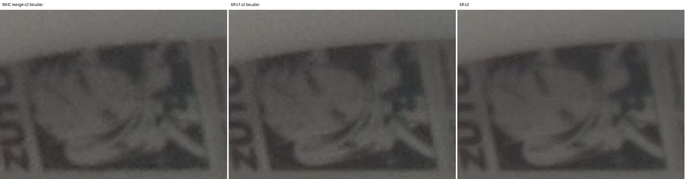
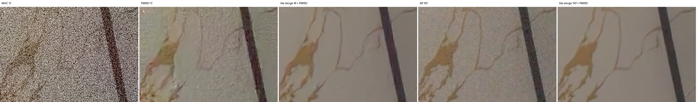

# 管线算法升级：借鉴 JSR 思路改造现有模块，以及可公开集成的更优算法

> 设备：Poco F5（LineageOS，骁龙 7+ Gen 2）。所有测试素材均为本机 RAW 连拍。
> 前置文档：[`PIPELINE_REPORT.md`](PIPELINE_REPORT.md)（原 HDR+ 风格 CPU 管线）、[`JSR_EVALUATION.md`](JSR_EVALUATION.md)（JSR 评估）。
> 前提（用户给定）：合成耗时在分钟级以内都可以接受，因此不再强求“1 秒出图”。

> 本文复制自研究工作区 `Poco-F5-RAW-Report/`。文中的 `pipeline/`、`probe/`、`data/`、`bin/` 都指该工作区下的原型、采集工具和素材，不在 PocoPaw 仓库内。PocoPaw 中的对应实现在 [`app/src/main/cpp/burstpipe/`](../../app/src/main/cpp/burstpipe/)。

## PocoPaw 实现情况（2026-11-01）

标注约定同 [`PIPELINE_REPORT.md`](PIPELINE_REPORT.md)：**[App 已实现]**、**[仅原型]**、**[未实现]**。PocoPaw 这一版只接入纯 CPU 的经典算法，不引入任何推理运行时。

| 本文内容 | PocoPaw 状态 |
|---|---|
| 核回归合并 1x（LK 细化、GAT 结构张量、各向异性核、鲁棒权重） | **[App 已实现]**：设置“处理方式 → 核回归合并”，管线 id `hdrplus_kr`。主摄 8 帧 6.4 s，超广角 8 帧 3.4 s |
| 核回归 2x 超分 | **[仅原型]**：App 固定 1x 输出 |
| 相位覆盖率指标 | **[仅原型]**：App 内仍会计算（`KrStats`），但不参与决策，也不显示 |
| 噪声自适应色度降噪 | **[App 已实现]**：两种处理方式都使用 |
| `--save-merged` 前后端拆分 | **[仅原型]** |
| PMRID 学习式降噪 | **[仅原型]**：需要 ONNX Runtime，本版不接入 |
| C5 / FFCC 白平衡、HDRnet 色调、libultrahdr、RAFT 等候选 | **[未实现]** |

---

## 0. 结论摘要

1. **合并：用核回归合并替代 HDR+ 的分块合并加 MHC 去马赛克，已实现。** 核回归合并即 Wronski 2019 的 Handheld Multi-Frame Super-Resolution，按 Lafenêtre et al. IPOL 2023 的 MIT 实现移植到 C++ 并在手机上运行。
   - 去马赛克和合并在同一步完成：每个原始 Bayer 采样用各向异性高斯核直接累加到 RGB 网格，完全不再插值。
   - 1x 输出的细节与原管线持平，残余噪声明显更低（静态 8 帧 σ 从 0.00244 降到 0.00193，高噪 16 帧从 0.00305 降到 0.00188）。
   - 手持连拍下 2x 输出比 1x 加双三次放大清晰，是真正的多帧超分。
   - 手机上处理超广角 8 帧，1x 约 3.3 s，2x 约 8.8 s。
2. **借鉴 JSR 的三个思路已落地：**
   - 合并后数据先做方差稳定（VST/GAT）再估计结构张量；
   - 新增“相位覆盖率”指标，衡量手抖是否带来足够的亚像素采样多样性。不过当前版本在静置连拍上也有 0.73，区分度不足，还需改进，暂不能用来自动决定是否输出 2x；
   - 色度降噪强度按实测噪声自适应。
   - JSR 主网络本身不集成，理由见 `JSR_EVALUATION.md`。
3. **学习式 RAW 降噪：PMRID（ECCV 2020，Apache-2.0，权重随仓库发布）可直接集成，效果显著。**
   - ISO 2884 下，4 帧合并加 PMRID 约等于 16 帧传统合并，同等画质所需帧数约减为 1/4。这对本机“每次开相机最多 65 个 RAW 请求”的限制很有价值。
   - 用 ONNX Runtime 在手机 CPU 上实测，8.3 MP 超广角一次推理约 **1.1 s**（4 线程），与 PyTorch 输出的最大误差为 5e-6。
   - 低噪声（高 SNR）场景会抹平纹理，必须按噪声水平做门控或混合。
4. **推荐的新管线：** 核回归合并（1x，或在覆盖率足够时输出 2x），接按噪声门控的 PMRID，再接原有的色彩、色调、锐化。预计超广角单张总耗时约 5–10 s，主摄约 10–20 s，远在“分钟级”预算内。
5. **候选的公开可集成算法**（只列许可证允许商用的，详见第 4 节）：
   - 降噪：PMRID、NAFNet、Restormer、SCUNet；
   - 白平衡：C5、FFCC；
   - 色调：HDRnet；
   - 光流：RAFT、SEA-RAFT；
   - 增益图输出：libultrahdr；
   - 推理运行时：ONNX Runtime、ncnn。
   - 排除 GPL 方案（hdr-plus-swift、RCD、librtprocess）、非商用方案（deep-burst-sr、LED）和无许可证的仓库（BurstM、Open-AISP）。

---

## 1. 为什么要换：经典管线的瓶颈

| 模块 | 原实现（HDR+ 2016 风格） | 局限 |
|---|---|---|
| 对齐 | 灰度四合一图上分块匹配（16×16 块，步长 8），整数像素偏移 | 没有亚像素精度，手抖带来的采样多样性被浪费 |
| 合并 | 每块按维纳滤波思路的空域鲁棒合并 | 只能降噪，不能提升分辨率；块边界依赖余弦窗 |
| 去马赛克 | MHC（Malvar 2004）线性插值 | 合并后再插值，高频细节和伪色有上限 |
| 降噪 | 合并本身加固定强度色度降噪 | 帧数受限（单次 ≤65 请求，暗光时尤其明显）时噪声残留大 |
| 白平衡、色调 | HAL 给出的 AWB 增益和 Mertens 曝光融合 | Pixel 当前版本已用学习式 AWB（FFCC 系）和 HDRnet 系色调 |

Google 自己在 2019 年已经把 Pixel 的合并换成 Super Res Zoom 式的核回归合并（Wronski 2019），并在 Night Sight 中加入学习式 AWB。所以“Pixel 这一套”的较新形态本身就是 **核回归合并 + 学习式模块**，第 2、3 节正是沿这个方向升级。

---

## 2. 借鉴 JSR 思路的改造（已实现）

JSR 声称有效的几个思路是：多帧亚像素对齐、物理噪声建模、按图像结构自适应的重建。这些思路本身成立，问题在它的实现不可复现（见 `JSR_EVALUATION.md`）。下面用公开、可验证的算法实现同样的思路。

### 2.1 核回归合并（`pipeline/src/kr.cpp`）**[App 已实现，1x]**

流程如下：

1. **亚像素对齐细化**：在原有分块匹配结果上，对每个 tile 做 Lucas-Kanade 迭代（逆向组合式 ICA）。光流被限制在块匹配偏移 ±1 px 内，tile 之间用升余弦插值得到逐像素位移。
2. **结构张量**：在参考帧的灰度图上计算。参考 JSR 的“物理噪声建模”，先做广义 Anscombe 变换（GAT）稳定方差，再求梯度。这样暗部的噪声不会被误判为边缘。
3. **各向异性核**：结构张量的特征值决定核沿边缘拉长（k_stretch=4）、垂直边缘收缩（k_shrink=2）。基础参数 k_detail、k_denoise、D_th、D_tr 按估计 SNR（dB）在 IPOL 推荐区间内线性插值：

   | SNR | k_detail | k_denoise | D_th | D_tr |
   |---|---|---|---|---|
   | 低 | 0.33 | 5 | 0.81 | 1.24 |
   | 高 | 0.25 | 3 | 0.71 | 1.00 |

   高噪时核更宽、降噪更强，低噪时保细节。
4. **鲁棒性**：比较参考帧和对齐帧的局部均值，按噪声模型算 z-score，经斜坡函数映射成权重，再取 3×3 最小值，用来抑制运动区域的鬼影。
5. **累加**：每帧取目标像素周围 3×3 个原始 Bayer 采样，按“核 × 鲁棒权重”分别累加到 R、G、B 三个通道，最后归一化。输出可以是 1x 或 2x 的线性相机 RGB，**跳过去马赛克**。
6. 接着做 `normalize_rgb`（按颜色通道的镜头阴影补偿、白平衡、截断），之后的色彩、色调流程与原管线共用。

### 2.2 相位覆盖率（JSR 的“亚像素多样性”思路）**[仅原型]**

对每个 tile，统计所有帧的位移落在 Bayer 2 px 周期内 16 个半像素相位格中的几个，取比例。程序在 `kr:` 输出行打印该值。

实测结果：

| 素材 | 平均位移 | 覆盖率 | 2x 实际增益 |
|---|---|---|---|
| hh_main8（手持） | 5.5 px | 0.78 | 小（原片偏软） |
| hh_uw8（手持） | 3.9 px | 0.79 | 中等 |
| uw8（手机静置） | 很小 | 0.73 | 几乎没有 |

**当前版本的指标区分度不够。** 静置连拍也有 0.73，因为 LK 在噪声下估计出的亚像素抖动同样会“填满”相位格，而且静置的手机仍有微小振动。要据此自动选择 1x 还是 2x，需要改进：只统计 LK 置信度高的 tile，并且要求位移的离散程度显著超过 LK 的噪声误差。在改进之前，2x 应保留为手动选项。

### 2.3 噪声自适应色度降噪 **[App 已实现]**

原管线的色度降噪是固定强度。现在改为：先在输出 RGB 上用 Immerkær 方法估计噪声 σ，乘以显示增益得到“可见噪声”，强度取 `clamp(可见σ / 0.01, 1, 6)`。2x 输出时强度再乘以放大倍数，因为色斑尺寸随之放大。这修正了 2x 输出的彩色斑块问题。

### 2.4 前后端拆分：`--save-merged` **[仅原型]**

参考 JSR“前端合并 + 后端网络”的结构，`burstpipe --save-merged dir` 会写出合并后的 float32 马赛克，以及对应的噪声模型 `merged.json`。噪声模型的方差两项都除以有效帧数，有效帧数 = 1 + (n−1)·平均权重。这样任何外部 RAW 域网络（目前是 PMRID）都能作为后端接入。

### 2.5 结果

**细节与噪声（Mac，8 线程）：**

| 素材 | 原管线 σ | 核回归 1x σ | 合并耗时 |
|---|---|---|---|
| uw8（静态，8 帧） | 0.00244 | 0.00193 | 55 → 828 ms |
| uwnoisy16（ISO 2884，16 帧，2 ms 快门） | 0.00305 | 0.00188 | → 约 1.9 s |

- 1x 下细节与“分块合并 + MHC”持平，平坦区更干净：[`cmp_uw8_detail.jpg`](images/kr/cmp_uw8_detail.jpg)、[`cmp_noisy_detail.jpg`](images/kr/cmp_noisy_detail.jpg)。
- 静态连拍做 2x 几乎没有增益：`cmp_sr_uw8.jpg`。SNR 8.8 dB 的高噪组做 2x 还会出现方向性纹理：`cmp_sr_noisy.jpg`。所以 2x 必须由覆盖率和 SNR 共同门控。
- 单帧时核回归不如 MHC 加降噪。它本质上是多帧方法，用默认噪声模型还会出现蠕虫状纹理：`cmp_noisy_n1.jpg`。

**手持连拍**（用户手持实拍，66 ms 快门，主摄 ISO 67、超广角 ISO 107）：
- 超广角平均位移 3.9 灰度像素。核回归 2x 明显比核回归 1x 加双三次放大更锐，字母边缘和贴纸纹理更清楚，增益中等。
- 主摄平均位移 5.5 像素、覆盖率 0.78，但原片本身有运动模糊或对焦偏软，2x 增益有限：`cmp_hh_main_sticker.jpg`、`cmp_hh_main_sticker2.jpg`。



**手机耗时**（`burstpipe-android`，8 线程，总耗时 ms）：

| 素材 | 原管线 | 核回归 1x | 核回归 2x |
|---|---|---|---|
| hh_uw8（8.1 MP × 8） | 1412 | 3256（合并 1605，LK 细化 336） | 8814 |
| hh_main8（16 MP × 8） | 2319 | 5819（合并 3133） | 15997（配合 `--ds 2` 缩小输出） |

核回归目前是标量 C++ 实现，还没有做 NEON 向量化，有 2–4 倍的优化空间（估算）。

---

## 3. 学习式 RAW 降噪：PMRID（已验证）**[仅原型]**

### 3.1 为什么选它

- 模型：Wang et al., *Practical Deep Raw Image Denoising on Mobile Devices*，ECCV 2020（旷视），[MegEngine/PMRID](https://github.com/MegEngine/PMRID)。
- **许可证 Apache-2.0，PyTorch 预训练权重随仓库发布。** 约 103 万参数，每百万原始像素 7.85 GFLOP，专为手机设计。
- 训练用的是 OPPO Reno 10x 的 10-bit RAW，有效范围 959 DN，与本机 10-bit、黑电平 64、白电平 1023 几乎一致。
- 它的 K-Sigma 变换只依赖泊松-高斯噪声模型 var = k·S + σ，不依赖 ISO 表。本机 HAL 没有 noiseProfile，正好可以直接用连拍自标定得到的噪声模型代入。

### 3.2 接入方式（`pipeline/tools/pmrid_denoise.py`）

1. 把 BGGR 翻转成 RGGB，打包成 4 通道半分辨率图。
2. 按 K-Sigma 变换映射到训练锚点（ISO 1600 的 k=0.968、σ=2.979），乘以 256，补边到 32 的倍数。
3. 推理，再做逆变换。
4. 输出写成单帧连拍目录（DN×16 保留亚 DN 精度），由 `burstpipe -n 1` 完成后续色彩处理。

可以对单帧（`--frame k`）或合并后的马赛克（`--merged dir`）降噪。

### 3.3 画质（ISO 2884 高噪组）



- **单帧 + PMRID** 远好于 MHC 单帧，接近核回归 16 帧，但有轻微“塑料感”，整体偏粉。偏色的原因推测是负值被截断为 0，导致暗部均值上偏。
- **4 帧合并 + PMRID** 约等于 16 帧合并或核回归 16 帧。**同等画质所需帧数约降为 1/4**，曝光总时长和运动鬼影风险随之下降。
- **16 帧合并 + PMRID** 最干净。
- **局限**：在高 SNR 的手持超广角合并结果上（有效 k=0.0325，低于训练分布）会抹掉细纹理：`cmp_pmrid_hhuw.jpg`。所以必须按噪声水平门控，或与输入按比例混合。

### 3.4 手机实测（ONNX Runtime 1.31.1，CPU）

导出为 ONNX（opset 17，固定输入 1×4×1248×1664，对应 3280×2464 超广角），用 `pipeline/tools/ort_run.cpp` 在手机上直接推理：

| 线程数 | 单次推理（3 次） |
|---|---|
| 8 | 1450 / 1466 / 1321 ms |
| 4 | 1194 / 1190 / 1108 ms |

- 4 线程（只用大核和超大核）比 8 线程更快，因为 A510 小核会拖慢同步。模型加载约 20 ms。
- 输出与 Mac 上 PyTorch 的最大绝对误差为 4.8e-6，数值正确。
- 主摄 16 MP 的输入像素约为超广角的 2 倍，按比例估算约 2.2–2.5 s。
- 没有用 GPU、NPU 或 int8 量化。之后接入 QNN/NNAPI 或 int8 预计还能快数倍（估算，未测）。

---

## 4. 可公开集成的更优算法调研

筛选标准：有公开代码，许可证允许商用和闭源集成，有预训练权重或能低成本自训，计算量可以在手机 CPU 上分钟级内完成。

### 4.1 按管线模块

| 模块 | 候选 | 许可证 | 权重 | 计算量 / 备注 | 结论 |
|---|---|---|---|---|---|
| 合并 + 去马赛克 + 超分 | Handheld Multi-Frame SR（Jamy-L，IPOL 2023） | MIT | 无需 | 只有 CUDA 版，已移植到 C++ | **已集成**（PocoPaw：1x **[App 已实现]**，2x **[仅原型]**） |
| RAW 降噪 | **PMRID** | Apache-2.0 | 有 | 7.85 GFLOP/MP，手机约 1.1 s / 8 MP | **已验证，推荐**（PocoPaw **[仅原型]**） |
| RAW 降噪 | Sony raw_image_denoising（ICCV 2021 挑战赛方案） | MIT | 需核实 | 较大 | 备选 |
| sRGB 降噪 / 修复 | NAFNet | MIT | 有（SIDD、GoPro） | 中等，宽度 32 版本可裁剪 | 可做后处理，需在本机数据上微调 |
| sRGB 降噪 / 修复 | Restormer | MIT | 有 | 很大（Transformer），手机上约数十秒到分钟级（估算） | 仅限离线“极致模式” |
| 盲降噪 | SCUNet | Apache-2.0 | 有（KAIR releases） | 大 | 备选，适合真实噪声 |
| 学习式多帧超分 | BSRT、Burstormer | MIT | 有（在 BurstSR 上训练） | 很大，且训练于 Canon/三星传感器，需要迁移 | 研究方向，暂不集成 |
| 光流（替代分块匹配） | RAFT、SEA-RAFT | BSD-3 | 有 | RAFT 较重，SEA-RAFT 更轻 | 在大运动、遮挡场景替代 LK |
| 白平衡 | C5（Afifi，ICCV 2021） | Apache-2.0 | 有 | 很小 | **推荐**：跨相机，可直接用本机 RAW 直方图 |
| 白平衡 | FFCC（Google，Pixel 同源） | Apache-2.0 | 需按传感器训练 | 极小 | 需要采集标定集 |
| 白平衡 | fc4 | MIT | 有 | 小 | 备选 |
| 去马赛克（单帧回退） | demosaicnet（Gharbi 2016） | MIT | 有 | 小 | 单帧或低覆盖率时替代 MHC |
| 色调 / 风格 | HDRnet | Apache-2.0 | 需自训 | 极小（双边网格） | 用 Pixel 成片做目标风格训练，最接近 Pixel 风格 |
| 低光增强 | LowlightENR 等 | MIT | 有 | 中 | 备选 |
| 增益图 HDR 输出 | libultrahdr | Apache-2.0 | 不适用 | 很小 | **推荐**：输出 Ultra HDR JPEG，对应 Pixel 的 HDR 照片 |
| 推理运行时 | ONNX Runtime | MIT | 不适用 | 已在手机上验证 | **推荐** |
| 推理运行时 | ncnn | BSD-3 | 不适用 | 体积更小，ARM 优化好 | 备选 |

### 4.2 排除项

| 项目 | 原因 |
|---|---|
| hdr-plus-swift、RCD、librtprocess | GPL-3，闭源集成会触发传染性条款 |
| deep-burst-sr（DBSR）、LED | CC BY-NC，禁止商用 |
| BurstM、Open-AISP | 仓库没有许可证，默认保留所有权利 |
| JSR | 没有许可证，前端闭源，计算量过大（详见 `JSR_EVALUATION.md`） |

### 4.3 参考指标

- 真实 BurstSR 基准目前的最好成绩约 30.99 dB（BSRT-L + BurstGP）。这类模型在合成或真实 BurstSR 上领先经典方法 1–3 dB。但它们都训练在特定传感器和特定退化模型上，直接迁移到本机效果未知，而且计算量是 PMRID 的数十倍以上。
- 也调研到 DualDn、“高效连拍 RAW 降噪（VST + 多频率）”（14.3 GFLOPs）等工作，后者没有找到公开代码。

---

## 5. 推荐的新管线

```
RAW 连拍（≤65 帧/次开机，暗光 4–8 帧即可）
  │
  ├─ 分块匹配（灰度四合一图） → LK 亚像素细化（每 tile） → [大运动时：SEA-RAFT]
  ├─ 噪声模型自标定（帧间差分） → 有效帧数
  ├─ 核回归合并（GAT 结构张量 + 鲁棒权重）
  │     ├─ 用户选择变焦/高清 且 SNR 足够 → 2x 输出（覆盖率指标改进后改为自动）
  │     └─ 否则 → 1x 输出
  │
  ├─ [门控] PMRID RAW 降噪：按合并后的 k_eff 决定强度
  │     k_eff 落在训练区间：全量；偏低：与输入按比例混合；很低：跳过
  │
  ├─ 白平衡：C5（失败时回退到 HAL AWB）
  ├─ 镜头阴影补偿 / CCM / 色度降噪（噪声自适应）
  ├─ 色调：Mertens（当前） → HDRnet（以 Pixel 成片为目标训练）
  ├─ 锐化 / 风格
  └─ 输出：JPEG + libultrahdr 增益图
```

PocoPaw 中这条推荐管线的落地情况：

- 分块匹配、LK 细化、噪声自标定、核回归合并 1x、镜头阴影补偿 / CCM / 自适应色度降噪、Mertens 色调、锐化、JPEG 输出：**[App 已实现]**。
- 2x 输出、PMRID 门控：**[仅原型]**。
- SEA-RAFT、C5、HDRnet、libultrahdr 增益图：**[未实现]**。

预计耗时（手机 CPU，暂无 GPU/NPU）：

| 摄像头 | 核回归 1x | PMRID | 其它 | 合计 |
|---|---|---|---|---|
| 超广角 8 MP × 8 帧 | 3.3 s | 1.1 s | <1 s | 约 5 s（2x 约 10 s） |
| 主摄 16 MP × 8 帧 | 5.8 s | 约 2.3 s（估算） | 约 1 s | 约 9 s（2x 约 18 s） |

PocoPaw 实测（不含 PMRID，含 DNG 与 JPEG 写出）：超广角 8 帧核回归 1x 为 3.4 s，主摄 8 帧为 6.4 s，主摄 16 帧为 12.1 s。详见 `PIPELINE_REPORT.md` 第 7.4 节。

---

## 6. 路线图

1. **噪声标定（P0）**：按 ISO 采集暗场和平场，拟合 k(ISO)、σ(ISO)，替代每次的帧间估计，单帧时也能用。 PocoPaw：**[未实现]**。
2. **PMRID 门控与混合（P0）**：按 k_eff 区间设定混合曲线；保留负值、改为在 K-Sigma 域截断，修正偏粉的问题。 PocoPaw：**[未实现]**。
3. **在本机传感器上微调 PMRID（P1）**：用三脚架 64 帧平均作为干净真值，配合标定好的噪声模型合成训练对。 PocoPaw：**[未实现]**。
4. **改进相位覆盖率指标（P1）**：按 LK 置信度加权，并与 LK 噪声误差比较，用来自动选择 1x 或 2x。 PocoPaw：**[未实现]**。
5. **核回归 NEON 向量化（P1）**：目标是把超广角 1x 合并压到 1 s 以内。 PocoPaw：**[未实现]**。
6. **横向色差（LCA）校正（P1）**：在核回归累加时对 R、B 通道加按半径变化的位移，2x 输出边缘的彩边会更少。 PocoPaw：**[未实现]**。
7. **C5 白平衡（P1）**：直接用预训练权重，与 HAL AWB 对比。 PocoPaw：**[未实现]**。
8. **学习式色调（P2）**：用 Pixel 同场景成片训练 HDRnet，实现“Pixel 风格”色调。 PocoPaw：**[未实现]**。
9. **加速（P2）**：PMRID 改用 int8 量化或 QNN/NNAPI；尝试尺度等变的超分网络，作为 2x 之后的细节增强（JSR 思路的延伸）。 PocoPaw：**[未实现]**。

---

## 7. 复现

```bash
cd ~/Documents/Poco-F5-RAW-Report/pipeline
./build.sh                                   # Mac + Android 两个版本

# 核回归合并：1x / 2x
bin/burstpipe-mac data/hh_uw8 -n 8 --kr -o out/kr/hh_uw8_kr1.jpg
bin/burstpipe-mac data/hh_uw8 -n 8 --scale 2 -o out/kr/hh_uw8_kr2.jpg
#   其它参数：--kdetail / --kdenoise 覆盖核参数，--noise A B 覆盖噪声模型

# 前后端拆分：传统合并 → PMRID → 后端处理
bin/burstpipe-mac data/uwnoisy16 -n 4 --save-merged data/m_noisy4 -o /tmp/x.jpg
/tmp/pilenv/bin/python3 tools/pmrid_denoise.py data/uwnoisy16 data/pm_noisy4 --merged data/m_noisy4
bin/burstpipe-mac data/pm_noisy4 -n 1 -o out/kr/pm_noisy4.jpg

# PMRID 在手机上推理（ONNX Runtime Android AAR 解压到 /tmp/ort）
/tmp/pilenv/bin/python3 tools/pmrid_export_onnx.py /tmp/pmrid_uw.onnx 1248 1664
/tmp/pilenv/bin/python3 tools/pmrid_denoise.py data/uwnoisy16 /tmp/unused --dump-input /tmp/pm_in.f32
$NDK/toolchains/llvm/prebuilt/darwin-x86_64/bin/aarch64-linux-android31-clang++ -std=c++17 -O2 \
  -I/tmp/ort/headers tools/ort_run.cpp -L/tmp/ort/jni/arm64-v8a -lonnxruntime -static-libstdc++ -o bin/ort_run-android
adb shell mkdir -p /data/local/tmp/ort
adb push /tmp/ort/jni/arm64-v8a/libonnxruntime.so bin/ort_run-android /tmp/pmrid_uw.onnx /tmp/pm_in.f32 /data/local/tmp/ort/
adb shell "cd /data/local/tmp/ort && LD_LIBRARY_PATH=. ./ort_run-android pmrid_uw.onnx pm_in.f32 pm_out.f32 1 4 1248 1664 4 3"
adb pull /data/local/tmp/ort/pm_out.f32 /tmp/
/tmp/pilenv/bin/python3 tools/pmrid_denoise.py data/uwnoisy16 data/pm_phone --load-output /tmp/pm_out.f32
```

---

## 8. 参考资料

- Wronski et al., *Handheld Multi-Frame Super-Resolution*, SIGGRAPH 2019 — [arXiv](https://arxiv.org/abs/1905.03277)
- Lafenêtre, Facciolo, Eboli, *Implementing Handheld Burst Super-Resolution*, IPOL 2023 — [代码（MIT）](https://github.com/Jamy-L/Handheld-Multi-Frame-Super-Resolution)
- Wang et al., *Practical Deep Raw Image Denoising on Mobile Devices*, ECCV 2020 — [代码（Apache-2.0）](https://github.com/MegEngine/PMRID)
- Chen et al., *Simple Baselines for Image Restoration*（NAFNet），ECCV 2022 — [代码（MIT）](https://github.com/megvii-research/NAFNet)
- Zamir et al., *Restormer*, CVPR 2022 — [代码](https://github.com/swz30/Restormer)
- Zhang et al., *Practical Blind Image Denoising via Swin-Conv-UNet*（SCUNet） — [代码](https://github.com/cszn/SCUNet)
- Luo et al., *BSRT*, CVPRW 2022 — [代码](https://github.com/Algolzw/BSRT)；Dudhane et al., *Burstormer*, CVPR 2023 — [代码](https://github.com/akshaydudhane16/Burstormer)
- Afifi et al., *Cross-Camera Convolutional Color Constancy*（C5），ICCV 2021 — [代码](https://github.com/mahmoudnafifi/C5)
- Barron & Tsai, *Fast Fourier Color Constancy*, CVPR 2017 — [代码](https://github.com/google/ffcc)
- Gharbi et al., *Deep Joint Demosaicking and Denoising*, SIGGRAPH Asia 2016 — [demosaicnet](https://github.com/mgharbi/demosaicnet)
- Gharbi et al., *HDRnet*, SIGGRAPH 2017 — [代码](https://github.com/google/hdrnet)
- Teed & Deng, *RAFT*, ECCV 2020 — [代码](https://github.com/princeton-vl/RAFT)；Wang et al., *SEA-RAFT*, ECCV 2024 — [代码](https://github.com/princeton-vl/SEA-RAFT)
- [google/libultrahdr](https://github.com/google/libultrahdr)、[ONNX Runtime](https://github.com/microsoft/onnxruntime)、[Tencent/ncnn](https://github.com/Tencent/ncnn)

> 许可证信息来自各仓库在调研时的 LICENSE 文件。集成前请再次核对，尤其是权重文件，它可能有单独的使用条款。
