# 管线实现与实测：原型、PocoPaw 集成与手机耗时

> 本文复制自研究工作区（`Poco-F5-RAW-Report/`）根目录的同名文档。`../../../` 开头的链接指向研究工作区，只在完整检出研究工作区时可用。

- 日期：2026-11-01（最初原型、P1）、2026-11-03（GPU、P0）
- 设备：Redmi Note 12 Turbo / Poco F5（marble），Snapdragon 7+ Gen 2，Adreno 725。耗时均为手机实测（`burstpipe-android`、`session_check-android` 或 App logcat），另注明的除外；Mac 负载重，Mac 计时只作参考。
- 原型：[`pipeline/`](../../../pipeline/)（`burstpipe`、`session_check`、`pipeline/tools/`）；逐项原始记录在 [`pipeline/out/p1/RESULTS.md`](../../../pipeline/out/p1/RESULTS.md)
- App：[`PocoPaw/app/src/main/cpp/burstpipe/`](../../app/src/main/cpp/burstpipe/)（原生管线）与 [`PocoPaw/app/src/main/java/com/izum1k/pocopaw/pipeline/`](../../app/src/main/java/com/izum1k/pocopaw/pipeline/)（曝光规划、阶段、边拍边合并、合成 DNG）；P0 各项在 `dev-exp` 分支上每项一个提交（见各节）
- 相关文档：[`PIPELINE.md`](PIPELINE.md)（架构、选型与路线图）、[`VALIDATION.md`](VALIDATION.md)（实拍素材上的验证）、[`CAMERA_HAL.md`](CAMERA_HAL.md)（HAL 限制）

本文按模块组织，每节标出状态：**[App 已实现]**、**[仅原型]**、**[未实现]**。路线图上的批次（P0 / P1）写在节标题后面，方便和旧记录对照。

## 0. 结论摘要

两份路线图的 P0、P1 全部在原型中实现并测量；纯 CPU / GPU 的经典算法择优接入了 PocoPaw，学习式模块（C5、FFCC、PMRID）按约定只做原型。

| 条目 | 批次 | 状态 | 关键结果 |
|---|---|---|---|
| 噪声标定 | P0 | **[App 已实现]**（主摄） | HAL 不报噪声模型，主摄改用标定曲线（ISO 50–876）；鲁棒性阈值 1.75 / 3.9，手持包围权重 .911 → .934 |
| 噪声自适应 | P0 | **[App 已实现]** | 锐化阈值随可见噪声，高噪声限制目标亮度；ISO 876 平坦区噪声 10.8 → 8.7（8 bit） |
| 参考帧选择 | P0 | **[App 已实现]** | 前 3 帧取梯度能量最高者；手持成片梯度能量 +3%；DNG 写实际参考帧 |
| 常驻线程池 + 核回归 NEON | P1 | **[App 已实现]** | 超广角 8MP 核回归 1x：合并 1600 → 683 ms，总计 3.05 → 1.49 s |
| 亚像素多样性 / 自动 2x | P1 | **[仅原型]** | 静止连拍得分 0.000，手持 0.750，阈值 0.3 能干净区分 |
| 频域合并 | P1 | **[App 已实现]**（夜景） | 高噪声 16 帧：残余噪声 σ 0.00305（空间域）→ 0.00089（频域 + 空间收缩 2） |
| 手持与运动 | P1 | **[App 已实现]** | 运动掩膜膨胀 1：鬼影 0.453 → 0.374，残余噪声只增 3% |
| 横向色差（LCA） | P1 | **[App 已实现]**（超广角，核回归） | 超广角中径残余色差 0.2–0.35 px → 0.0–0.1 px，合并耗时 +5% |
| 包围曝光 | P1 | **[App 已实现]** | 合成包围：高光 259.1 对 259.1 DN；App 16MP×8 帧 3.0 s |
| 夜景模式 | P1 | **[App 已实现]** | 陀螺仪运动测光；桌面放置时选 175 ms / ISO 50；App 16MP×8 帧 3.0 s |
| RCD / AMaZE 去马赛克 | P1 | **[App 已实现]**，默认 RCD | Kodak 8 张：MHC 29.7 dB、RCD 32.8 dB、AMaZE 33.7 dB；16MP 49 / 160 / 681 ms |
| 低分辨率色调映射 | P0 | **[App 已实现]** | 16MP 色调映射 CPU 260 → 95 ms、GPU 138 → 72 ms；对全分辨率 52.9–63.6 dB |
| Pixel 风格 | P1 | **[App 已实现]** | 亮度与 ISP 成片一致（L* 54.8 对 55.6），局部对比 +25–30% |
| Ultra HDR 增益图 | P1 | **[App 已实现]** | 主摄最大增益 2.3–2.6×，增益图 20–45 KB |
| libjpeg-turbo | P0 | **[App 已实现]** | 16MP 编码 26–28 ms（stb 132 ms，`Bitmap.compress` 147–217 ms） |
| 学习式 AWB（C5、FFCC） | P1 | **[仅原型]** | C5 手机推理 5 ms；需灰卡素材定结论 |
| PMRID 本机微调 | P1 | **[仅原型]** | 合成训练对上有收益，64 帧真值上不如官方权重 |
| PMRID 门控 | P0 | **[仅原型]** | MSE 最优混合系数 0.89–0.97；**偏粉来自后处理** |
| 边拍边合并 | P0 | **[App 已实现]**（默认） | 16 帧从对焦到 JPEG 3.19 → 2.29 s，峰值内存 +1064 → +181 MB |
| NEON（对齐、合并） | P0 | **[App 已实现]** | 主摄 8 帧 CPU 对齐 454 → 347 ms、合并 349 → 234 ms |
| GPU 加速（OpenCL） | — | **[App 已实现]**（默认） | App 内 HDR+ 8 帧 2286 → 1501 ms；核回归约 2 倍；GPU 对 CPU 70 dB 以上 |
| 合成 DNG | P0 | **[App 已实现]**（默认） | 16 位马赛克 + GainMap + 双光源矩阵；与原型逐像素相同 |
| 主摄 2x 裁切变焦 | — | **[App 已实现]** | 裁剪 + 核回归 1x 0.97 s / 276 MB（见 [`PIPELINE.md`](PIPELINE.md#9-主摄-2x软件变焦)） |

**主摄 16MP × 8 帧的耗时演进**：

| 阶段 | 条件 | 耗时 |
|---|---|---|
| 最初原型 | `burstpipe` 纯 CPU 8 线程，stb JPEG（第 1 节） | 2395 ms |
| App 首版 | 纯 CPU，含 DNG 写出（7.6 节） | 2191 ms |
| P1 | `session_check` 纯 CPU，经典 RCD（7.5 节） | 1460 ms |
| GPU | App 内，JPEG 输出（7.3 节） | 1501 ms（同版本 CPU 2286 ms） |
| P0 | App 内 GPU，边拍边合并（只算管线） | 916 ms；从对焦锁定到 JPEG 1.68 s |

---

## 1. 最初原型实测（纯 CPU，8 线程，2026-11-01）

这一节是 P1 / GPU / P0 优化之前的基线，保留作对照。

### 1.1 测试素材

| 素材 | 摄像头 | 曝光 | 帧数 | 用途 |
|---|---|---|---|---|
| `main8` | 主摄 4624×3472 | 欠曝 1 档，换算后低 ISO | 8 | 性能基准（场景距离约 19 cm，画面失焦，不用于看细节） |
| `uw8` | 超广角 3280×2464 | 测光 33 ms / ISO 341 → 66 ms / ISO 87（−1 EV） | 8 | 画质对比（定焦，清晰） |
| `uwnoisy16` | 超广角 | 快门限制 2 ms → ISO 2884（−1 EV） | 16 | 模拟暗光高噪声 |

所有素材都是手机平放在桌面上拍的静态场景。后来又拍了手持组（`hh_main8`、`hh_uw8`）、包围组 `t_br`、夜景组 `t_night` 和 P1 实拍素材（见 [`VALIDATION.md`](VALIDATION.md#2-p1-实拍素材验证)）。

### 1.2 降噪效果

噪声用 Immerkær 方法在合成 RAW 的 G 平面上测量（归一化到 0–1）：

| 素材 | 1 帧 σ | N 帧 σ | 实测降幅 | 理论 √N | 合并平均权重 |
|---|---|---|---|---|---|
| `main8`（N=8） | 0.00322 | 0.00109 | 2.95× | 2.83× | 0.989 |
| `uw8`（N=8） | 0.00766 | 0.00244 | 3.14× | 2.83× | 0.990 |
| `uwnoisy16`（N=4） | 0.01395 | 0.00621 | 2.25× | 2.00× | 0.976 |
| `uwnoisy16`（N=16） | 0.01395 | 0.00305 | 4.57× | 4.00× | 0.976 |

实测降幅略高于 √N，原因是重叠块的窗口混合带来了轻微的空间平滑。合并权重接近 1，说明在静态场景下对齐准确、几乎没有误拒收。

超广角正常光照（左：ISP 直出 JPEG；中：本管线单帧；右：本管线 8 帧），中心 600×400 裁切：

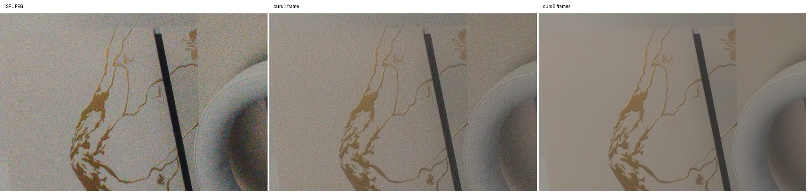

超广角 ISO 2884（左：1 帧；中：4 帧；右：16 帧）：

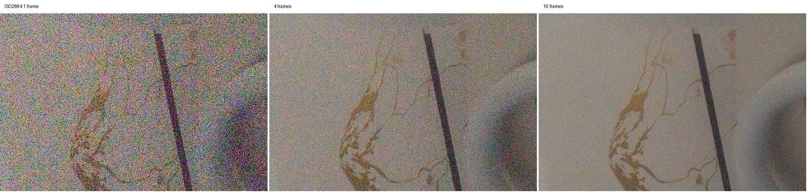

全图（左：本管线 8 帧；右：ISP 直出）：

| 本管线 `uw8` 8 帧 | ISP JPEG |
|---|---|
| 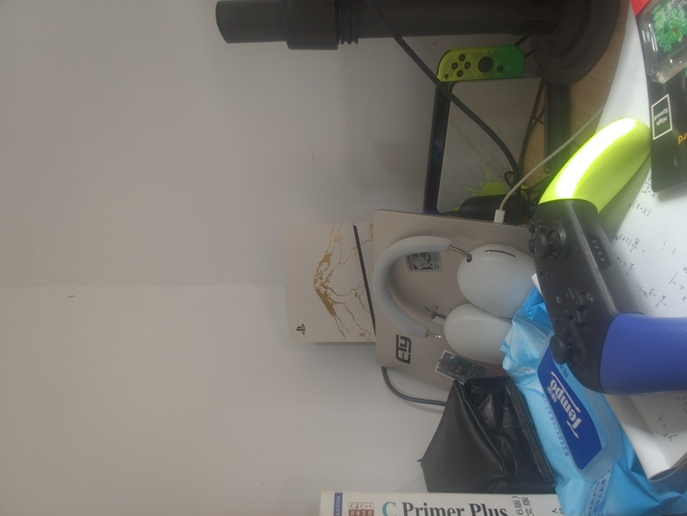 | 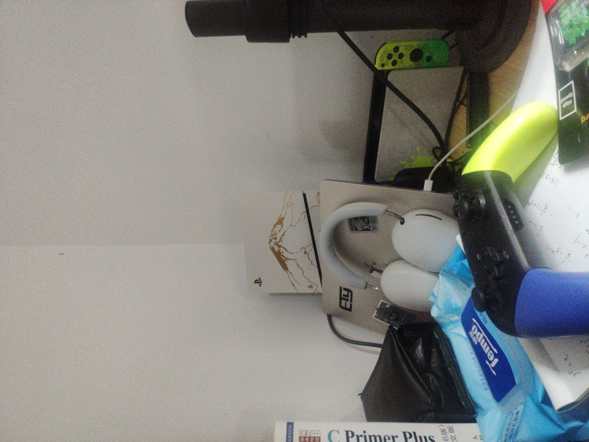 |

观察（当时的版本）：

- 8 帧合成的平坦区域明显比 ISP 直出干净（ISP 用的是 33 ms / ISO 341，本管线是 8 × 66 ms / ISO 87），细节保持良好，没有涂抹感。
- 成片整体略暗、对比略低，白平衡略偏冷灰；ISP 更亮、更暖。后来由 Pixel 风格（5.3 节）和标准风格调亮（`da38e98`）处理。
- ISO 2884 单帧的彩色噪点很重：当时色度降噪强度固定。后来改为噪声自适应（2.2 节）。

### 1.3 耗时（ms）

| 阶段 | 主摄 16MP × 8 | 超广 8MP × 8 | 超广 8MP × 16 | 超广 8MP × 1 |
|---|---|---|---|---|
| 读取 RAW | 112 | 64 | 108 | 14 |
| 灰度 + 金字塔 | 105 | 64 | 126 | 16 |
| 对齐 | 507 | 350 | 851 | — |
| 噪声标定 | 83 | 26 | 43 | — |
| 合并 | 230 | 119 | 261 | — |
| LSC + WB | 98 | 64 | 55 | 49 |
| 去马赛克 | 66 | 45 | 33 | 31 |
| CCM | 12 | 7 | 8 | 6 |
| 色度降噪 | 60 | 33 | 33 | 31 |
| 局部色调映射 | 395 | 232 | 272 | 227 |
| 外观曲线 | 86 | 47 | 45 | 46 |
| 锐化 | 92 | 53 | 57 | 57 |
| JPEG 编码 | 408 | 286 | 397 | 350 |
| **总计** | **2395** | **1462** | **2342** | **856** |

- 主摄 16MP × 8 帧：单线程 4414 ms，8 线程 2395 ms，加速比只有 1.84。原因：JPEG 编码（stb）单线程，约占 17%；对齐和合并受内存带宽限制；4 颗 A510 小核比大核慢很多；内核 5.10 的 `mmap_lock` 让多线程并发缺页串行化（已用缓冲池缓解）。
- Mac（Apple Silicon，8 线程）同一组主摄数据约 0.9 s。峰值内存（主摄 8 帧）约 880 MB。采集 8 帧 × 66 ms 加保存约 0.7 s。
- 收益最大的三项优化（3135 → 2395 ms）：图像缓冲改为未初始化内存并用缓冲池复用；sRGB 编解码查表；拉普拉斯金字塔原地构建。

---

## 2. 噪声

### 2.1 噪声标定

状态：**[App 已实现，主摄]**（P0，提交 `b4bdfa7`）。

- **来源**：本机 HAL 不报 `SENSOR_NOISE_PROFILE`，无法与标定表对比，按计划的备选：主摄用三脚架标定曲线 `calib/noise_curve_cam0.json`（`tools/noise_calib.py curve`，ISO 50/100/400/800/876，a 0.06–1.25、b 0.30–5.36 DN，按 ISO 插值），超广角继续帧间估计，补拍 `dk_uw`、`tp_uw_*` 见 [`VALIDATION.md`](VALIDATION.md#附录-ap1-拍摄清单)。包围曝光的参考帧放大了 f 倍，模型随之变为 a' = f·a、b' = f²·b。标定过程（暗场、读出噪声、热像素、k / b 拟合）见 [`VALIDATION.md`](VALIDATION.md#22-噪声标定)。
- **鲁棒性**：P1 实拍发现直接换标定值后手持包围权重从 .91 掉到 .47。原因是帧间估计偏低 10–25%，并吸收了对齐误差，阈值是按它调的。三个候选里选了标定模型单独一组阈值 1.75 / 3.9（`kRobustCalibrated`），估计模型保持 2 / 4.5。
- **验证**：
  - 鬼影（`ghost_eval`，越低越好）：标定 / 估计 = 空间域 0.373 / 0.374，核回归 0.389 / 0.393。
  - 64 帧真值 PSNR：ISO 800 54.07 / 54.07，ISO 876 59.47 / 59.40，ISO 100 56.21 / 56.32。
  - `br_main` 权重 .934、可见噪声 0.0047（估计 .911 / 0.0051）；`nt_main_hand` 频域可见噪声 0.0032（0.0047）。
  - GPU 对 CPU：`main8` 95.06 dB，包围 93.15 dB。App 实拍 ISO 788：`var 0.1445 S + 0.591 calibrated robust 1.75-3.90`。
- App：`LensCalibration.noise`；原型 `--noise-cal auto`。

### 2.2 噪声自适应

状态：**[App 已实现]**（算法升级 + P0，提交 `70a04f8`）。

- 色度降噪：在输出 RGB 上用 Immerkær 方法估计 σ，乘以显示增益得到“可见噪声”，强度取 `clamp(可见σ / 0.01, 1, 6)`；2x 输出时再乘以放大倍数。
- 锐化阈值 `core = max(0.004, 0.6·visibleSigma)`；目标亮度在可见噪声超过 0.015 时乘以 √(0.015 / visible)，最低 0.5 倍。CPU 与 GPU 的 finish 同步。
- 局部对比也随可见噪声减弱（`61752b4`），暗包围和暗场景的阴影保持干净。
- JPEG 平坦区噪声（8 bit，32 px 块高通标准差的第 20 百分位）与平均亮度，修改前 → 后：

| 素材 | 平坦区噪声 | 平均亮度 |
|---|---|---|
| `uwnoisy16` | 7.48 → 5.97 | 123.5 → 108.1 |
| `t_dark` | 7.22 → 5.89 | 122.8 → 110.3 |
| `tp_main_iso3200`（ISO 876） | 10.81 → 8.71 | 112.7 → 100.7 |
| `tp_main_iso800` | 4.55 → 3.96 | 110.4 → 108.9 |
| `main8` / `uw8` / `hh_main8` / `t_br` | 不变 | 不变 |

---

## 3. 对齐与合并

### 3.1 参考帧选择

状态：**[App 已实现]**（P0，提交 `04deccf`）。

- `align.cpp` 的 `sharpest_frame`：前 3 帧中心区域 4×4 合并后的梯度能量，后一帧要锐利 3% 以上才替换；包围曝光仍用最短曝光帧。
- 手持组 `hh_main8` 三帧锐度 866 / 1018 / 1040，选第 1 帧（第 2 帧差距不到 3%）；三脚架和支撑组差距在 0.5% 以内，保持第 0 帧。
- 成片梯度能量（越高越清晰）：`hh_main8` 5.47 对固定第 0 帧 5.30（+3%），`syn_hhmain` 7.55 对 7.47；合并权重 .896 对 .891。
- 耗时每帧 1–3 ms；App 的参考帧阶段 7 ms（4 帧）。App 的 `RawBurst.referenceIndex` 由原生层回传，参考帧 DNG 写的是实际选中的帧。

### 3.2 核回归合并

状态：**[App 已实现，1x]**（算法升级 + P1）。

算法见 [`PIPELINE.md`](PIPELINE.md#72-核回归合并pipelinesrckrcpp)。

- P1：`parallel_for` 原来每个并行区都新建线程，手机上每个阶段要多花几毫秒；改为常驻线程池（调用线程也参与，嵌套区内联执行）。核回归累加改为 NEON：四个 Bayer 相位放在 SIMD 通道里，核权重与流场按块缓存；LK 细化共享参考帧梯度。

| 超广角 uw8，核回归 1x | 标量 | 线程池 + NEON |
|---|---|---|
| LK 细化 | 282 ms | 51 ms |
| 合并 | 1600 ms | 683 ms |
| 总计 | 3052 ms | 1494 ms |

- 主摄手持 `hh_main8` 核回归 1x 总计 5.8 → 2.9 s；超广角 2x 8.8 → 4.5 s；经典路径主摄 2.4 → 1.6 s。NEON 与标量结果的 JPEG 最大差 5 级，0.014% 像素不同（浮点求和顺序）。
- 最初标量版（`burstpipe-android`，8 线程，总耗时 ms）：

| 素材 | 原管线 | 核回归 1x | 核回归 2x |
|---|---|---|---|
| hh_uw8（8.1 MP × 8） | 1412 | 3256（合并 1605，LK 细化 336） | 8814 |
| hh_main8（16 MP × 8） | 2319 | 5819（合并 3133） | 15997（配合 `--ds 2` 缩小输出） |

- GPU 版主摄 8 帧 3021 → 1473 ms（7.3 节）。App 中“处理方式 → 核回归合并”（`hdrplus_kr`），陀螺仪判定静止时自动退回 HDR+（`c9ef124`）；2x 不接入（主摄 2x 浮点 RGB 约 600 MB）。

### 3.3 亚像素多样性与自动 2x

状态：**[仅原型]**（P1）。

原来的“相位覆盖率”在静止连拍上也有 0.7 以上（LK 噪声本身就会填满相位格），区分不了手持和静止。新指标 `subpixel_diversity`：

1. 由 LK 的 Hessian 最小特征值和噪声模型得到每块位移的标准误差；只用所有帧误差都小于 0.1 灰度像素的块。
2. 每块计算各帧位移的稳健离散度（中位绝对偏差），减去 3 倍估计误差后归一化，再乘以半像素相位格的覆盖比例。

| 连拍 | 得分 | 可信块比例 | 离散度（raw px） |
|---|---|---|---|
| uw8（静止） | 0.000 | 0.14 | 0.26 |
| main8（静止） | 0.000 | 0.12 | 0.42 |
| t_night（放在桌上） | 0.000 | 0.37 | 0.35 |
| hh_uw8（手持） | 0.750 | 0.09 | 7.84 |
| hh_main8（手持） | 0.750 | 0.09 | 7.36 |
| uwnoisy16（手持） | 0.750 | 0.15 | 8.89 |

`--scale auto` 在得分 ≥ 0.3 时用 2x。App 用陀螺仪判断手持 / 静止，不用这个指标。

### 3.4 频域合并

状态：**[App 已实现，夜景]**（P1）。

按 HDR+ 论文第 5 节实现成对 Wiener 合并（`merge_freq.cpp`）：16×16 半重叠正弦窗，四个 Bayer 平面放在 SIMD 通道里，可选对合并后频谱做空间收缩。

- 正确性：`c → ∞` 时与普通均值一致（σ 0.00303 对空间域 0.00305）。
- 空间收缩要四个平面共用增益，否则会出现迷宫纹。
- 高噪声 uwnoisy16（超广角 16 帧，2 ms 快门，ISO 800）：空间域 σ 0.00305；频域 s=1 0.00135；s=2 0.00089；s=4 0.00054（开始抹细节）。
- 普通光照下频域合并让文字略软，所以只在夜景模式使用（`c=64`、`s=2`）。手机耗时：超广角 8MP 合并 0.32 s，主摄 16MP 0.62 s。64 帧真值上比空间域高 0.7–2.6 dB（[`VALIDATION.md`](VALIDATION.md#23-合并与-pmrid64-帧真值)）。
- 频域合并不支持曝光加权，包围时自动退回空间域；GPU 版逐系数 DFT 比 CPU 慢约 10 倍，仍在 CPU 上。

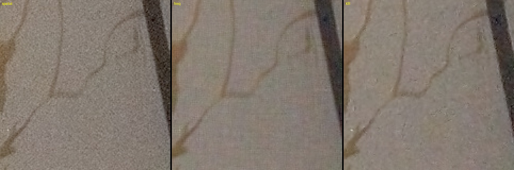

### 3.5 手持与运动

状态：**[App 已实现]**（P1）。

- 空间域合并改为逐帧“鲁棒性图 → 膨胀 → 累加”，与核回归共用 `MergeOpts` 和 `frame_weight`（两帧噪声相加的 z 检验）；`--motion-dilate R` 是鲁棒性图上的最小值滤波。
- 合成运动：`tools/synth_motion.py` 把一块纹理（对比度 ×1.6 / ×1.15）以每帧 40–56 px 的速度贴进真实连拍；`tools/ghost_eval.py` 在轨迹上测鬼影。

| hh_main8 空间域，高对比运动块 | 鬼影均值 | p99 | 合并权重 | 残余 σ |
|---|---|---|---|---|
| 阈值 3–6，膨胀 0 | 0.509 | 1.75 | | |
| 阈值 2–4.5，膨胀 0 | 0.453 | 1.25 | 0.971 | 0.00103 |
| **阈值 2–4.5，膨胀 1** | **0.374** | **1.0** | 0.888 | 0.00106 |
| 阈值 1.5–3，膨胀 1 | 0.320 | 1.0 | 0.675 | 0.00120 |

调高阈值鬼影反而变多；三脚架素材上所有设置的鬼影都不高于静止基线。**决定**：保持阈值 2 / 4.5（标定噪声时 1.75 / 3.9），两条合并路径都默认膨胀 1。真实运动素材（`mo_*`）还没拍。

### 3.6 横向色差（LCA）

状态：**[App 已实现，超广角]**（P1）。

- 模型：通道 X 在 `p + (p − c)(k1 + k2 (r/rmax)²)` 处采样；核回归累加时按输出像素平移 R / B 的查询点（NEON 按相位设通道偏移）。2x 裁切时用全幅坐标的中心。
- 标定 `tools/lca_calib.py`：取强径向 G 边缘，对局部归一化的 R / B 与 G 做径向 LK，修剪加权最小二乘；r/rmax > 0.7 的块不足 8 个时不拟合三次项。
- 超广角（uw8 + hh_uw8 合并拟合）：kr +0.000471 / −0.000348，kb +0.000096 / +0.000372（中径 R +0.39 px、B +0.19 px，角上 B +0.96 px）。主摄中径 R +0.08、B +0.15 px，低于每块噪声（拟合 rms 0.24–0.31 px）。
- 校正后中径残余：hh_uw8 +0.25 / +0.18 → +0.01 / +0.03 px；uw8 +0.28 / +0.36 → −0.10 / −0.01；uwnoisy16（不在标定集内）+0.16 / +0.18 → +0.01 / +0.10。合并耗时 +4–5%。
- **决定**：超广角自动启用（App 中 `LensCalibration`）；主摄屏幕棋盘格标定在成片上复测对不上、校正会过冲，不启用（[`VALIDATION.md`](VALIDATION.md#25-lca)）。

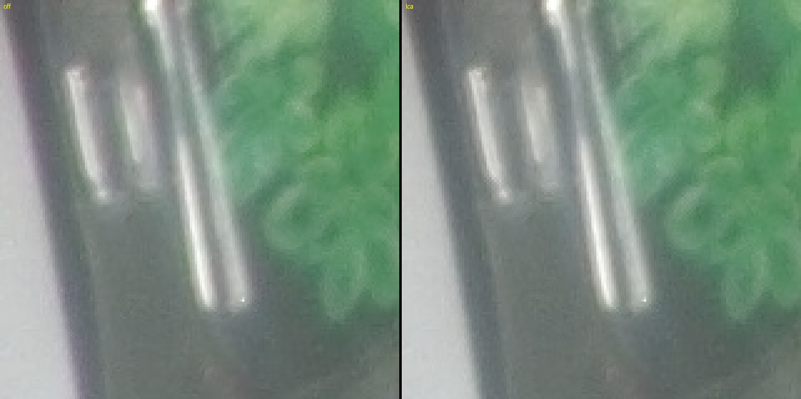

---

## 4. 场景模式

### 4.1 包围曝光

状态：**[App 已实现]**（P1）。

- 参考帧取最短曝光（保高光）；其余帧在黑电平以上按 `e_max / e_k` 放大到 uint16，参考帧白电平相应提高；噪声模型用与参考帧同曝光的帧估计。
- 每帧权重：z 检验用 `var_ref + (g·a·s + g²·b)`，再乘曝光的逆方差权重；该帧中达到 0.98 白电平的样本权重为 0，再做膨胀。空间域和核回归都支持。
- t_br（桌面，66 ms × 4 + 27.5 ms × 2，比 4.03）：增益 0.248，白电平 1023 → 3931；可见噪声 σ：包围空间域 0.0068、包围核回归 0.0053、以长帧为参考 0.0073。
- 合成包围（uw8 中 2/3 帧 +2 EV 并剪切）：高光均值 259.1 对 259.1 DN，相对误差 1.9%（中间调噪声 2.3%），没有洋红或发灰的高光。
- App：`BurstExposure.bracket` 每 3 帧中 2 帧 −2 EV、1 帧 0 EV（`ExposurePlan.PerFrame`）；原生会话自动选最短曝光为参考。实拍主摄 8 帧：增益 1, 1, 0.25, …，总计 3.0 s。合成 DNG 写 BaselineExposure = log2 f 抵消扩大的白电平。

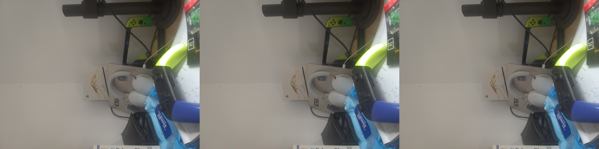

### 4.2 夜景模式

状态：**[App 已实现]**（P1）。

- 运动测光：取景时读陀螺仪 RMS 角速度，乘焦距（像素），在模糊预算 1.5 px（有 OIS 时 ×4）内取最长快门，限制在 33–333 ms（probe 为 500 ms），在测光曝光（0 EV）下换算 ISO。
- 夜景风格：目标亮度 0.11、压缩比 4、对比 0.18、饱和度 1.05、锐化 0.4、局部对比 0.15、色度降噪 ×1.6；并选择频域合并 + 空间收缩 2。夜景下“风格”设置置灰（`10526a7`）。
- uwnoisy16 可见噪声 σ：默认 0.0253；夜景风格 + 空间域 0.0155；+ 频域 s1 0.0064；**s2 0.0042**；s4 0.0026（抹细节）；核回归 0.0092（2.8 s）。
- App 实拍（手机放在桌上）：选了 175 ms / ISO 50，频域合并，16MP × 8 帧总计 3.0 s。

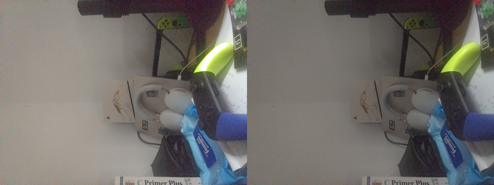

---

## 5. 后处理与输出

### 5.1 去马赛克：RCD / AMaZE

状态：**[App 已实现]**（P1）。

从 librtprocess（GPL-3，与 PocoPaw 许可证一致）引入 RCD 与 AMaZE，按水平条带并行。

| | MHC | RCD | AMaZE |
|---|---|---|---|
| Kodak 8 张 PSNR / 伪色 | 29.67 dB / 38.8 | 32.76 dB / 26.5 | 33.68 dB / 23.6 |
| 对 ISP JPEG（2x 缩小）PSNR / 伪色 | 37.89 / 13.8 | 37.68 / 13.3 | 38.41 / 12.1 |
| 手机 16MP 耗时 | 49 ms | 160 ms | 681 ms |

MHC 在高频纹理上有明显拉链和伪色。**决定**：App 经典路径默认 RCD（多 110 ms），AMaZE 作为可选项保留在原生接口里。随仓库的 librtprocess `rcd.cc` 没有 SIMD 分支，保持 `-O3 -ffast-math` 自动向量化。

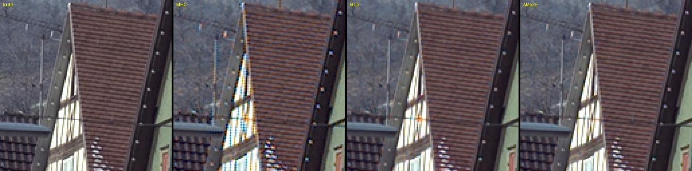

### 5.2 低分辨率色调映射

状态：**[App 已实现]**（P0，提交 `9e773dd`）。

- Mertens 融合改在 4×4 合并的亮度上做，融合增益（log2）对亮度（log2）用快速引导滤波（r 2，eps 0.02）上采样回全分辨率；`--tone-full` 保留旧路径对照。
- 与全分辨率版 JPEG 的 PSNR：`main8` 62.98、`uw8` 63.57、`t_br` 60.52、`br_main_backlit` 52.93、`br_uw_backlit` 54.76、夜景 58.72 dB。差异集中在灯泡和画框边缘（`br_main_backlit` 第 99.9 百分位 6 级），全分辨率裁切上没有光晕。
- 16MP 耗时：CPU 260 → 93–97 ms（log2 / exp2 多项式近似、按行插值系数、不再分配全分辨率 Y），GPU 138 → 72 ms。App 实拍 GPU 色调映射 62 ms，后处理 703 → 632 ms。
- 近似函数让 GPU 对 CPU 从 89–96 dB 降到 70–81 dB，仍在 50 dB 要求以上。

### 5.3 风格：标准 / Pixel

状态：**[App 已实现]**（P1）。

`--look pixel`：目标亮度 0.22、压缩比 6、对比 0.26、饱和度 1.24、锐化 0.9、局部对比 0.6（1/4 分辨率快速引导滤波）、白平衡略偏冷 0.025、天空蓝饱和度 ×1.18 / 色相 −4°、肤色饱和度 ×0.92 / 色相 +3°（不用三角函数的 CbCr 窗口）。

| 1024 px 宽，L* 均值 / 局部对比 / 色度 / b* | ISP | 默认 | Pixel |
|---|---|---|---|
| main8 | 55.6 / 1.16 / 11.2 / 8.3 | 52.3 / 1.02 / 11.0 / 7.9 | 54.8 / 1.25 / 11.9 / 7.8 |
| hh_uw8 | 56.9 / 2.69 / 7.9 / 3.4 | 52.0 / 1.30 / 6.2 / 3.6 | 57.1 / 1.71 / 6.3 / 2.9 |

亮度与 ISP 一致、色调更冷、局部对比比默认高 25–30%（ISP 的锐化仍更重）。风格阶段手机耗时从最初 458 ms 优化到 209 ms。

实拍对比（[`VALIDATION.md`](VALIDATION.md#1-pocopaw-全设置组合与系统相机对比)）发现标准风格偏暗偏软、暖色高光红通道溢出，之后的调整：标准风格目标亮度 0.23、锐化 0.8、轻度局部对比 0.3（`da38e98`）；彩色高光按最大通道保色相压缩，不再先剪红通道（`844dbea`）。

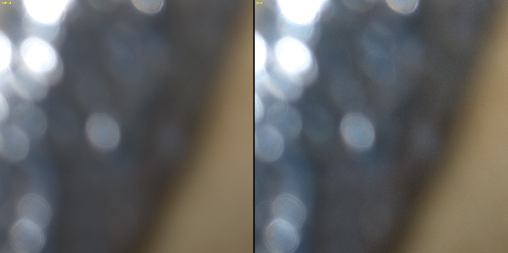

### 5.4 Ultra HDR

状态：**[App 已实现]**（P1）。

- HDR 版本：CCM 之后的场景线性亮度 × 色调映射的长曝光增益（1.0 = SDR 白），1.0 以上软肩部压到 headroom（默认 4）。
- 增益图自己算：1/4 分辨率单通道，`(Y_hdr + 1/64) / (Y_sdr + 1/64)`，只作用于 SDR 显示亮度 0.35–0.75 以上（smoothstep），对数域 3×3 平滑，灰度 JPEG q90。
- 容器用 libultrahdr API-4（压缩底图 + 增益图 + 元数据），同时写 XMP（hdrgm）和 ISO 21496-1。最大增益低于 1.05× 时不写增益图，退回普通 JPEG。底图与 SDR 一样用 4:2:0（`4a312b7`，小约 10%）。
- 用 `ultrahdr_app` 解码验证：main8 HDR 亮度最大 2.67、SDR 1.00，提亮只落在高光上。
- 最大增益：main8 2.3–2.6×、uw8 1.83×、hh_uw8 1.68×。正常曝光的连拍在 RAW 里就已经剪切，headroom 受限；−2 EV 包围能提高（实拍达到上限 4.0×）。
- App 端：系统 `ExifInterface` 只重写主图的 EXIF 段，增益图原样保留；实拍文件的 MPF 偏移校验正确。

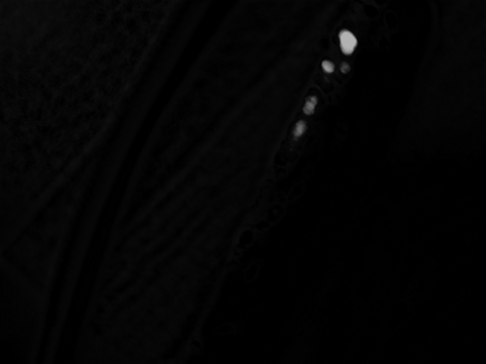

### 5.5 libjpeg-turbo

状态：**[App 已实现]**（P0，提交 `631c3f3`）。

- 原型与 App 都直接调用 libjpeg-turbo 3.1.0（来自 libultrahdr 的构建）：按 MCU 行切成条带并行编码，每条是独立的 baseline JPEG，用 DRI + RSTn 拼接；Ultra HDR 的基图和增益图走同一个编码器。`encode_jpeg_stb` 保留作对照。
- 手机 16MP q95：4:2:0 条带并行 26–28 ms（2.12 MB），单条 55 ms，4:4:4 33–36 ms；stb 132 ms；App 原来的 `Bitmap.compress` 147–217 ms。
- 拼接文件通过 `djpeg -strict`，解码结果与单条编码逐像素相同（restart marker 只重置 DC 预测）。
- App 的 JPEG 阶段（编码 + EXIF + MediaStore）195–209 → 69 ms，4 帧总计 1135 → 1000 ms。

---

## 6. 学习式模块

状态：**[仅原型]**。

按约定 App 不引入推理运行时；以下都在 `pipeline/tools/` 中。PMRID 的接入方式与画质见 [`PIPELINE.md`](PIPELINE.md#8-学习式-raw-降噪pmrid)。

### 6.1 学习式 AWB：C5 与 FFCC

批次：P1。

App 仍用 HAL 的 AsShotNeutral；P0 前已在 App 中预留 `AwbEstimator` 接口（默认返回 null），C5 将来可以作为它的一个实现接入。

- **C5**（`tools/awb_c5.py`）：官方跨相机权重（NUS + Gehler-Shi 的单反数据训练，对 Poco 的两颗传感器都是没见过的相机），m = 7：查询图加上同一摄像头的其它连拍作为无标签附加直方图。参考代码依赖已移除的 `torch.rfft`，FFT 卷积和 softmax 改在 numpy 中做，ONNX 只含编码器 / 解码器（2.0 MB）。手机端 `ort_run`：1 线程 9 ms，4 线程 5 ms。
- **FFCC**（`tools/ffcc.py`）：用 Python 重写（对数色度直方图 + 局部偏差直方图，FFT 卷积，偏置 B 即光源先验），在 SimpleCube++（Canon 550D，训练 1772 / 测试 462 张）上训练。要用到 Poco 上，先把 Cube++ 的原始 RGB 映射到 Poco 相机空间：D65 的 raw-to-raw 矩阵，再按每张图光源的相关色温（McCamy），在 colorTransform1（D65）和 colorTransform2（A）之间插值，做一次对角校正。

**Cube++ 测试集**（角误差，度）：

| 模型 | 均值 | 中位数 |
|---|---|---|
| FFCC，Canon 原生空间 | 2.49 | 0.89 |
| FFCC，映射到主摄（只用 D65 矩阵） | 1.32 | 0.70 |
| FFCC，映射到主摄（按光源插值，采用） | 1.91 | 0.64 |
| 灰度世界（映射后） | 2.66 | 1.69 |
| Shades of gray（映射后） | 2.83 | 1.10 |

**Poco 素材与 HAL 估计的一致性**（不是精度，只是和 HAL 的差距；HAL 的估计都落在 Poco 白点轨迹上约 4100–4400 K，偏离 < 1°）：

| 方法 | 均值 | 中位数 | 最差 |
|---|---|---|---|
| 灰度世界 | 1.02 | 0.98 | 1.98 |
| C5 | 3.27 | 2.14 | 10.10（uwnoisy16） |
| Shades of gray | 3.80 | 2.96 | 7.48 |
| FFCC | 5.18 | 5.60 | 5.82 |
| FFCC，去掉光源先验 B | 2.38 | 2.39 | 3.66 |

- FFCC 在每段素材上都比 HAL 偏蓝约 5°。Cube++ 几乎都是户外日光，学到的先验 B 把室内暖光（约 4300 K）拉向日光；去掉 B 后差距降到 2.4°。映射本身是一致的：插值后的日光白点与 HAL 在日光下差 0.36°。
- C5 在大多数素材上与 HAL 相差约 2°；在 uwnoisy16（ISO 800、2 ms，噪声很大）上差 10°，跨相机模型对高噪声直方图不稳。
- 两组白纸真值的初评（FFCC 1.57°、C5 1.73°、HAL 4.02°）见 [`VALIDATION.md`](VALIDATION.md#27-awb初步2-组)。样本太少，等 `awb_*` 灰卡素材到齐，`awb_eval.py` 会自动改用灰卡真值（`<burst>/awb_gt.json`），届时再决定 C5 是否接入、FFCC 是否要用 Poco 自己的数据重新学习先验 B。

### 6.2 PMRID 本机微调

批次：P1。

计划用三脚架 64 帧平均作真值，当时 `tp_*` 素材还没拍，所以先用 SimpleCube++ 的干净原始图作信号源，用 Poco 的噪声模型合成训练对（`tools/pmrid_finetune.py`）。

- **数据**：Cube++ 训练集映射到超广角相机空间（`camera_map`），按 Poco 的 RGGB 重新马赛克，随机缩放亮度。噪声按 `var = k·x + b`（DN）合成：k 在 [0.05, 12] 内取对数均匀分布（覆盖超广角 ISO 50–3200，k ≈ 0.0026–0.0035·ISO），b = 0.3 + 0.5k²。输入用 PMRID 原版的 k-sigma 变换，统一到它的锚点噪声。
- **训练**：从官方权重开始，Adam lr 1e-4（余弦衰减）、L1、batch 16 × 256²，2000 次迭代，Mac MPS 约 20 分钟。只训练 20 次的试跑在真实数据上反而变差（51.26 dB 对 53.83 dB）。
- **合成测试**（Cube++ 测试集，同一噪声模型，PSNR dB）：

| k（DN） | 带噪 | 预训练 | 微调 |
|---|---|---|---|
| 0.3 | 43.68 | 43.68 | **45.87** |
| 1 | 38.18 | 41.20 | **42.00** |
| 3 | 33.33 | 38.73 | 38.78 |
| 8 | 29.36 | **36.45** | 36.22 |

- **真实测试**（uwnoisy16，ISO 800 / 2 ms，噪声估计 k = 2.78、b = 1.17）：以 16 帧合并（有效帧数 14.3）为伪真值评估第 0 帧，“估计”一列按 `var_gt = mean(k·ref + b) / neff` 扣掉伪真值的残余噪声。

| | PSNR | 估计（对干净真值） |
|---|---|---|
| 带噪第 0 帧 | 43.16 | 43.43 |
| 预训练 | 53.83 | 58.93 |
| **微调** | **54.50** | **61.62** |

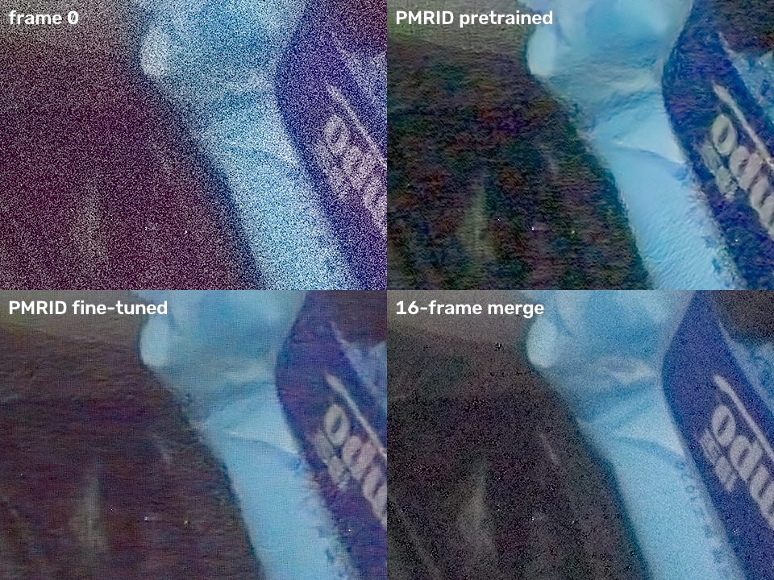

**结论更新**：在主摄 64 帧真值上（[`VALIDATION.md`](VALIDATION.md#23-合并与-pmrid64-帧真值)），超广角微调和按标定 b 设范围的主摄微调都比官方权重低 0.5–1.2 dB：合成训练对迁移不到实拍，**保留官方权重**。微调权重 `pipeline/calib/pmrid_poco_uw.ckp`、`pmrid_poco_main.ckp` 留作实验；等有更亮的 `tp_main_bright` 后，可以试着直接用真值做训练对。

### 6.3 PMRID 门控与混合

批次：P0。

工具：`tools/pmrid_gate.py`（主摄三脚架 `tp_main_iso100/800/3200`，完整表格在 `pipeline/out/p1/pmrid_gate.txt`）。输入为第 0 帧或前 n 帧（n = 2/4/8/16）的空间域合并（标定噪声），PMRID 用官方权重、按 k/neff、b/neff 降噪。真值从 64 帧对齐平均里**扣掉输入用到的帧**，保证真值的残余噪声与输入无关。

**截断位置**（对干净真值估计的 PSNR，dB）：

| 输入下界（K-Sigma 域） | ISO 876 单帧 | ISO 800 单帧 | ISO 876 8 帧 |
|---|---|---|---|
| 线性 0 DN 的映射（原做法，默认） | **64.25** | **55.02** | **64.92** |
| 0 | 64.20 | 54.92 | 64.90 |
| −1 | 63.40 | 54.90 | 64.90 |
| −2 | 58.68 | 54.89 | 64.90 |
| −S/K（方差为零处，负值全保留） | 57.23 | 54.88 | 64.90 |

官方模型是用截断后的输入训练的，下界放低就超出了它的分布，高噪声单帧最多掉 7 dB。所以默认保持“线性 0 DN 的映射”这个下界（`to_ksigma(floor=None)`），`--ks-floor` 留作实验。

**偏粉**：计划的假设是“线性域截断让暗部均值上偏”。实测不成立：

- PMRID 输出在暗部（真值 G 第 10–30 百分位）的偏色（白平衡后 R−G、B−G 误差）：各合并输入都在 ±0.07 DN 以内；高噪声单帧略偏绿（ISO 800 −0.11 / −0.49，ISO 876 −0.33 / −0.39 DN），没有偏粉。
- `uwnoisy16` 第 0 帧对它自己的 16 帧合并：默认 −0.35 / −0.16，−S/K −0.50 / −0.25。若在 K-Sigma 域截到 0 才会偏粉（+5.1 / +3.0 DN）。
- 偏粉出现在**后处理**：成片暗部（最暗 15%）的 R−G / B−G（8 bit），`uwnoisy16` 单帧 +26.6 / +17.2，16 帧合并 +7.3 / +2.6，PMRID 单帧 +0.9 / +1.5。原因是 `finish.cpp` 的归一化在乘白平衡增益（R 1.85、B 1.64）之前把每个通道截到 0，高噪声暗部的均值被抬高；只去掉这一处截断，单帧降到 +19.5 / +12.8，去马赛克和 CCM 之后还有截断。这部分涉及 App 后处理和 GPU kernel，**未改**，列在 [`PIPELINE.md`](PIPELINE.md#133-后续) 的后续工作里。

**混合曲线**：MSE 最优 α* = ⟨p − x, t − x⟩ / ‖p − x‖²。

| k_eff（DN） | ISO 800 | ISO 876 |
|---|---|---|
| 约 1（单帧） | 0.975 | 0.969 |
| 0.5–0.6（2 帧） | 0.965 | 0.958 |
| 0.26–0.32（4 帧） | 0.945 | 0.951 |
| 0.13–0.16（8 帧） | 0.911 | 0.929 |
| 0.07–0.08（16 帧） | 0.897 | 0.891 |

- ISO 100（k_eff 0.12 → 0.018）各档都是 1.0；混合带来的提升最多 0.11 dB，说明在这个范围内 PMRID 基本应全量使用。
- `pmrid_denoise.ALPHA_KNOTS` 设为 (log10 k_eff, α) = (−1.1, 0.90)、(−0.5, 0.95)、(0, 0.97)，区间外取端点值。
- PMRID 对输入的提升：ISO 876 单帧 50.47 → 64.25 dB、8 帧 59.76 → 64.92 dB、16 帧 61.92 → 65.15 dB；ISO 100 8 帧（k_eff 0.018）52.54 → 52.97 dB，增益很小但仍为正。
- 手持超广角（k_eff 0.0325）上看到的纹理涂抹，在三脚架真值的 MSE 上没有体现。低噪声端的门控需要手持真值（`mo_*`、`tp_uw_*`）或感知指标来定。

---

## 7. 工程化与 App 集成

### 7.1 边拍边合并

状态：**[App 已实现，默认]**（P0，提交 `e2ce88c`）。

- **原生层**：`merge.cpp` 的 `SpatialMerge` 把 `merge_frames` 拆成逐帧接口（批处理也改用它，输出不变）；`BurstSession` 增加 `begin_stream` / `add_frame` / `end_frames`：先缓存前 3 帧选参考帧，之后每来一帧就对齐、算鲁棒性、累加，然后释放。GPU 端 `GpuBurst::create_stream` 只开参考帧和当前帧两个槽，复用原有 kernel；GPU 失败时从参考帧重新开始走 CPU。
- **App**：`BurstStream` 在单独的串行线程上接收帧；`CameraController` 的 `SteadyGate` 在线剔除失焦或移动中的帧（前 3 帧的中位对焦距离作基准）；参考帧确定后其余帧立即归还相机。只用于单一曝光的空间域合并，包围、夜景（频域）和核回归仍走批处理。
- **一致性**：流式对批处理 JPEG 最大差 0（`main8`、`uw8`，CPU）；GPU 流式对 CPU 77.5–80.3 dB（含 2x 变焦、32 帧、标定噪声）。
- **耗时**：主摄 16MP 每帧 CPU 72–82 ms、GPU 70–76 ms，帧间隔 66 ms，所以最后一帧之后还积压 2–3 帧；32 帧 CPU 1889 ms、GPU 1758 ms 合并完。
- **App A/B**（主摄，GPU，标定噪声，从对焦锁定到 JPEG，进程 RSS 峰值相对空闲，每 50 ms 采样）：

| 帧数 | 批处理 | 边拍边合并 |
|---|---|---|
| 4 | 1.51 s，+305 MB | 1.41 s，+161 MB |
| 8 | 2.03 s，+595 MB | 1.68 s，+212 MB |
| 16 | 3.19 s，+1064 MB | 2.29 s，+181 MB |

批处理时的峰值 RSS（App 首版，纯 CPU）：主摄 8 帧核回归约 1.57 GB，16 帧经典合并约 1.9 GB，16 帧核回归约 2.18 GB；处理结束后回落到约 270 MB。

### 7.2 NEON（对齐与合并）

状态：**[App 已实现]**（P0，提交 `676ed4e`）。

- `align.cpp` 的 `tile_cost`、`merge.cpp` 的块读取 / 鲁棒性（4 块并行）/ 累加改为 NEON；`min_filter` 改成可自动向量化；`frame_weight` 改用 float（与 GPU 一致）。`-DBURSTPIPE_NO_NEON` 保留标量版本供对拍。
- 手机 CPU，标量 → NEON（ms）：

| 素材 | 对齐 | 合并 |
|---|---|---|
| `main8` | 454 → 347 | 349 → 234 |
| `uwnoisy16` | 609 → 518 | 392 → 275 |
| `uw8` | 250 → 213 | 187 → 132 |
| `t_br`（包围，剪切检查保留标量第 1 遍） | 203 → 184 | 179 → 176 |

- NEON 对标量 JPEG：`main8` / `t_br` 最大差 1，`uw8` / `uwnoisy16` 最大差 2（浮点求和顺序），差值超过 8 的样本为 0。

### 7.3 GPU 加速（OpenCL）

状态：**[App 已实现，默认]**（2026-11-03）。

设置 → 开发 → “GPU 加速”，默认开启。实现在 `pipeline/src/gpu/`（App 内为 `burstpipe/gpu/` 的同名副本）：

- 运行时：`dlopen` 系统的 `libOpenCL.so`（Manifest 用 `uses-native-library` 声明，`required="false"`）；按“源码 + 驱动版本 + 编译选项”缓存程序二进制；开启 `cl_qcom_perf_hint` 高性能档；中间图像全部常驻显存。
- 上 GPU 的步骤：对齐（灰度图、金字塔、逐块 L1/L2 搜索）；合并（空间域鲁棒合并、边拍边合并，以及核回归的 LK 细化和核累加）；后处理（从 LSC / WB 到 RGBA 输出，只下载最终位图，Ultra HDR 需要时再按需下载线性 RGB）。
- 仍在 CPU 上：噪声标定（数据量很小）；频域合并（逐系数 DFT 的 GPU 版比 CPU 慢约 10 倍，留待改写为寄存器 FFT）；JPEG / DNG 编码。
- 回退：任一步在 GPU 上失败（设备不可用、编译失败、显存不足），该步及之后的步骤自动改用 CPU，结果不变，只是变慢。日志 `PocoPawPipeline` 的摘要行末尾写明 `gpu: align merge finish`。
- Adreno 上要避免运行时索引的私有数组和对全局内存的逐 lane 串行循环，两者都慢一个数量级。

**一致性**：`session_check --gpu --compare` 把同一组素材的 GPU 和 CPU 输出逐像素对比（8 bit RGBA，PSNR）。Mac（OpenCL 1.2）上所有模式都在 70 dB 以上；Ultra HDR 增益图的最大增益一致（2.37）。手机上（`pipeline/tools/gpu_check.sh`，Adreno 725，暖机后单次，主摄 `main8` 8 帧，另注明的除外；P0 之前的版本）：

| 模式 | CPU ms | GPU ms | PSNR | 最大差值（0–255） | 在 GPU 上的步骤 |
|---|---|---|---|---|---|
| RCD（默认） | 1736 | 1252 | 95.4 dB | 1 | 对齐、合并、后处理 |
| MHC | 1632 | 1121 | 96.6 dB | 1 | 对齐、合并、后处理 |
| AMaZE | 2316 | 1962 | 91.1 dB | 3 | 对齐、合并、后处理（AMaZE 本身在 CPU） |
| Pixel 风格 | 1909 | 1346 | 89.5 dB | 2 | 对齐、合并、后处理 |
| 夜景（`uw8`） | 956 | 757 | 95.8 dB | 2 | 对齐、合并、后处理 |
| 频域合并（`uwnoisy16`） | 1810 | 1558 | 94.3 dB | 1 | 对齐、后处理 |
| 核回归 1x | 3021 | 1473 | 76.5 dB | 12 | 对齐、核回归、后处理 |
| 核回归 + LCA（`uw8`） | 1597 | 825 | 82.8 dB | 9 | 对齐、核回归、后处理 |
| 包围曝光（`t_br`） | 828 | 671 | 93.6 dB | 3 | 对齐、合并、后处理 |
| 核回归包围曝光（`t_br`） | 1314 | 752 | 70.8 dB | 28 | 对齐、核回归、后处理 |
| 2x 变焦 | 972 | 765 | 94.2 dB | 1 | 对齐、合并、后处理 |
| 核回归 1.5x | 1759 | 1073 | 80.4 dB | 5 | 对齐、核回归、后处理 |
| 单帧 | 911 | 705 | 95.2 dB | 1 | 对齐、合并、后处理 |

差异来自浮点求和顺序、`-cl-mad-enable` 的乘加融合和核回归权重里的 `native_exp`。核回归的权重对微小误差更敏感，所以 PSNR 较低；即便如此，差值超过 8 的样本也不到十万分之二，肉眼不可见。P0 的低分辨率色调映射用了多项式近似，GPU 对 CPU 降到 70–81 dB，仍在 50 dB 门槛以上。

**App 内耗时**（主摄 16MP，室内静态场景，JPEG 输出；单位 ms）：

| 模式 | 帧数 | 后端 | 对齐 | 合并 | 后处理 | JPEG | 总计 |
|---|---|---|---|---|---|---|---|
| HDR+ | 4 | CPU | 250 | 222 | 1105 | 217 | **1795** |
| HDR+ | 4 | GPU | 199 | 104 | 692 | 217 | **1213** |
| HDR+ | 8 | CPU | 513 | 486 | 1090 | 198 | **2286** |
| HDR+ | 8 | GPU | 381 | 221 | 702 | 197 | **1501** |

- App 内 HDR+ 整体快约 1.5 倍：合并快 2.2 倍，后处理快 1.6 倍，对齐快 1.35 倍。后处理里剩下的大头是渲染预览位图和 RGBA 输出的回读。
- 核回归在 App 里只在手持时启用，桌面测试拍不到，所以看 `session_check` 的数字：主摄 8 帧 3021 → 1473 ms，约 2 倍。
- GPU 初始化（创建设备并编译全部 OpenCL 程序）首次约 740 ms，在开启 GPU 加速后由后台预热完成；之后从程序二进制缓存加载，约 13 ms。
- **温度**：连续 5 次 4 帧连拍，每次间隔约 5 s，耗时稳定在 1200 到 1232 ms，没有降频迹象。GPU（`gpuss-0`）33.9 → 36.7 °C，CPU 大核（`cpu-1-0`）36.7 → 40.2 °C，机身（`quiet_therm`）29.4 → 30.0 °C。

**NPU（Hexagon cDSP）只做了可行性探测**，结果显示在“设备能力”页：FastRPC 可用；架构 V69，有 4 个 128 字节 HVX 上下文；系统报告支持 unsigned PD；打开系统自带的 calculator 示例模块失败（错误 0x80000442）。要在 cDSP 上跑自己的代码，需要用 Hexagon SDK 编译 skel 并随 App 打包，没有做。

### 7.4 合成 DNG

状态：**[App 已实现，默认]**（P0，提交 `5d1ad29`）。

- **写入器**：`pipeline/src/dng.cpp` 的 `encode_dng`，原型（`burstpipe --dng`）与 App 共用同一份 C++ 代码，App 侧的 Kotlin `MergedDngWriter` 只负责从 Camera2 收集标签。计划里写的是纯 Kotlin 写入器，改成共用 C++ 的原因：两边输出可以直接逐字节对拍，GPU 路径的马赛克也不用回传到 Java 堆。
- **内容**：
  - 无压缩 16 位 CFA，DNG 1.4。数值 ×16（白电平 ×16 超过 65535 时取更小的倍数），保留合并带来的 4 位小数精度，黑白电平同步放大。
  - 镜头阴影写成 4 个 GainMap opcode（OpcodeList2，标记为可选），2x 变焦时按裁切区域定位。
  - ColorMatrix / ForwardMatrix / CalibrationIlluminant 1–2 取自 `CameraCharacteristics`，AsShotNeutral 取自参考帧的 `CaptureResult`；方向、厂商、型号和 256 px 缩略图沿用原来的写法。
  - 包围曝光合并后白电平扩大了 f 倍，写 BaselineExposure = log2 f 抵消，否则渲染器会暗约 2 档（`t_br`：Mac 预览平均亮度 41 → 104）。
- **文件布局**：macOS ImageIO 拒绝“像素条带在 IFD 之前且带 OpcodeList2”的文件，改为 IFD 在前、数据在后（与 `DngCreator` 相同）后正常解码。
- **App**：设置“DNG 内容：合成 / 参考帧”，默认合成；合并完成后由 `MergedDngStage` 写出。核回归输出 RGB，没有马赛克，仍在合并前写参考帧 DNG。
- **验证**：
  - 一致性：`main8`（标定噪声）上，原型 `--dng` 与 App 会话（批处理和流式）的原始数据最大差 0；手机 CPU 版也完全相同，GPU 版和 GPU 流式最大差 1/65535（139 dB）。`t_br` 原型对会话最大差 0。
  - rawpy 读取：黑电平 1024、白电平 16368，CFA 排列与相机白平衡正确；|dng/16 − merged.f32| ≤ 0.031 DN。
  - 解码：macOS 预览（`sips`）能正确解码 `main8`、2x 变焦（2312×1736）和 `t_br`，颜色正确。
  - 体积与耗时：文件 32.1 MB；编码在 Mac 上 12 ms，手机 CPU 22 ms，GPU 路径含下载 112 ms。
  - App 实拍（4 帧流式，DNG + JPEG）：`merged_dng` 阶段 123 ms（编码 + 写入 32.3 MB），总计 1211 ms；92% 的采样用到了 4 位小数；厂商、型号、方向、光源 21 / 17 正确。

### 7.5 移植方式与设置

**移植方式**：原型的 `align`、`merge`、`merge_freq`、`kr`、`demosaic`、`finish`、`dng`、`ultrahdr`、`gpu/` 与 App 中的文件**逐字节相同**。差异只在：

- `common.h`：App 的 `Raw` 是相机缓冲区的只读视图（零拷贝）；包围曝光需要改写样本时 `make_writable()` 先复制一份。元数据由 `RawMetadata` 经 JNI 传入，没有 `meta.json` 和文件读取。
- `burst.*`、JNI、`pool.cpp`：会话接口（含边拍边合并）与内存池。
- 第三方：librtprocess（源码）、libultrahdr + libjpeg-turbo（arm64 预编译静态库，`pipeline/tools/build_ultrahdr.sh` 重建）、stb_image_write、OpenCL 头文件。

`pipeline/tools/session_check.cpp` 用 App 的源码处理 probe 连拍。最初移植时同一组素材（`uw8`）上 App 与原型输出的 JPEG 逐字节相同；P1 时 5 种模式（经典 RCD、包围曝光、夜景频域合并、核回归 + LCA + Pixel 风格、Ultra HDR）的 JPEG 最大差 ≤ 1 级（抖动）。`pipeline/tools/build_session_check.sh` 同时把 `gpu/` 和 `third_party/opencl/` 同步进 App。

**App 中的阶段**：`AlignStage`（含 2x 裁切）、`MergeStage`、`FinishStage`、`MergedDngStage`、`JpegWriteStage`，注册在 `PipelineRegistry` 中，组成 `hdrplus` 与 `hdrplus_kr` 两条管线。场景模式在 `BurstExposure`（曝光规划）和 `HdrPlusPipeline`（每个场景的合并与风格）里，每颗镜头的常量（LCA、噪声曲线）在 `LensCalibration`。

**设置**：

| 设置 | 选项 | 作用 |
|---|---|---|
| 场景 | 自动 / 包围曝光 HDR / 夜景 | 曝光规划（`BurstExposure.plan / bracket / night`）；夜景还会切到频域合并和夜景风格 |
| 风格 | 标准 / Pixel 风格 | `LookParams` 预设；夜景下置灰 |
| Ultra HDR | 开 / 关 | 输出带增益图的 JPEG |
| 处理方式 | HDR+ 合并 / 核回归 | 经典路径默认 RCD；核回归在超广角上自动校正 LCA，静止时退回 HDR+ |
| 连拍帧数 | 4 / 8 / 16 | 默认 8 |
| 输出格式 | DNG（单帧直出） / JPEG / DNG + JPEG | 默认 DNG + JPEG |
| DNG 内容 | 合成 / 参考帧 | 默认合成 |
| GPU 加速 | 开 / 关 | 默认开 |

曝光规划 `BurstExposure`：用预览 AE 的“曝光 × ISO”，减 1 EV，优先最低 ISO，快门上限有 OIS 时 66 ms、无 OIS 时 33 ms。实拍中，预览 ISO 876 / 10 ms 被换算为连拍 ISO 67 / 66 ms。

### 7.6 App 内实测（历史记录）

**App 首版**（2026-11-01，纯 CPU，DNG + JPEG 输出）。室内桌面静态场景（帧间平均位移 0 到 0.5 灰度像素），预览测光 ISO 876 / 10 ms，换算后主摄连拍为 ISO 67 / 66 ms。“总计”是从合并开始到文件写完的管线耗时，不含约 0.6 s（8 帧）的采集时间：

| 摄像头 / 模式 | 帧数 | 对齐 | 合并 | 后处理（含渲染位图） | JPEG | 其它（quick look + DNG） | 总计 |
|---|---|---|---|---|---|---|---|
| 主摄 16MP，HDR+ | 8 | 587 | 285 | 928 | 167 | 224 | **2191 ms** |
| 主摄 16MP，核回归 1x | 8 | 599 | 4536 | 920 | 163 | 225 | **6443 ms** |
| 主摄 16MP，HDR+ | 16 | 1215 | 671 | 956 | 155 | 407 | **3404 ms** |
| 主摄 16MP，核回归 1x | 16 | 1200 | 9573 | 946 | 147 | 236 | **12102 ms** |
| 超广角 8MP，HDR+ | 8 | 349 | 137 | 499 | 105 | 163 | **1253 ms** |
| 超广角 8MP，核回归 1x | 8 | 350 | 2283 | 490 | 101 | 155 | **3379 ms** |

与最初原型相比（主摄 8 帧 2395 ms，其中 stb JPEG 408 ms），App 内主摄 8 帧 2191 ms，还多写了一张 32 MB 的 DNG：JPEG 改用系统编码器（约 400 → 160 ms），也没有读文件的开销。

主摄 8 帧经典合并的成片（App 直出 JPEG，缩小到 1600 px）：

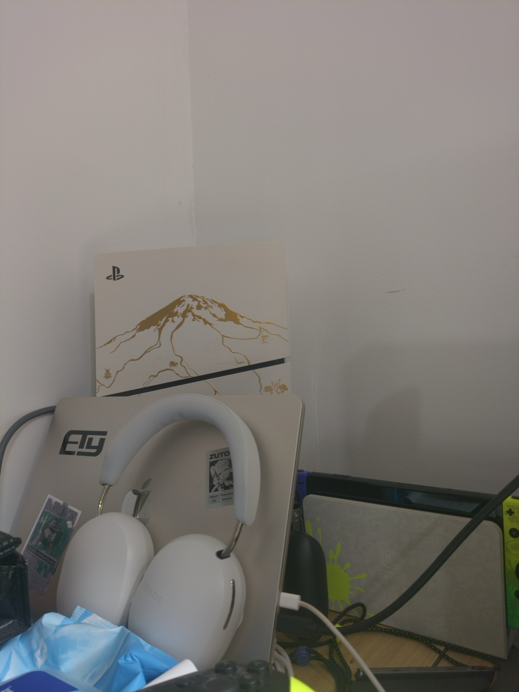

**P1 之后**（`session_check-android`，8 线程纯 CPU，同一套原生代码）：

| 素材 | 模式 | 总计 |
|---|---|---|
| main8（16MP × 8） | 经典 RCD | 1.46 s |
| main8 | 经典 RCD + Ultra HDR | 1.75 s |
| main8 | 经典 MHC | 1.37 s |
| t_br（8MP × 6，包围） | 经典 RCD | 0.69 s |
| uwnoisy16（8MP × 16） | 频域 + 夜景风格 | 1.56 s |
| uw8（8MP × 8） | 核回归 + LCA + Pixel 风格 | 1.40 s |

App 实拍（主摄 16MP × 8 帧，纯 CPU，含快速预览、DNG 写出和 JPEG 写出）：

| 设置 | 管线日志 | 总计 |
|---|---|---|
| 自动，Pixel 风格，Ultra HDR | classic/spatial/rcd，最大增益 1.50×，增益图 22 KB | 2.82 s |
| 包围曝光，Pixel 风格，Ultra HDR | 增益 1, 1, 0.25…，最大增益 1.64× | 2.97 s |
| 夜景，Ultra HDR | classic/freq/rcd，175 ms / ISO 50 | 2.96 s |
| 核回归，16 帧，标准风格 | kr | 6.37 s |

**P0 之后**（GPU，标定噪声，从对焦锁定到 JPEG）：4 帧 1.41 s、8 帧 1.68 s、16 帧 2.29 s（7.1 节）；管线本身 8 帧 916 ms。72 种设置组合的出片时间见 [`VALIDATION.md`](VALIDATION.md#附录-b全部组合指标)（P0 之前的版本）。

---

## 8. 许可证

PocoPaw 以 GPL-3.0 发布。

| 组件 | 许可证 | 位置 |
|---|---|---|
| librtprocess（RCD、AMaZE） | GPL-3.0 | 原型与 App |
| libultrahdr、libjpeg-turbo | Apache-2.0 / MIT；IJG / BSD-3 / zlib | 原型与 App（静态库） |
| stb_image_write | MIT / 公有领域 | 原型与 App |
| hdr-plus-swift | GPL-3.0 | 只作频域合并参考，未复制代码 |
| Handheld Multi-Frame SR（IPOL 2023） | MIT | 核回归合并的移植来源 |
| C5（官方权重） | Apache-2.0 | 仅原型 `pipeline/tools/third_party/C5` |
| PMRID（官方权重） | Apache-2.0 | 仅原型 |
| SimpleCube++ 数据集 | CC BY 4.0 | 仅原型训练（不随仓库分发） |

---

## 9. 复现

```bash
cd ~/Documents/Poco-F5-RAW-Report/pipeline
./build.sh                                               # burstpipe-mac / burstpipe-android
bin/burstpipe-mac data/main8 --demosaic rcd --look pixel --ultrahdr -o out.jpg
bin/burstpipe-mac data/t_br --demosaic rcd               # 包围：自动选最短曝光为参考
bin/burstpipe-mac data/uwnoisy16 --look night            # 夜景：频域合并 s2
bin/burstpipe-mac data/uw8 --kr --lca auto --scale auto  # 核回归 + LCA + 自动 2x
bin/burstpipe-mac data/main8 --noise-cal auto --dng out.dng -o out.jpg   # 标定噪声 + 合成 DNG
python3 tools/awb_eval.py data/main8 data/uw8 ...        # AWB 对比
python3 tools/ffcc.py train-cube /path/SimpleCube++ calib/ffcc_cam0.npz --to-camera data/main8
python3 tools/pmrid_finetune.py train /path/SimpleCube++ calib/pmrid_poco_uw.ckp --camera data/uw8
python3 tools/pmrid_finetune.py eval-real data/uwnoisy16 /tmp/PMRID/models/torch_pretrained.ckp calib/pmrid_poco_uw.ckp --merged <dir>
python3 tools/pmrid_gate.py ...                          # PMRID 门控与混合曲线（P0）

# App 源码对拍（Mac 或手机）
tools/build_session_check.sh                             # 同时把 gpu/ 与 third_party/opencl/ 同步进 App
tools/gpu_check.sh                                       # GPU 对 CPU 的 PSNR 与耗时
```

实拍素材的拉取、标定和真值评测命令见 [`VALIDATION.md`](VALIDATION.md#4-复现)。
