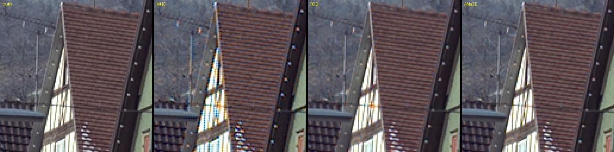
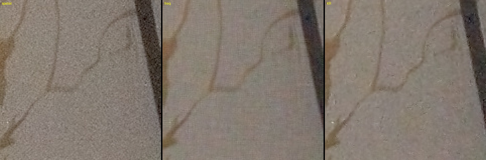
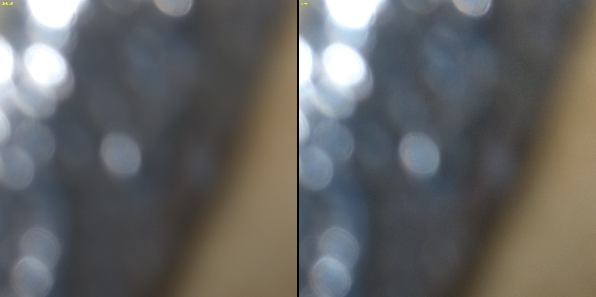
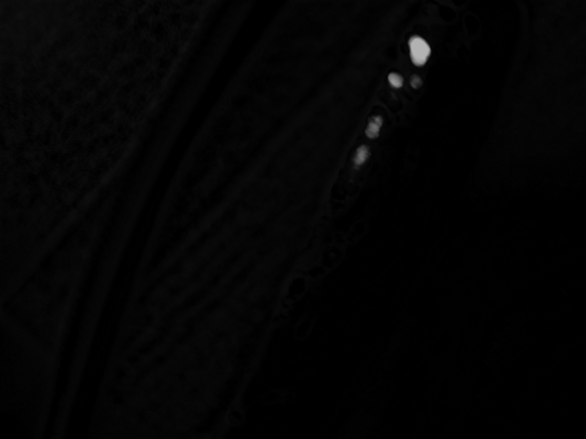
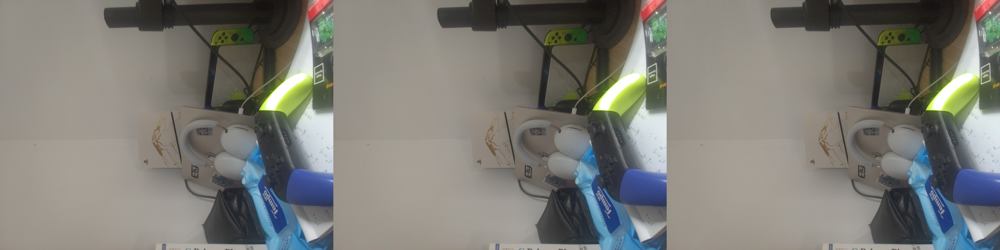
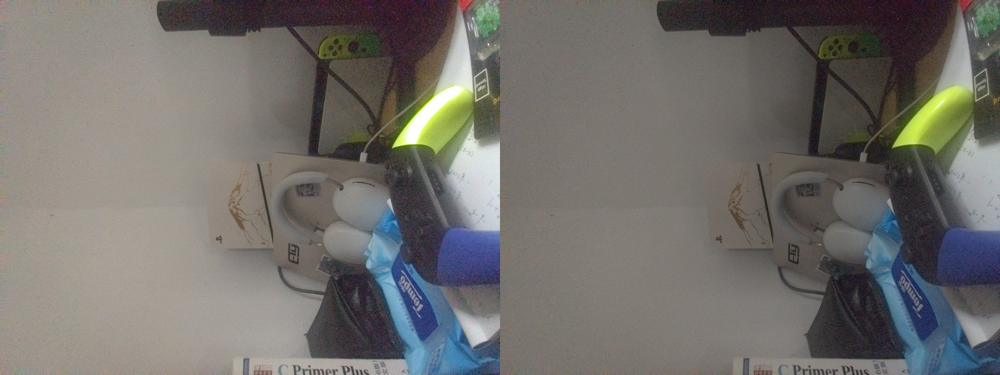
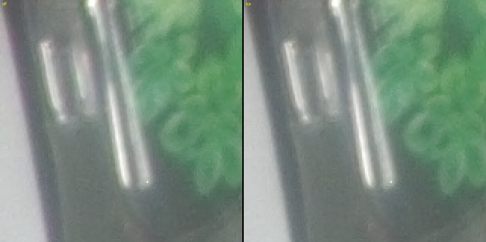
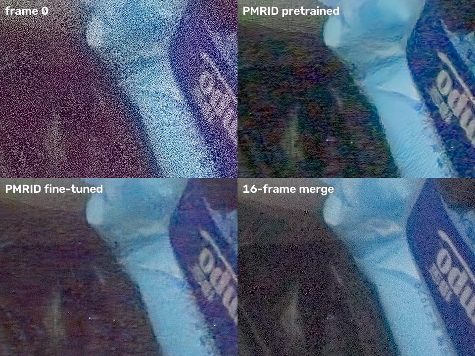
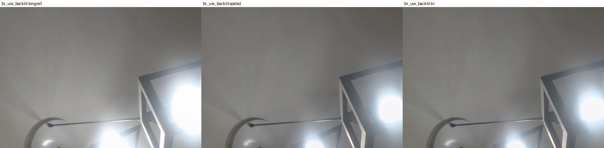
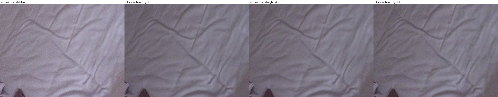

# P1 图像管线功能：原型实现、实测与 PocoPaw 集成

- 日期：2026-11-01
- 设备：Redmi Note 12 Turbo / Poco F5（marble），Snapdragon 7+ Gen 2，所有耗时都是手机 8 线程纯 CPU 实测（Mac 负载重，计时不可信）
- 前置报告：[`PIPELINE_REPORT.md`](PIPELINE_REPORT.md) 第 8 节 P1 表、[`ALGORITHM_UPGRADE.md`](ALGORITHM_UPGRADE.md) 第 6 节路线图
- 原型：[`pipeline/`](../../../pipeline/)（`burstpipe` 命令行，C++17）与 `pipeline/tools/`（Python 实验脚本）；逐项原始记录在 [`pipeline/out/p1/RESULTS.md`](../../../pipeline/out/p1/RESULTS.md)
- App：[`app/src/main/cpp/burstpipe/`](../../app/src/main/cpp/burstpipe/)（原生管线）与 [`app/src/main/java/com/izum1k/pocopaw/pipeline/`](../../app/src/main/java/com/izum1k/pocopaw/pipeline/)（曝光规划、阶段、设置）

> 本文复制自研究工作区 `Poco-F5-RAW-Report/`。文中的 `pipeline/`、`data/`、`bin/` 都指该工作区下的原型、工具和素材，不在 PocoPaw 仓库内；图片已复制到 `images/p1/`。

## 0. 结论摘要

P1 两份路线图里的全部条目都已在原型中实现并测量，纯 CPU 的部分择优接入了 PocoPaw；学习式模块（C5、FFCC、PMRID）按约定只做原型。

| 条目 | 原型 | App | 关键结果 |
|---|---|---|---|
| 常驻线程池 + 核回归 NEON | 完成 | 已接入 | 超广角 8MP 核回归 1x：合并 1600 → 683 ms，总计 3.05 → 1.49 s |
| RCD / AMaZE 去马赛克 | 完成 | 已接入，默认 RCD | Kodak 8 张：MHC 29.7 dB、RCD 32.8 dB、AMaZE 33.7 dB；16MP 耗时 49 / 160 / 681 ms |
| 频域合并 | 完成 | 已接入（夜景模式） | 高噪声 16 帧：残余噪声 σ 0.00305（空间域）→ 0.00089（频域 + 空间收缩 2） |
| 亚像素多样性 / 自动 2x | 完成 | 未接入（2x 内存约 600 MB） | 静止连拍得分 0.000，手持连拍 0.750，阈值 0.3 能干净区分 |
| Pixel 风格 | 完成 | 已接入（设置“风格”） | 亮度与 ISP 成片一致（L* 54.8 对 55.6），局部对比 +25–30% |
| Ultra HDR 增益图 | 完成 | 已接入（设置开关） | 主摄最大增益 2.3–2.6×，增益图 20–45 KB，手机端约 0.3 s |
| 手持与运动 | 完成 | 已接入 | 运动掩膜膨胀 1：鬼影 0.453 → 0.374，残余噪声只增 3% |
| 包围曝光 | 完成 | 已接入（场景“包围曝光”） | 合成包围：高光 259.1 对 259.1 DN；实拍 App 端 16MP×8 帧 3.0 s |
| 夜景模式 | 完成 | 已接入（场景“夜景”） | 陀螺仪运动测光；桌面放置时选 175 ms / ISO 50；App 端 16MP×8 帧 3.0 s |
| 横向色差（LCA） | 完成 | 已接入（超广角，核回归） | 超广角中径残余色差 0.2–0.35 px → 0.0–0.1 px，合并耗时 +5% |
| 学习式 AWB（C5、FFCC） | 完成 | 不接入（约定） | 与 HAL 差距：C5 中位 2.1°（高噪声素材 10°）；FFCC 受 Cube++ 日光先验影响偏蓝 5°，去先验 2.4°；C5 手机推理 5 ms；需灰卡素材定结论 |
| PMRID 本机微调 | 完成 | 不接入（约定） | 合成训练对微调：真实高噪声帧 53.83 → 54.50 dB（估计对干净真值 58.9 → 61.6 dB） |

**实拍验证**（第 14 节，2026-11-03）：已用 13 组 P1 素材完成噪声标定、64 帧真值评测、LCA、包围、夜景和两组灰卡 AWB。频域合并对真值比空间域高 0.7–2.6 dB；PMRID 官方权重好于两版微调；标定噪声表和主摄 LCA 暂不接入 App（标定噪声表已在 P0 接入，见 [`P0_REPORT.md`](P0_REPORT.md) 第 1 节）；P1 拍摄页修复了 64 帧分段重开后失焦的问题，并按主摄 ISO 上限 876 调整了档位。运动组和其余灰卡组还没拍，补拍清单在 [`pipeline/CAPTURE_P1.md`](../../../pipeline/CAPTURE_P1.md) 末尾。

---

## 1. 常驻线程池与核回归 NEON

- `parallel_for` 原来每个并行区都新建线程，手机上每个阶段要多花几毫秒；改为常驻线程池（调用线程也参与，嵌套区内联执行）。
- 核回归合并的累加改为 NEON：四个 Bayer 相位放在 SIMD 通道里，核权重与流场按块缓存；LK 细化共享参考帧梯度。

| 超广角 uw8，核回归 1x | 之前 | 之后 |
|---|---|---|
| LK 细化 | 282 ms | 51 ms |
| 合并 | 1600 ms | 683 ms |
| 总计 | 3052 ms | 1494 ms |

主摄手持 hh_main8 核回归 1x 总计 5.8 → 2.9 s；超广角 2x 8.8 → 4.5 s；经典路径主摄 2.4 → 1.6 s。NEON 与标量结果的 JPEG 最大差 5 级，0.014% 像素不同（浮点求和顺序）。

## 2. 去马赛克：RCD / AMaZE

从 librtprocess（GPL-3，与本仓库许可证一致）引入 RCD 与 AMaZE，按水平条带并行。

| | MHC | RCD | AMaZE |
|---|---|---|---|
| Kodak 8 张 PSNR / 伪色 | 29.67 dB / 38.8 | 32.76 dB / 26.5 | 33.68 dB / 23.6 |
| 对 ISP JPEG（2x 缩小）PSNR / 伪色 | 37.89 / 13.8 | 37.68 / 13.3 | 38.41 / 12.1 |
| 手机 16MP 耗时 | 49 ms | 160 ms | 681 ms |

MHC 在高频纹理上有明显拉链和伪色（`pipeline/out/p1/cmp_demosaic_kodim08.jpg`）。**决定**：App 经典路径默认 RCD（多 110 ms），AMaZE 作为可选项保留在原生接口里。



## 3. 频域合并

按 HDR+ 论文第 5 节实现成对 Wiener 合并（`merge_freq.cpp`）：16×16 半重叠正弦窗，四个 Bayer 平面放在 SIMD 通道里，可选对合并后频谱做空间收缩。

- 正确性：`c → ∞` 时与普通均值一致（σ 0.00303 对空间域 0.00305）。
- 空间收缩要四个平面共用增益，否则会出现迷宫纹。
- 高噪声 uwnoisy16（超广角 16 帧，2 ms 快门，ISO 800）：空间域 σ 0.00305；频域 s=1 0.00135；s=2 0.00089；s=4 0.00054（开始抹细节）。
- 普通光照下频域合并让文字略软，所以只在夜景模式使用（`c=64`、`s=2`）。手机耗时：超广角 8MP 合并 0.32 s，主摄 16MP 0.62 s。



## 4. 亚像素多样性与自动 2x

原来的“相位覆盖率”在静止连拍上也有 0.7 以上（LK 噪声本身就会填满相位格），区分不了手持和静止。新指标 `subpixel_diversity`：

1. 由 LK 的 Hessian 最小特征值和噪声模型得到每块位移的标准误差；只用所有帧误差都小于 0.1 灰度像素的块。
2. 每块计算各帧位移的稳健离散度（中位绝对偏差），减去 3 倍估计误差后归一化，再乘以半像素相位格的覆盖比例。

| 连拍 | 得分 | 可信块比例 | 离散度（raw px） |
|---|---|---|---|
| uw8（静止） | 0.000 | 0.14 | 0.26 |
| main8（静止） | 0.000 | 0.12 | 0.42 |
| t_night（放在桌上） | 0.000 | 0.37 | 0.35 |
| hh_uw8（手持） | 0.750 | 0.09 | 7.84 |
| hh_main8（手持） | 0.750 | 0.09 | 7.36 |
| uwnoisy16（手持） | 0.750 | 0.15 | 8.89 |

`--scale auto` 在得分 ≥ 0.3 时用 2x。App 暂不接入 2x：主摄 2x 的浮点 RGB 约 600 MB。

## 5. Pixel 风格

`--look pixel`：目标亮度 0.22、压缩比 6、对比 0.26、饱和度 1.24、锐化 0.9、局部对比 0.6（1/4 分辨率快速引导滤波）、白平衡略偏冷 0.025、天空蓝饱和度 ×1.18 / 色相 −4°、肤色饱和度 ×0.92 / 色相 +3°（不用三角函数的 CbCr 窗口）。

| 1024 px 宽，L* 均值 / 局部对比 / 色度 / b* | ISP | 默认 | Pixel |
|---|---|---|---|
| main8 | 55.6 / 1.16 / 11.2 / 8.3 | 52.3 / 1.02 / 11.0 / 7.9 | 54.8 / 1.25 / 11.9 / 7.8 |
| hh_uw8 | 56.9 / 2.69 / 7.9 / 3.4 | 52.0 / 1.30 / 6.2 / 3.6 | 57.1 / 1.71 / 6.3 / 2.9 |

亮度与 ISP 一致、色调更冷、局部对比比默认高 25–30%（ISP 的锐化仍更重）。风格阶段手机耗时从最初 458 ms 优化到 209 ms。



## 6. Ultra HDR

- HDR 版本：CCM 之后的场景线性亮度 × 色调映射的长曝光增益（1.0 = SDR 白），1.0 以上软肩部压到 headroom（默认 4）。
- 增益图自己算：1/4 分辨率单通道，`(Y_hdr + 1/64) / (Y_sdr + 1/64)`，只作用于 SDR 显示亮度 0.35–0.75 以上（smoothstep），对数域 3×3 平滑，灰度 JPEG q90。
- 容器用 libultrahdr API-4（压缩底图 + 增益图 + 元数据），同时写 XMP（hdrgm）和 ISO 21496-1。最大增益低于 1.05× 时不写增益图，退回普通 JPEG（室内无高光的场景）。
- 用 `ultrahdr_app` 解码验证：main8 HDR 亮度最大 2.67、SDR 1.00，提亮只落在高光上（`pipeline/out/p1/uhdr_main8_boost.png`）。
- 最大增益：main8 2.3–2.6×、uw8 1.83×、hh_uw8 1.68×。正常曝光的连拍在 RAW 里就已经剪切，headroom 受限；−2 EV 包围能提高。
- App 端：系统 `ExifInterface` 只重写主图的 EXIF 段，增益图原样保留；实拍文件的 MPF 偏移校验正确。



## 7. 手持与运动

- 空间域合并改为逐帧“鲁棒性图 → 膨胀 → 累加”，与核回归共用 `MergeOpts` 和 `frame_weight`（两帧噪声相加的 z 检验）；`--motion-dilate R` 是鲁棒性图上的最小值滤波。
- 合成运动：`tools/synth_motion.py` 把一块纹理（对比度 ×1.6 / ×1.15）以每帧 40–56 px 的速度贴进真实连拍；`tools/ghost_eval.py` 在轨迹上测鬼影。

| hh_main8 空间域，高对比运动块 | 鬼影均值 | p99 | 合并权重 | 残余 σ |
|---|---|---|---|---|
| 阈值 3–6，膨胀 0 | 0.509 | 1.75 | | |
| 阈值 2–4.5，膨胀 0 | 0.453 | 1.25 | 0.971 | 0.00103 |
| **阈值 2–4.5，膨胀 1** | **0.374** | **1.0** | 0.888 | 0.00106 |
| 阈值 1.5–3，膨胀 1 | 0.320 | 1.0 | 0.675 | 0.00120 |

调高阈值鬼影反而变多；三脚架素材上所有设置的鬼影都不高于静止基线。**决定**：保持阈值 2 / 4.5，两条合并路径都默认膨胀 1。

## 8. 包围曝光

- 参考帧取最短曝光（保高光）；其余帧在黑电平以上按 `e_max / e_k` 放大到 uint16，参考帧白电平相应提高；噪声模型用与参考帧同曝光的帧估计。
- 每帧权重：z 检验用 `var_ref + (g·a·s + g²·b)`，再乘曝光的逆方差权重；该帧中达到 0.98 白电平的样本权重为 0，再做膨胀。空间域和核回归都支持；频域合并不支持曝光加权，包围时自动退回空间域。
- t_br（桌面，66 ms × 4 + 27.5 ms × 2，比 4.03）：增益 0.248，白电平 1023 → 3931；可见噪声 σ：包围空间域 0.0068、包围核回归 0.0053、以长帧为参考 0.0073。
- 合成包围（uw8 中 2/3 帧 +2 EV 并剪切）：高光均值 259.1 对 259.1 DN，相对误差 1.9%（中间调噪声 2.3%），没有洋红或发灰的高光。
- App：`BurstExposure.bracket` 每 3 帧中 2 帧 −2 EV、1 帧 0 EV（`ExposurePlan.PerFrame`）；原生会话自动选最短曝光为参考。实拍主摄 8 帧：增益 1, 1, 0.25, …，总计 3.0 s。



## 9. 夜景模式

- 运动测光：取景时读陀螺仪 RMS 角速度，乘焦距（像素），在模糊预算 1.5 px（有 OIS 时 ×4）内取最长快门，限制在 33–333 ms（probe 为 500 ms），在测光曝光（0 EV）下换算 ISO。
- 夜景风格：目标亮度 0.11、压缩比 4、对比 0.18、饱和度 1.05、锐化 0.4、局部对比 0.15、色度降噪 ×1.6；并选择频域合并 + 空间收缩 2。
- uwnoisy16 可见噪声 σ：默认 0.0253；夜景风格 + 空间域 0.0155；+ 频域 s1 0.0064；**s2 0.0042**；s4 0.0026（抹细节）；核回归 0.0092（2.8 s）。
- App 实拍（手机放在桌上）：选了 175 ms / ISO 50，频域合并，16MP × 8 帧总计 3.0 s。



## 10. 横向色差（LCA）

- 模型：通道 X 在 `p + (p − c)(k1 + k2 (r/rmax)²)` 处采样；核回归累加时按输出像素平移 R / B 的查询点（NEON 按相位设通道偏移）。
- 标定 `tools/lca_calib.py`：取强径向 G 边缘，对局部归一化的 R / B 与 G 做径向 LK，修剪加权最小二乘；r/rmax > 0.7 的块不足 8 个时不拟合三次项。
- 超广角（uw8 + hh_uw8 合并拟合）：kr +0.000471 / −0.000348，kb +0.000096 / +0.000372（中径 R +0.39 px、B +0.19 px，角上 B +0.96 px）。主摄中径 R +0.08、B +0.15 px，低于每块噪声（拟合 rms 0.24–0.31 px）。
- 校正后中径残余：hh_uw8 +0.25 / +0.18 → +0.01 / +0.03 px；uw8 +0.28 / +0.36 → −0.10 / −0.01；uwnoisy16（不在标定集内）+0.16 / +0.18 → +0.01 / +0.10。合并耗时 +4–5%。
- **决定**：超广角自动启用（App 中 `LensCalibration`）；主摄要等 `lca_main` 标定板素材。



## 11. 学习式 AWB：C5 与 FFCC

两个模型都只做原型（Python），App 仍用 HAL 的 AsShotNeutral。

- **C5**（`tools/awb_c5.py`）：官方跨相机权重（NUS + Gehler-Shi 的单反数据训练，对 Poco 的两颗传感器都是没见过的相机），m = 7：查询图加上同一摄像头的其它连拍作为无标签附加直方图。参考代码依赖已移除的 `torch.rfft`，FFT 卷积和 softmax 改在 numpy 中做，ONNX 只含编码器 / 解码器（2.0 MB）。手机端 `ort_run`：1 线程 9 ms，4 线程 5 ms。
- **FFCC**（`tools/ffcc.py`）：用 Python 重写（对数色度直方图 + 局部偏差直方图，FFT 卷积，偏置 B 即光源先验），在 SimpleCube++（Canon 550D，训练 1772 / 测试 462 张）上训练。要用到 Poco 上，先把 Cube++ 的原始 RGB 映射到 Poco 相机空间：D65 的 raw-to-raw 矩阵，再按每张图光源的相关色温（McCamy），在 colorTransform1（D65）和 colorTransform2（A）之间插值，做一次对角校正，让每个光源落在 Poco 看到它的位置。

**Cube++ 测试集**（角误差，度）：

| 模型 | 均值 | 中位数 |
|---|---|---|
| FFCC，Canon 原生空间 | 2.49 | 0.89 |
| FFCC，映射到主摄（只用 D65 矩阵） | 1.32 | 0.70 |
| FFCC，映射到主摄（按光源插值，采用） | 1.91 | 0.64 |
| 灰度世界（映射后） | 2.66 | 1.69 |
| Shades of gray（映射后） | 2.83 | 1.10 |

**Poco 素材与 HAL 估计的一致性**（还没有灰卡素材，下表不是精度，只是和 HAL 的差距；HAL 的估计都落在 Poco 白点轨迹上约 4100–4400 K，偏离 < 1°）：

| 方法 | 均值 | 中位数 | 最差 |
|---|---|---|---|
| 灰度世界 | 1.02 | 0.98 | 1.98 |
| C5 | 3.27 | 2.14 | 10.10（uwnoisy16） |
| Shades of gray | 3.80 | 2.96 | 7.48 |
| FFCC | 5.18 | 5.60 | 5.82 |
| FFCC，去掉光源先验 B | 2.38 | 2.39 | 3.66 |

- FFCC 在每段素材上都比 HAL 偏蓝约 5°。Cube++ 几乎都是户外日光，学到的先验 B 把室内暖光（约 4300 K）拉向日光；去掉 B 后差距降到 2.4°。映射本身是一致的：插值后的日光白点与 HAL 在日光下差 0.36°。
- C5 在大多数素材上与 HAL 相差约 2°；在 uwnoisy16（ISO 800、2 ms，噪声很大）上差 10°，跨相机模型对高噪声直方图不稳。
- 这些素材都是室内光、场景单一，灰度世界与 HAL 吻合得最好，并不能说明它更准。

**决定**：两个学习式模型都没有比 HAL 更可信的证据，App 不接入。等 `awb_*` 灰卡素材拍完，`awb_eval.py` 会自动改用灰卡真值（`<burst>/awb_gt.json`）；届时再判断 C5 是否值得用，以及 FFCC 是否要用 Poco 自己的数据重新学习先验 B。

## 12. PMRID 本机微调

计划用三脚架 64 帧平均作真值，`tp_*` 素材还没拍。所以先用 SimpleCube++ 的干净原始图作信号源，用 Poco 的噪声模型合成训练对（`tools/pmrid_finetune.py`）。

- **数据**：Cube++ 训练集映射到超广角相机空间（`camera_map`），按 Poco 的 RGGB 重新马赛克，随机缩放亮度。噪声按 `var = k·x + b`（DN）合成：k 在 [0.05, 12] 内取对数均匀分布（覆盖超广角 ISO 50–3200，k ≈ 0.0026–0.0035·ISO），b = 0.3 + 0.5k²。输入用 PMRID 原版的 k-sigma 变换，统一到它的锚点噪声。
- **训练**：从官方权重开始，Adam lr 1e-4（余弦衰减）、L1、batch 16 × 256²，2000 次迭代，Mac MPS 约 20 分钟。只训练 20 次的试跑在真实数据上反而变差（51.26 dB 对 53.83 dB），完整训练后才有收益。
- **合成测试**（Cube++ 测试集，同一噪声模型，PSNR dB）：

| k（DN） | 带噪 | 预训练 | 微调 |
|---|---|---|---|
| 0.3 | 43.68 | 43.68 | **45.87** |
| 1 | 38.18 | 41.20 | **42.00** |
| 3 | 33.33 | 38.73 | 38.78 |
| 8 | 29.36 | **36.45** | 36.22 |

- **真实测试**（uwnoisy16，ISO 800 / 2 ms，噪声估计 k = 2.78、b = 1.17）：以 16 帧合并（有效帧数 14.3）为伪真值评估第 0 帧。伪真值本身也有残余噪声，"估计"一列按 `var_gt = mean(k·ref + b) / neff` 扣掉这部分，换算成相对干净真值的 PSNR。

| | PSNR | 估计（对干净真值） |
|---|---|---|
| 带噪第 0 帧 | 43.16 | 43.43 |
| 预训练 | 53.83 | 58.93 |
| **微调** | **54.50** | **61.62** |

- 低噪声端提升最大：预训练模型在 k = 0.3 时几乎不起作用，与输入相同。高噪声端（k = 8）略差 0.2 dB，说明训练分布在高 ISO 端偏少。成片上，微调版暗部的大块色斑和"油画感"比预训练少，平坦区域更干净；与 16 帧合并相比仍有涂抹。



**决定**：微调权重 `pipeline/calib/pmrid_poco_uw.ckp` 优于官方权重，`pmrid_denoise.py --weights` 可直接使用。按约定只留在原型，App 不引入 ONNX Runtime。拍到 `tp_*` 后，用真实 64 帧真值复核，并补主摄的权重。

## 13. PocoPaw 集成

**移植方式**：原型的 `align`、`merge`、`merge_freq`、`kr`、`demosaic`、`finish`、`ultrahdr` 与 App 中的文件**逐字节相同**。差异只在：

- `common.h`：App 的 `Raw` 是相机缓冲区的只读视图；包围曝光需要改写样本时 `make_writable()` 先复制一份。
- `burst.*`、JNI、`pool.cpp`：会话接口与内存池。
- 第三方：librtprocess（源码）、libultrahdr + libjpeg-turbo（arm64 预编译静态库）、stb_image_write。

`pipeline/tools/session_check.cpp` 用 App 的源码处理 probe 连拍。与原型命令行对比，5 种模式的 JPEG 最大差 ≤ 1 级（抖动），即结果一致：经典 RCD、包围曝光、夜景频域合并、核回归 + LCA + Pixel 风格、Ultra HDR。

**设置与模式**：

| 设置 | 选项 | 作用 |
|---|---|---|
| 场景 | 自动 / 包围曝光 HDR / 夜景 | 曝光规划（`BurstExposure.plan / bracket / night`）；夜景还会切到频域合并和夜景风格 |
| 风格 | 标准 / Pixel 风格 | `LookParams` 预设 |
| Ultra HDR | 开 / 关 | 输出带增益图的 JPEG |
| 处理方式 | HDR+ 合并 / 核回归 | 经典路径默认 RCD；核回归在超广角上自动校正 LCA |

**手机端耗时**（`session_check-android`，8 线程，同一套原生代码）：

| 素材 | 模式 | 总计 |
|---|---|---|
| main8（16MP × 8） | 经典 RCD | 1.46 s |
| main8 | 经典 RCD + Ultra HDR | 1.75 s |
| main8 | 经典 MHC | 1.37 s |
| t_br（8MP × 6，包围） | 经典 RCD | 0.69 s |
| uwnoisy16（8MP × 16） | 频域 + 夜景风格 | 1.56 s |
| uw8（8MP × 8） | 核回归 + LCA + Pixel 风格 | 1.40 s |

**App 实拍**（主摄 16MP × 8 帧，含快速预览、DNG 写出和 JPEG 写出）：

| 设置 | 管线日志 | 总计 |
|---|---|---|
| 自动，Pixel 风格，Ultra HDR | classic/spatial/rcd，最大增益 1.50×，增益图 22 KB | 2.82 s |
| 包围曝光，Pixel 风格，Ultra HDR | 增益 1, 1, 0.25…，最大增益 1.64× | 2.97 s |
| 夜景，Ultra HDR | classic/freq/rcd，175 ms / ISO 50 | 2.96 s |
| 核回归，16 帧，标准风格 | kr | 6.37 s |

没有接入 App 的：核回归 2x 与自动 2x（内存）、AMaZE 的设置项（接口已支持）、学习式模块（C5、FFCC、PMRID，按约定只做原型）。

## 14. 实拍验证

2026-11-03 用 PocoPaw 的 P1 拍摄页拍了 13 组素材（`pipeline/data/p1/<名称>/`，格式与 probe 相同），逐组检查用 `tools/p1_check.py`，原始数字在 `RESULTS.md` 的 “real P1 captures” 之后几节。

### 14.1 素材情况与拍摄页问题

- 主摄 HAL 的 ISO 上限是 876：`tp_main_iso3200` 实际是 ISO 876 / 1.25 ms，`dk_main` 的 1600–6400 三档都被钳到 876。P1 拍摄页已改成 `tp_main_iso400` 和暗场 100 / 200 / 400 / 800 / 876，另加一组明亮场景 `tp_main_bright`。
- **64 帧三脚架组后 8 帧失焦**：一次打开相机最多 65 个 RAW 请求，拍摄页把 64 帧拆成 56 + 8 两次拍摄，中间重开相机丢了对焦锁定。第 56–63 帧的 G 平面梯度从 10.80 降到 10.37。已修复：后续分段关掉 AF，沿用第一段的对焦距离，`meta.json` 逐帧记录对焦距离。修复后在手机上补拍一组验证，64 帧对焦距离都是 1.799 D，梯度 14.81–14.84，第 55/56 帧前后没有变化。本节的真值只用前 56 帧。
- 场景偏暗：三组三脚架素材 p99 只有 18–138 DN（满量程约 960）；夜景组单帧信号只比黑电平高 2–20 DN，预览 AE 已顶到 30 ms / ISO 876；包围组拍的是暗房里的台灯，灯泡在 −2 EV 帧里也剪切。

### 14.2 噪声标定

`tools/noise_calib.py` 用 `dk_main` 求暗场参数，用 56 帧对齐均值作真值、帧对差分拟合 `var = k·S + b`（DN）：

| ISO | 读出噪声 DN | 热像素 | 标定 k / b | 管线自估 k / b |
|---|---|---|---|---|
| 100 | 0.58 | 42 | 0.120 / 0.49 | 0.114 / 0.34 |
| 400 | 1.34 | 274 | — | — |
| 800 | 2.17 | 1691 | 0.987 / 5.28 | 0.787 / 3.40 |
| 876 | 2.38 | 1566 | 1.247 / 5.36 | 1.123 / 2.81 |

各档黑电平比元数据的 64 高 0.20–0.26 DN（`meta.json` 把动态黑电平取整了），行噪声和列固定噪声都在 0.1 DN 以下。管线自估的 k 偏低 5–20%、b 偏低 30–50%；手持素材上 b 要么卡在下限 0.25，要么被对齐残差撑大（包围组 b = 8）。

换成标定噪声的效果不一致：三脚架真值 PSNR 只高 0.0–0.26 dB；手持夜景 `nt_main_hand` 的可见噪声 0.0047 → 0.0032；但手持包围的平均权重从 0.91 掉到 0.47，噪声反而增加 60%。原因是鲁棒性阈值是按自估模型调的。所以 **App 暂不接入标定表**，等 `mo_*` 素材到了再分路径调整阈值。（2026-11-03 更新：P0 给标定模型单独设了阈值 1.75 / 3.9，手持包围权重回到 .934，主摄已接入，见 [`P0_REPORT.md`](P0_REPORT.md) 第 1 节。）

### 14.3 合并与 PMRID：64 帧真值

`tools/p1_truth_eval.py`，RAW 域 PSNR（dB），8 帧合并对 56 帧真值（ISO 100 对 16 帧）：

| 方法 | ISO 100 | ISO 800 | ISO 876（−4 EV） |
|---|---|---|---|
| 单帧 | 53.25 | 47.64 | 50.54 |
| 空间域 | 56.32 | 54.07 | 59.40 |
| 频域 s1 | 57.06 | 55.13 | 61.58 |
| 频域 s2 | 57.09 | 55.22 | 61.98 |
| PMRID 官方（单帧） | 56.46 | 54.77 | 62.72 |
| PMRID 超广角微调 | 55.99 | 53.91 | 61.53 |
| PMRID 主摄微调 | 56.00 | 53.85 | 61.56 |

频域合并比空间域高 0.7–2.6 dB，确认夜景用频域是对的。PMRID 官方权重单帧就接近 8 帧空间域合并，在 ISO 876 还比频域 s2 高 0.7 dB。两版微调（Cube++ 合成噪声对，主摄版按标定 b 设了噪声范围）在主摄上都比官方低 0.5–1.2 dB：合成训练对迁移不到实拍，**保留官方权重**。等有更亮的 `tp_main_bright` 后，可以试着直接用真值做训练对。

### 14.4 LCA

屏幕棋盘格标定（`calib/lca_cam*_checker.json`）：主摄中径 R 约 0、B +0.19 px，但在校正后的核回归成片上复测时，结果和 RAW 拟合对不上，校正还会过冲，**主摄继续不启用**。超广角 B 与现有系数一致（0.20 对 0.19 px），R 只拟合出线性项（中径 0.55 对 0.39 px），**现有系数不变**。

### 14.5 包围曝光

`br_*` 手持，4.9 / 19.6 ms（超广角 12.2 / 48.8 ms），ISO 50：

| | 空间域 | 核回归 | 只用长帧作参考 |
|---|---|---|---|
| 主摄可见噪声 / 权重 | 0.0051 / 0.91 | 0.0044 / 0.91 | 0.0048 / 0.29 |
| 超广角 | 0.0057 / 0.92 | 0.0050 / 0.93 | 0.0050 / 0.29 |

默认以短帧为参考，12 帧都参与合并，长帧在剪切处被拒绝；以长帧为参考时短帧基本被拒，只剩 4 帧长帧（权重 0.29），高光也就跟着长帧剪切。Ultra HDR 两组都达到增益上限 4.0×（普通连拍是 1.7–2.6×），22% 的块被提亮。手机端：主摄空间域 + Pixel + Ultra HDR，CPU 2.58 s、GPU 2.41 s；核回归 3.80 / 2.41 s；GPU 与 CPU 差 76–79 dB。场景是台灯而不是窗前逆光，暗部细节和窗外层次还要补拍验证。



### 14.6 夜景

运动测光：手持选了 33 ms × 30 帧（陀螺仪 0.18 rad/s），靠稳选了 192 ms × 16 帧，两组都看不到运动模糊。可见噪声：

| | 默认风格 | 夜景 s1 | 夜景 s2 | 夜景 s4 | 夜景 + 核回归 |
|---|---|---|---|---|---|
| `nt_main_hand` | 0.0266 | 0.0072 | 0.0047 | 0.0029 | 0.0090 |
| `nt_main_brace` | 0.0152 | 0.0037 | 0.0024 | 0.0015 | 0.0053 |
| `nt_uw_hand` | 0.0554 | 0.0168 | 0.0123 | 0.0084 | 0.0201 |

s4 会把仅有的纹理抹平，**默认仍是 s2**。手机端夜景频域：主摄手持 30 帧 CPU 5.09 s、GPU 4.75 s（16 帧 3.07 / 2.91 s），靠稳 3.15 / 3.06 s，超广角 2.65 / 2.59 s；GPU 与 CPU 差 93–95 dB，远好于 50 dB 的门槛。30 帧耗时超过 5 s；只用 16 帧时噪声 0.0047 → 0.0058，耗时降到约 3 s，App 的夜景帧数上限可以在两者之间权衡。



### 14.7 AWB（初步，2 组）

白纸真值角误差（°）：

| | HAL | 灰度世界 | Shades of Gray | C5 | FFCC | FFCC 去先验 |
|---|---|---|---|---|---|---|
| `awb_warm` | 2.71 | 3.65 | 3.30 | 2.89 | 2.45 | 1.92 |
| `awb_cool` | 5.32 | 6.81 | 4.30 | 0.56 | 0.70 | 5.50 |

`awb_cool` 的白纸确实偏冷，HAL 把它判暖了 5.3°；C5 和 FFCC 都在 1° 以内。两组均值：FFCC 1.57°、C5 1.73°、HAL 4.02°。样本太少，等其余 `awb_*` 到齐再决定。

### 14.8 状态

| 素材 | 状态 |
|---|---|
| `tp_main_iso100/800/3200`、`dk_main` | 已完成标定与真值评测；后 8 帧失焦，需重拍（拍摄页已修复） |
| `lca_main`、`lca_uw` | 已完成，主摄不启用，超广角不变 |
| `br_main_backlit`、`br_uw_backlit` | 流程验证通过；需白天窗前逆光重拍 |
| `nt_main_hand`、`nt_main_brace`、`nt_uw_hand` | 已完成；可补一组不那么极端的夜景 |
| `awb_warm`、`awb_cool` | 已完成初评 |
| `mo_main_wave`、`mo_main_walk`、`mo_uw_street` | 未拍：真实运动下阈值 2 / 4.5 + 膨胀 1 是否够用 |
| `awb_day`、`awb_shade`、`awb_mixed`、`awb_night` | 未拍 |
| `tp_main_bright`、`tp_main_iso400` | 新增项，未拍 |

补拍清单在 [`pipeline/CAPTURE_P1.md`](../../../pipeline/CAPTURE_P1.md) 末尾。

## 15. 许可证

| 组件 | 许可证 | 位置 |
|---|---|---|
| librtprocess（RCD、AMaZE） | GPL-3.0 | 原型与 App |
| libultrahdr、libjpeg-turbo | Apache-2.0 / MIT；IJG / BSD-3 / zlib | 原型与 App（静态库） |
| hdr-plus-swift | GPL-3.0 | 只作频域合并参考，未复制代码 |
| C5（官方权重） | Apache-2.0 | 仅原型 `pipeline/tools/third_party/C5` |
| PMRID（官方权重） | Apache-2.0 | 仅原型 |
| SimpleCube++ 数据集 | CC BY 4.0 | 仅原型训练（不随仓库分发） |

## 16. 复现

```bash
cd ~/Documents/Poco-F5-RAW-Report/pipeline
./build.sh                                               # burstpipe-mac / burstpipe-android
bin/burstpipe-mac data/main8 --demosaic rcd --look pixel --ultrahdr -o out.jpg
bin/burstpipe-mac data/t_br --demosaic rcd               # 包围：自动选最短曝光为参考
bin/burstpipe-mac data/uwnoisy16 --look night            # 夜景：频域合并 s2
bin/burstpipe-mac data/uw8 --kr --lca auto --scale auto  # 核回归 + LCA + 自动 2x
python3 tools/awb_eval.py data/main8 data/uw8 ...        # AWB 对比
python3 tools/ffcc.py train-cube /path/SimpleCube++ calib/ffcc_cam0.npz --to-camera data/main8
python3 tools/pmrid_finetune.py train /path/SimpleCube++ calib/pmrid_poco_uw.ckp --camera data/uw8
python3 tools/pmrid_finetune.py eval-real data/uwnoisy16 /tmp/PMRID/models/torch_pretrained.ckp calib/pmrid_poco_uw.ckp --merged <dir>
# 第 14 节实拍验证
tools/pull_p1.sh                                         # 手机 P1 目录 -> data/p1/<名称>
python3 tools/p1_check.py data/p1/*                      # 逐组质量表
python3 tools/noise_calib.py dark data/p1/dk_main        # 暗场 -> calib/dark_cam0.json
python3 tools/noise_calib.py flat data/p1/tp_main_iso{100,800,3200} --pipeline --out calib/noise_cam0.json
python3 tools/p1_truth_eval.py data/p1/tp_main_iso800 --ckp official=/tmp/PMRID/models/torch_pretrained.ckp main=calib/pmrid_poco_main.ckp
python3 tools/awb_eval.py data/p1/awb_warm data/p1/awb_cool
```
