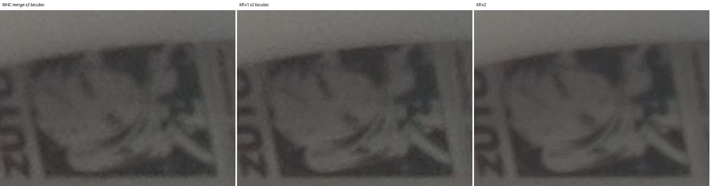
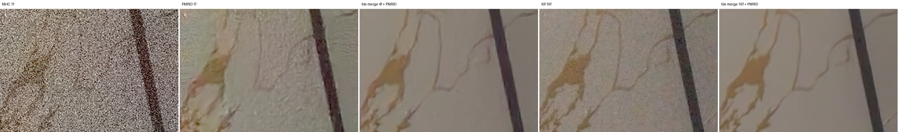
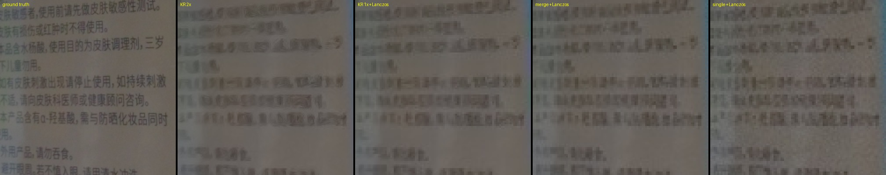

# 多帧 RAW 处理管线：架构调研、算法选型与路线图

> 本文复制自研究工作区（`Poco-F5-RAW-Report/`）根目录的同名文档。`../../../` 开头的链接指向研究工作区，只在完整检出研究工作区时可用。

- 日期：2026-11-01 初稿，2026-11-03 合并更新（P0、P1、GPU、2x 变焦）
- 设备：Redmi Note 12 Turbo / Poco F5（marble），LineageOS，Snapdragon 7+ Gen 2（1×X2 2.92 GHz + 3×A710 2.5 GHz + 4×A510 1.8 GHz），Adreno 725
- 原型：[`pipeline/`](../../../pipeline/)（`burstpipe` 命令行，C++17）与 `pipeline/tools/`（Python 实验脚本）；采集端 [`probe/`](../../../probe/)（`CaptureActivity`）
- App：[`PocoPaw/app/src/main/cpp/burstpipe/`](../../app/src/main/cpp/burstpipe/)（原生管线）与 [`PocoPaw/app/src/main/java/com/izum1k/pocopaw/pipeline/`](../../app/src/main/java/com/izum1k/pocopaw/pipeline/)（阶段、曝光规划、边拍边合并、合成 DNG）
- 相关文档：[`CAMERA_HAL.md`](CAMERA_HAL.md)（HAL 限制，本文的设计约束来源）、[`IMPLEMENTATION.md`](IMPLEMENTATION.md)（逐项实现与手机实测）、[`VALIDATION.md`](VALIDATION.md)（实拍验证与系统相机对比）

本文回答“做什么、为什么这样做、现在做到哪一步”；每个模块怎么实现、实测多少毫秒、怎么取舍，见 [`IMPLEMENTATION.md`](IMPLEMENTATION.md)。标注约定：**[App 已实现]** 指已在 PocoPaw 中运行并在手机上验证，**[仅原型]** 指只在 `burstpipe` 原型中实现，**[未实现]** 指两边都没有做。

## PocoPaw 实现情况（2026-11-03）

- 管线：原型的算法文件（`align`、`merge`、`merge_freq`、`kr`、`demosaic`、`finish`、`dng`、`ultrahdr`、`gpu/`）与 App 中的文件**逐字节相同**；只有 `common.h`（帧是只读 `Raw` 视图）、`pool.cpp`、`burst.*` 和 JNI 是 App 独有的。`pipeline/tools/session_check.cpp` 用 App 的源码处理 probe 连拍，与原型命令行对拍。
- 两条管线：`hdrplus`（分块对齐 + 空间域鲁棒合并 + RCD，默认）和 `hdrplus_kr`（分块对齐 + LK 细化 + 核回归 1x；陀螺仪判定静止时自动退回 `hdrplus`）。
- 设置：场景（自动 / 包围曝光 HDR / 夜景）、风格（标准 / Pixel，夜景固定用夜景风格）、Ultra HDR、处理方式、连拍帧数（4 / 8 / 16）、输出格式（DNG / JPEG / DNG + JPEG）、DNG 内容（合成 / 参考帧）、GPU 加速（默认开）。主摄 1x 胶囊上的 2x 档是中心裁切变焦。
- 加速：对齐、合并（频域合并除外）和后处理默认在 GPU（OpenCL）上运行，任一步失败自动回退到 CPU；GPU 与 CPU 输出差距要求在 50 dB 以上（实测 70 dB 以上）。NPU 只做了可行性探测。
- 速度（主摄 16MP，GPU，室内静态，从对焦锁定到 JPEG）：4 帧 1.41 s、8 帧 1.68 s、16 帧 2.29 s；单一曝光默认边拍边合并，内存与帧数无关。
- 仅原型：核回归 2x 与自动 2x、PMRID（含门控与微调）、C5 / FFCC 白平衡、`--save-merged`。未实现：HDRnet 色调、语义区域、零快门延迟、NPU。

各模块的状态标在第 5 节的选型表和第 13 节的路线图里。

## 0. 结论摘要

1. **Google Camera（HDR+ 系列）和 Adobe Project Indigo 的管线骨架是同一个**：固定或包围曝光的**欠曝 RAW 连拍** → 在 **Bayer 域对齐 + 鲁棒合并**（一张降噪后的“合成 RAW”）→ **传统 RAW 后处理**（去马赛克、色彩）→ **强局部色调映射** → 锐化与风格化。两者的差异主要在“味道”：Pixel 的局部色调映射更重、阴影提得更高、锐度更强；Indigo 更克制，追求“单反感”。
2. 这套骨架的每一级都有**成熟的开源算法**可以纯 CPU 实现。按这个规划写的原型 `burstpipe` 最初在手机上纯 CPU 8 线程处理主摄 16MP × 8 帧要 2.4 s；经过 P1（线程池、NEON）、GPU 和 P0（边拍边合并、低分辨率色调映射、libjpeg-turbo）三轮优化，App 内同样 8 帧从对焦锁定到 JPEG 是 1.68 s，其中管线本身 916 ms。
3. 本机 HAL 的几个限制直接决定了管线设计（第 4 节）：每次打开相机最多 65 个 RAW 请求，所以只能“按下快门再拍连拍”；AE 被防频闪锁在 10 ms，要先测光再换算成低 ISO + 长快门；没有 `noiseProfile`，噪声模型靠自标定或三脚架标定；镜头阴影很重，RAW 域只做 85% 亮度补偿。
4. **合并的较新形态是核回归合并**（Wronski 2019 / IPOL 2023，MIT），去马赛克和合并一步完成，支持 1x 和 2x 输出（第 7 节）。1x 已接入 App；2x 在主摄上收益很小（第 9 节）。
5. **学习式 RAW 降噪 PMRID**（Apache-2.0）效果显著：4 帧合并 + PMRID 约等于 16 帧传统合并，64 帧真值上单帧 PMRID 就接近 8 帧空间域合并（第 8 节）。按约定只做原型，App 不引入推理运行时。
6. **主摄 2x：ISZ（传感器内裁切）第三方用不上**（[`CAMERA_HAL.md`](CAMERA_HAL.md#6-主摄-isz传感器内-2x)），改用“中心裁切 + 多帧合并 + Lanczos 放大”，手机上 0.97 s / 276 MB，噪声和细节都好于系统 ISP 的数码 2x（第 9 节）。
7. **JSR（“World Best”超分）不能接入**：没有许可证、前端闭源、算力需求高约四个数量级；它的几个思路（方差稳定、亚像素多样性、LCA、噪声自适应）已用公开算法实现（第 10 节）。
8. 两份旧路线图的 P0、P1 全部完成，剩余工作见第 13 节：后处理偏粉、超广角噪声标定、运动组补拍、夜景流式合并、HDRnet 风格等。

---

## 1. Google Camera 管线架构（公开资料）

### 1.1 HDR+（Hasinoff et al., SIGGRAPH Asia 2016）

这是 Pixel 所有静态照片模式的基础，论文和开源数据集都已公开。

| 阶段 | 做法 |
|---|---|
| 曝光策略 | 整组连拍**用同一个、偏短的曝光**（宁可欠曝也要保住高光），靠多帧平均把暗部噪声降下来。帧数通常 2 到 8 帧。曝光由一个基于样例库的“HDR 测光”决定，同时给出短曝光和“合成长曝光”的增益。 |
| 零快门延迟 | 取景时 RAW 帧持续进入环形缓冲，按下快门时直接取已经拍好的帧，没有延迟。 |
| 参考帧 | 从前 3 帧中选**最锐利**的一帧做参考（类似“幸运成像”）。 |
| 对齐 | 在 Bayer 2×2 平均得到的灰度图上建 4 级金字塔（下采样倍率 2/4/4），**由粗到细逐块搜索**；块大小 16/16/16/8，搜索半径 1/4/4/4；最细一级用 L1 距离，其它级用 L2。块之间重叠一半。 |
| 合并 | 对每个 16×16 块、每个 Bayer 平面做 **2D DFT，在频域做逐对的 Wiener 式鲁棒合并**：和参考帧差异大于噪声预期的频率分量会被拒收，从而抑制鬼影；块之间用升余弦窗混合。 |
| 后处理（Finishing） | 黑电平 → 镜头阴影校正 → 白平衡 → 去马赛克 → 色度降噪 → 色彩校正 → **局部色调映射（动态范围压缩）** → 去雾 → 全局色调曲线 → 色差校正 → 锐化 → 按色相调整颜色 → 抖动。 |
| 局部色调映射 | 从合并结果生成“短曝光”和“合成长曝光”两张图，用 **Mertens 式曝光融合**在拉普拉斯金字塔里混合。这是 Pixel“阴影提亮、高光不过曝、整体偏平但局部很有对比”的根源。 |

### 1.2 HDR+ with Bracketing（Google AI Blog, 2021，Pixel 5 起）

- 不再固定曝光：先取若干**短曝光**（零快门延迟），按下快门后再补**长曝光**帧。**短曝光帧做参考**（运动冻结得最好，高光也不会丢），长曝光帧用来提升暗部信噪比。
- 合并从频域改为**空间域逐像素合并**（思路接近 Super Res Zoom 的鲁棒性模型），官方称比原先快约 40%，同时能处理不同曝光的帧。
- 这正是本原型选用空间域鲁棒合并的理由。

### 1.3 Night Sight（Liba et al., SIGGRAPH Asia 2019）

- **运动测光**：取景时根据光流估计手持抖动和场景运动，动态决定每帧曝光（最长约 1/3 s 手持、上脚架可到 1 s）和帧数（最多 15 帧）。
- 合并沿用 HDR+ 或 Super Res Zoom 的鲁棒合并。
- **学习式白平衡**：在 FFCC（Fast Fourier Color Constancy，Barron & Tsai 2017）基础上，用夜景数据训练。
- **夜景专用色调映射**：保留“夜晚感”，不会把夜景拉成白天；适度提亮、加对比、压暗部饱和度。

### 1.4 Super Res Zoom（Wronski et al., SIGGRAPH 2019）

- 利用手抖带来的亚像素位移，把多帧 Bayer 数据直接累积到更高分辨率的 RGB 网格上，**同时完成去马赛克和超分**。
- 每个样本用**各向异性核回归**（根据局部结构张量决定核的形状）加权，再乘一个**鲁棒性权重**（和参考帧局部均值、方差的偏差）抑制运动物体。
- Pixel 3 起，变焦和主摄普通拍照都用这套合并（相当于“免去马赛克”）。

### 1.5 Live HDR+ 与 HDRnet（Gharbi et al., SIGGRAPH 2017；Google AI Blog 2020）

- 取景器里的“所见即所得”：用一个小网络在低分辨率预测**双边网格里的局部仿射颜色变换**，再在全分辨率上切片（slice）应用，以此实时逼近 HDR+ 的最终色调。
- 对本项目的启发：**色调映射可以在低分辨率上计算，再用引导上采样（双边网格或引导滤波）应用到全分辨率**。P0 的低分辨率色调映射就是按这个思路做的。

### 1.6 其它（公开资料 + 推测）

- **Ultra HDR**（Android 14+）：SDR JPEG + 增益图（gain map），HDR 屏幕上显示更亮的高光；开源实现 `libultrahdr`。
- **Real Tone**：针对深肤色的 AWB / 曝光 / 色调调优（公开博客，算法细节未公开）。
- **语义分割辅助**（推测，基于 Tensor 时代的宣传和成片观察）：天空、人脸、人像区域用不同的色调、颜色和降噪强度。
- **ML 降噪 / 去马赛克**（推测）：Tensor 芯片上可能有学习式降噪，公开论文不足。本规划不依赖这部分。

### 1.7 “Pixel 风格”的可量化特征（观察与推测）

| 特征 | 对应的管线环节 |
|---|---|
| 高光几乎不过曝，天空保留层次 | 欠曝连拍 + 短曝光参考 |
| 阴影大幅提亮、整体“偏平”，但局部对比强 | 两档合成曝光的曝光融合，压缩比高 |
| 画面干净、暗部噪声低 | 多帧合并 + 色度降噪 |
| 锐利、微对比强（有时被批评“过锐”） | 较强的 USM / 局部对比增强 |
| 颜色偏写实、饱和度适中，白平衡略偏冷 | 色彩矩阵 + 温和的饱和度与色相调整，学习式 AWB |
| 夜景保留“夜晚感” | 夜景色调曲线：目标亮度低于白天 |

---

## 2. Adobe Project Indigo（2025 年 6 月发布，Levoy / Kainz 团队）

根据 Adobe Research 的技术文章：

- **更激进的欠曝 + 更多帧**：普通拍照最多 32 帧，帧数多于常见手机相机，追求更低的噪声和更少的“涂抹感”。
- **零快门延迟**：Photo 模式的参考帧来自按下快门之前的缓冲；Night 模式会用更长的单帧曝光（文章提到可到约 1 s，最多 32 帧，依赖稳定性判断）。
- **前端 / 后端分离**：
  - 前端：RAW 连拍的对齐 + 合并，输出**去马赛克之前的合成 DNG**。这个 DNG 可以直接进 Lightroom 二次编辑。
  - 后端：色调映射、锐化、颜色。默认使用 **Adaptive Color Profile**（AI 生成的“外观”参数，写进 DNG），后端据此渲染。
- **外观**：刻意模仿单反——温和的色调映射、尽量少的降噪涂抹、保留颗粒、不过度锐化；与 Pixel / iPhone 的“重 HDR”形成对比。
- **输出**：SDR JPEG + HDR 增益图（与 Ultra HDR / ISO 21496 同类格式），以及可选 DNG。
- **其它模式**：
  - 2 倍及以上变焦用多帧超分（与 Super Res Zoom 同一类方法）。
  - Long Exposure 模式：不对齐直接平均，模拟慢门的运动模糊效果。

**对本规划的启发**：

1. 前端输出“合成 RAW / DNG”是很好的分层点：前端追求物理正确（降噪、保细节），后端负责风格。Pixel 风格和 Indigo 风格可以**共用前端，只换后端参数**。PocoPaw 的合成 DNG 就是这个分层点（**[App 已实现]**）。
2. 帧数上限 32 与本机 65 请求上限恰好匹配，一次开机内可完成一组 32 帧连拍并留有余量。

---

## 3. 统一的管线模型

```mermaid
flowchart LR
  subgraph Capture[采集]
    A[AE/AWB/AF 收敛<br/>YUV 预览] --> B[测光换算<br/>低 ISO + 长快门]
    B --> C[RAW 连拍 N 帧<br/>+ 元数据]
  end
  subgraph Front[前端：Bayer 域]
    C --> D[参考帧选择]
    D --> E[金字塔块对齐]
    E --> F[噪声模型<br/>标定或自估]
    F --> G[鲁棒合并]
  end
  G --> H[(合成 RAW / DNG)]
  subgraph Back[后端：风格]
    H --> I[黑电平 / LSC / WB]
    I --> J[去马赛克]
    J --> K[色彩矩阵]
    K --> L[色度降噪]
    L --> M[局部色调映射<br/>合成曝光融合]
    M --> N[全局曲线 / 饱和度]
    N --> O[锐化]
    O --> P[JPEG / Ultra HDR]
  end
```



核回归合并把“鲁棒合并”和“去马赛克”合成一步，直接输出线性 RGB（第 7 节）。

---

## 4. 针对本机的设计约束与适配

| 本机事实（见 [`CAMERA_HAL.md`](CAMERA_HAL.md)） | 对管线的影响 | 处理方式 |
|---|---|---|
| 每次打开 `CameraDevice` 最多 65 个 RAW 请求 | 不能常驻 RAW 预览流做零快门延迟环形缓冲（约 2 秒就会触发错误）。单次连拍 ≤ 32 帧没有问题。 | 预览用 YUV 流，按下快门后再发 RAW 连拍；额度不足时先重开设备（约 0.5 s）。若要零快门延迟，可做“RAW 环形缓冲 + 每 60 帧重开设备”，代价是周期性断档。 |
| AE 带 RAW 流时快门被防频闪锁在 10 ms，只调 ISO | 直接用 AE 结果会得到“短快门 + 高 ISO”，不利于多帧降噪。 | 先用 YUV 预览让 AE 收敛，再按 `曝光×ISO×2^ev` 守恒换算成最低 ISO + 更长快门（上限有 OIS 66 ms、无 OIS 33 ms），超过上限再升 ISO。夜景按陀螺仪运动测光决定快门。 |
| 没有 `android.sensor.noiseProfile` | 合并的鲁棒性阈值和降噪强度缺少依据。 | 从连拍残差自标定泊松-高斯噪声模型（48 个亮度桶的中位数 + 加权线性拟合）；P0 起主摄改用三脚架标定曲线，并配一组单独的鲁棒性阈值。 |
| 镜头阴影很重，角落增益约 5 倍 | 全额补偿会把角落噪声放大约 5 倍。 | RAW 域只做 85% 的亮度补偿（色彩部分全额补偿），保留轻微暗角。 |
| 只能拿到像素合并后的尺寸（主摄 16MP、前置 4MP），ISZ 不可用 | 无法利用 64MP 全分辨率，也没有传感器内 2x。 | 主摄 2x 用软件裁切 + 多帧合并（第 9 节）。 |
| 主摄有光学防抖，超广角和前置没有 | 超广角、前置手持时单帧快门要更短。 | 快门上限按摄像头设置。 |
| 16MP RAW16 每帧 32 MB | 批处理时 8 帧 256 MB，峰值内存约 880 MB；32 帧会超过 2 GB。 | P0 起单一曝光**边收帧边合并**，内存与帧数无关（16 帧峰值 +181 MB）；包围、夜景、核回归仍批处理。RAW 拷贝放在原生 `malloc` 内存（`NativeMemory`），不计入 256 MB Java 堆。 |

---

## 5. 开源算法选型与当前实现

| 阶段 | 最初原型 | 可替换 / 进阶方案 | 开源参考 | 当前状态 |
|---|---|---|---|---|
| 曝光规划 | 测光后按“曝光×ISO 守恒”换算，最长 66 ms，`ev` 控制欠曝档数 | Night Sight 式运动测光；包围曝光（短参考 + 长帧） | — | **[App 已实现]** `BurstExposure`：自动（−1 EV）、包围（每 3 帧 2 帧 −2 EV + 1 帧 0 EV）、夜景运动测光（陀螺仪，33–333 ms） |
| 参考帧选择 | 固定第 0 帧（`-r` 可指定） | 前 3 帧按梯度能量选最锐利 | HDR+ 论文 | **[App 已实现]**（P0）：后帧需锐 3% 以上；包围取最短曝光 |
| 对齐 | HDR+ 4 级金字塔块匹配（16/16/16/8，半径 1/4/4/4，L1/L2） | 亚像素精修（二次曲面拟合）；Lucas-Kanade 精修（超分需要）；RAFT / SEA-RAFT | [hdrplus-python (IPOL)](https://www.ipol.im/pub/art/2021/336/)、[timothybrooks/hdr-plus](https://github.com/timothybrooks/hdr-plus)、[hdr-plus-swift](https://github.com/martin-marek/hdr-plus-swift) | **[App 已实现]**，NEON + GPU；LK 精修用于核回归；光流网络 **[未实现]** |
| 噪声模型 | 从“参考帧 − 对齐帧”残差自标定 `var = a·S + b` | 离线按 ISO 标定查表（补上缺失的 `noiseProfile`） | — | **[App 已实现]**：主摄标定曲线（ISO 50–876），超广角仍为自标定（待补拍） |
| 合并 | 空间域鲁棒合并：重叠块 + 升余弦窗，按 3×3 局部均值偏差（z 分数）给权重 | 频域 Wiener 合并；核回归超分合并 | hdr-plus-swift（两种合并都有）、[Handheld Multi-Frame SR](https://github.com/Jamy-L/Handheld-Multi-Frame-Super-Resolution)（[IPOL 2023](https://www.ipol.im/pub/art/2023/460/)） | 空间域（含包围加权、运动掩膜膨胀、边拍边合并）、频域（夜景）、核回归 1x **[App 已实现]**；核回归 2x **[仅原型]** |
| 镜头阴影 / WB | HAL 13×17 阴影图双线性插值，亮度部分补偿；HAL AWB 增益 | FFCC / C5 学习式 AWB | [google/ffcc](https://github.com/google/ffcc)、[C5](https://github.com/mahmoudnafifi/C5) | HAL 阴影图 + HAL AWB **[App 已实现]**，App 预留 `AwbEstimator` 接口；FFCC、C5 **[仅原型]** |
| 去马赛克 | Malvar-He-Cutler 5×5 线性滤波 | RCD、AMaZE（细节更好，慢 3 到 13 倍） | [RCD](https://github.com/LuisSR/RCD-Demosaicing)、[librtprocess](https://github.com/CarVac/librtprocess) | MHC、RCD（默认）、AMaZE **[App 已实现]**（librtprocess，GPL-3，与 PocoPaw 许可证一致；AMaZE 只在原生接口中可选） |
| 色彩 | HAL 给的 CCM（相机 RGB → 线性 sRGB） | DNG 双光源插值（ColorMatrix1/2 + ForwardMatrix） | Adobe DNG 规范 | HAL CCM **[App 已实现]**；管线内双光源插值 **[未实现]**（合成 DNG 已写入两组矩阵，由渲染器插值） |
| 色度降噪 | YCbCr，Cb/Cr 下采样 4 倍后高斯模糊再上采样 | 按噪声水平自适应强度；引导滤波；非局部均值 | — | **[App 已实现]**，按可见噪声自适应 |
| 局部色调映射 | 两档合成曝光 + Mertens 权重 + 拉普拉斯金字塔融合（全分辨率） | 局部拉普拉斯滤波；低分辨率计算 + 引导上采样（HDRnet 思路）；HDRnet | Mertens 2007；[Fast Local Laplacian (Aubry 2014)](https://people.csail.mit.edu/sparis/publi/2014/tog/Aubry_14-Fast_Local_Laplacian_Filters.pdf) | **[App 已实现]**（P0 起 1/4 分辨率融合 + 引导滤波上采样）；HDRnet **[未实现]** |
| 全局外观 | 高光去饱和、sRGB、smoothstep S 曲线、自然饱和度 | 按色相调整；3D LUT | — | **[App 已实现]**：标准 / Pixel / 夜景风格，按色相调整天空和肤色，彩色高光按最大通道保色相压缩；3D LUT **[未实现]** |
| 锐化 | 亮度 USM，带噪声阈值（coring） | 多尺度细节增强 | — | **[App 已实现]**，阈值随可见噪声 |
| 输出 | `stb_image_write` JPEG q95 | libjpeg-turbo；Ultra HDR 增益图；合成 DNG | [libjpeg-turbo](https://github.com/libjpeg-turbo/libjpeg-turbo)、[libultrahdr](https://github.com/google/libultrahdr) | **[App 已实现]**：原生 libjpeg-turbo 条带并行、Ultra HDR（libultrahdr）、合成 DNG（16 位 + GainMap） |

---

## 6. 原型实现：`burstpipe`

### 6.1 采集端（`probe/src/com/probe/raw/CaptureActivity.java`）

1. 开 1280×720 YUV 预览，AE / AWB / AF 自动、阴影图开启，跑 45 帧等待收敛。
2. 可选拍一张 ISP JPEG（q95）作为对照。
3. 读取收敛后的曝光、ISO、AWB 增益、CCM、对焦距离，换算成手动曝光；锁定对焦距离（AF OFF）。
4. 发 N 帧手动 RAW 连拍（`captureBurst`），保存 `frameNN.raw16` 和 `meta.json`（尺寸、行跨度、CFA、黑/白电平、WB、CCM、DNG 色彩矩阵、阴影图、每帧曝光/ISO/时间戳/对焦距离）。
5. 另有 `night`（运动测光）、`dark`（暗场）、`bracket`（逐帧曝光）和 ISZ 实验参数。PocoPaw 设置里的“P1 素材采集”页也能拍同格式的素材。

### 6.2 处理端（`pipeline/src/`）

| 文件 | 内容 |
|---|---|
| `common.h` | 线程并行（`parallel_for`，常驻线程池，原子计数分块，适应大小核）、计时器、图像容器（未初始化内存 + 缓冲池复用，避免缺页中断和清零开销） |
| `io.cpp` | `meta.json` 解析、RAW 读取、缓冲池、`crop_frames`（2x 变焦裁切） |
| `align.cpp` | Bayer → 灰度（2×2 求和）、金字塔、HDR+ 由粗到细块匹配（NEON）、最锐参考帧选择 |
| `merge.cpp` | 噪声模型自标定、空间域鲁棒合并（逐帧接口，支持边拍边合并、包围曝光加权、运动掩膜膨胀，NEON） |
| `merge_freq.cpp` | 频域成对 Wiener 合并（夜景） |
| `kr.cpp` | LK 细化、核回归合并 1x / 2x、亚像素多样性、LCA 校正 |
| `demosaic.cpp` | MHC，以及 librtprocess 的 RCD / AMaZE 条带并行封装 |
| `finish.cpp` | 归一化 + LSC + WB、CCM、色度降噪、合成曝光融合色调映射（1/4 分辨率）、风格、USM、Lanczos 放大、libjpeg-turbo 条带并行 JPEG |
| `ultrahdr.cpp` | HDR 版本与增益图、libultrahdr 封装 |
| `dng.cpp` | 合并后的马赛克写成 16 位 DNG（`--dng`），App 共用 |
| `gpu/` | OpenCL 运行时与对齐、合并、核回归、后处理 kernel（App 内为同名副本） |
| `main.cpp` | 命令行参数、阶段计时、噪声测量（Immerkær 方法，G 平面） |

可调的“外观”参数（`LookParams`）：`--key`（目标亮度）、`--comp`（压缩比，0 为自动，最大 8）、`--contrast`、`--sat`、`--sharpen`、`--chroma`（色度降噪强度）、`--lsc`（阴影补偿强度 0.85）、`--robust lo hi`（合并鲁棒性阈值）、`--look default|pixel|night`。其它开关：`--kr`、`--scale 1|2|auto`、`--crop Z`、`--lca auto`、`--demosaic mhc|rcd|amaze`、`--ultrahdr`、`--dng`、`--noise-cal auto`、`--motion-dilate R`、`--save-merged dir`、`--tone-full`。

---

## 7. 核回归合并与借鉴 JSR 思路的改造

### 7.1 为什么要换：经典管线的瓶颈

| 模块 | 原实现（HDR+ 2016 风格） | 局限 |
|---|---|---|
| 对齐 | 灰度四合一图上分块匹配（16×16 块，步长 8），整数像素偏移 | 没有亚像素精度，手抖带来的采样多样性被浪费 |
| 合并 | 每块按维纳滤波思路的空域鲁棒合并 | 只能降噪，不能提升分辨率；块边界依赖余弦窗 |
| 去马赛克 | MHC（Malvar 2004）线性插值 | 合并后再插值，高频细节和伪色有上限 |
| 降噪 | 合并本身加固定强度色度降噪 | 帧数受限（单次 ≤65 请求，暗光时尤其明显）时噪声残留大 |
| 白平衡、色调 | HAL 给出的 AWB 增益和 Mertens 曝光融合 | Pixel 当前版本已用学习式 AWB（FFCC 系）和 HDRnet 系色调 |

Google 在 2019 年已经把 Pixel 的合并换成 Super Res Zoom 式的核回归合并（Wronski 2019），并在 Night Sight 中加入学习式 AWB。所以“Pixel 这一套”的较新形态本身就是**核回归合并 + 学习式模块**。JSR 声称有效的几个思路（多帧亚像素对齐、物理噪声建模、按图像结构自适应的重建）本身成立，下面用公开、可验证的算法实现。

### 7.2 核回归合并（`pipeline/src/kr.cpp`）

状态：**[App 已实现，1x]**。

按 Lafenêtre et al. IPOL 2023 的 MIT 实现移植到 C++：

1. **亚像素对齐细化**：在原有分块匹配结果上，对每个 tile 做 Lucas-Kanade 迭代（逆向组合式 ICA）。光流被限制在块匹配偏移 ±1 px 内，tile 之间用升余弦插值得到逐像素位移。
2. **结构张量**：在参考帧的灰度图上计算。参考 JSR 的“物理噪声建模”，先做广义 Anscombe 变换（GAT）稳定方差，再求梯度。这样暗部的噪声不会被误判为边缘。
3. **各向异性核**：结构张量的特征值决定核沿边缘拉长（k_stretch=4）、垂直边缘收缩（k_shrink=2）。基础参数 k_detail、k_denoise、D_th、D_tr 按估计 SNR（dB）在 IPOL 推荐区间内线性插值：

   | SNR | k_detail | k_denoise | D_th | D_tr |
   |---|---|---|---|---|
   | 低 | 0.33 | 5 | 0.81 | 1.24 |
   | 高 | 0.25 | 3 | 0.71 | 1.00 |

   高噪时核更宽、降噪更强，低噪时保细节。
4. **鲁棒性**：比较参考帧和对齐帧的局部均值，按噪声模型算 z-score，经斜坡函数映射成权重，再取 3×3 最小值，用来抑制运动区域的鬼影。P1 起与空间域合并共用 `MergeOpts` 和 `frame_weight`。
5. **累加**：每帧取目标像素周围 3×3 个原始 Bayer 采样，按“核 × 鲁棒权重”分别累加到 R、G、B 三个通道，最后归一化。输出可以是 1x 或 2x 的线性相机 RGB，**跳过去马赛克**。
6. 接着做 `normalize_rgb`（按颜色通道的镜头阴影补偿、白平衡、截断），之后的色彩、色调流程与原管线共用。

### 7.3 亚像素多样性（JSR 的“Tap 相位统计”思路）

状态：**[仅原型]**。

最初的“相位覆盖率”（统计位移落在 16 个半像素相位格中的几个）在静置连拍上也有 0.73，因为 LK 在噪声下估计出的亚像素抖动同样会“填满”相位格，区分不了手持和静止。P1 改成 `subpixel_diversity`：只用 LK 误差小的块，离散度减去 3 倍估计误差后再乘以相位覆盖比例。静止连拍得分 0.000，手持 0.750，阈值 0.3 能干净区分，`--scale auto` 据此选 1x 或 2x。详见 [`IMPLEMENTATION.md`](IMPLEMENTATION.md#33-亚像素多样性与自动-2x)。

### 7.4 噪声自适应色度降噪

状态：**[App 已实现]**。

原管线的色度降噪是固定强度。现在改为：先在输出 RGB 上用 Immerkær 方法估计噪声 σ，乘以显示增益得到“可见噪声”，强度取 `clamp(可见σ / 0.01, 1, 6)`。2x 输出时强度再乘以放大倍数，因为色斑尺寸随之放大。P0 又把锐化阈值和目标亮度上限也接到可见噪声上。

### 7.5 前后端拆分：`--save-merged`

状态：**[仅原型]**。

参考 JSR“前端合并 + 后端网络”的结构，`burstpipe --save-merged dir` 会写出合并后的 float32 马赛克，以及对应的噪声模型 `merged.json`。噪声模型的方差两项都除以有效帧数，有效帧数 = 1 + (n−1)·平均权重。这样任何外部 RAW 域网络（目前是 PMRID）都能作为后端接入。App 中对应的分层点是合成 DNG。

### 7.6 结果

**细节与噪声（Mac，8 线程）：**

| 素材 | 原管线 σ | 核回归 1x σ |
|---|---|---|
| uw8（静态，8 帧） | 0.00244 | 0.00193 |
| uwnoisy16（ISO 2884，16 帧，2 ms 快门） | 0.00305 | 0.00188 |

- 1x 下细节与“分块合并 + MHC”持平，平坦区更干净：[`cmp_uw8_detail.jpg`](images/kr/cmp_uw8_detail.jpg)、[`cmp_noisy_detail.jpg`](images/kr/cmp_noisy_detail.jpg)。
- 静态连拍做 2x 几乎没有增益（`pipeline/out/kr/cmp_sr_uw8.jpg`）。SNR 8.8 dB 的高噪组做 2x 还会出现方向性纹理（`cmp_sr_noisy.jpg`）。所以 2x 必须由亚像素多样性和 SNR 共同门控。
- 单帧时核回归不如 MHC 加降噪。它本质上是多帧方法，用默认噪声模型还会出现蠕虫状纹理（`cmp_noisy_n1.jpg`）。
- 三脚架上核回归与 HDR+ 几乎没有区别（[`VALIDATION.md`](VALIDATION.md#13-连拍帧数与处理管线)），所以 App 在陀螺仪判定静止时自动退回 HDR+。

**手持连拍**（66 ms 快门，主摄 ISO 67、超广角 ISO 107）：

- 超广角平均位移 3.9 灰度像素。核回归 2x 明显比核回归 1x 加双三次放大更锐，字母边缘和贴纸纹理更清楚，增益中等。
- 主摄平均位移 5.5 像素，但原片本身有运动模糊或对焦偏软，2x 增益有限（`cmp_hh_main_sticker.jpg`）。第 9 节的有真值实验把这一点量化了。



耗时：最初的标量实现超广角 8 帧 1x 3.3 s、2x 8.8 s；P1 的 NEON 后 1x 1.49 s；GPU 版主摄 8 帧 1.47 s（[`IMPLEMENTATION.md`](IMPLEMENTATION.md#32-核回归合并)）。

---

## 8. 学习式 RAW 降噪：PMRID

状态：**[仅原型]**。

### 8.1 为什么选它

- 模型：Wang et al., *Practical Deep Raw Image Denoising on Mobile Devices*，ECCV 2020（旷视），[MegEngine/PMRID](https://github.com/MegEngine/PMRID)。
- **许可证 Apache-2.0，PyTorch 预训练权重随仓库发布。** 约 103 万参数，每百万原始像素 7.85 GFLOP，专为手机设计。
- 训练用的是 OPPO Reno 10x 的 10-bit RAW，有效范围 959 DN，与本机 10-bit、黑电平 64、白电平 1023 几乎一致。
- 它的 K-Sigma 变换只依赖泊松-高斯噪声模型 var = k·S + σ，不依赖 ISO 表。本机 HAL 没有 noiseProfile，正好可以直接用自标定或标定得到的噪声模型代入。

### 8.2 接入方式（`pipeline/tools/pmrid_denoise.py`）

1. 把 BGGR 翻转成 RGGB，打包成 4 通道半分辨率图。
2. 按 K-Sigma 变换映射到训练锚点（ISO 1600 的 k=0.968、σ=2.979），乘以 256，补边到 32 的倍数。
3. 推理，再做逆变换。
4. 输出写成单帧连拍目录（DN×16 保留亚 DN 精度），由 `burstpipe -n 1` 完成后续色彩处理。
5. 输出按有效增益 k_eff = k/neff 与输入混合：out = α(k_eff)·PMRID + (1 − α)·输入，α 取 0.90–0.97（`ALPHA_KNOTS`，P0 在 64 帧真值上拟合，见 [`IMPLEMENTATION.md`](IMPLEMENTATION.md#63-pmrid-门控与混合)）；输入下界保持在线性 0 DN 对应的 K-Sigma 值，`--ks-floor` 可放低。

可以对单帧（`--frame k`）或合并后的马赛克（`--merged dir`）降噪。

### 8.3 画质（ISO 2884 高噪组）



- **单帧 + PMRID** 远好于 MHC 单帧，接近核回归 16 帧，但有轻微“塑料感”，整体偏粉。P0 查明：PMRID 输出在 RAW 域没有偏粉（暗部偏差 ≤0.5 DN，略偏绿）；偏粉来自后处理归一化在白平衡前把各通道截到 0（不经 PMRID 的单帧成片暗部 R−G +26.6、B−G +17.2，PMRID 单帧只有 +0.9 / +1.5）。修复列入路线图。
- **4 帧合并 + PMRID** 约等于 16 帧合并或核回归 16 帧。**同等画质所需帧数约降为 1/4**，曝光总时长和运动鬼影风险随之下降，这对“每次开相机最多 65 个 RAW 请求”的限制很有价值。
- **16 帧合并 + PMRID** 最干净。
- **局限**：在高 SNR 的手持超广角合并结果上（有效 k=0.0325，低于训练分布）会抹掉细纹理（`cmp_pmrid_hhuw.jpg`）；三脚架真值的 MSE 上没有体现，低噪声端的门控还需要手持真值或感知指标。
- 64 帧真值上，单帧 PMRID 就接近 8 帧空间域合并，ISO 876 还比频域合并高 0.7 dB；用合成噪声对做的两版本机微调都不如官方权重（[`VALIDATION.md`](VALIDATION.md#23-合并与-pmrid64-帧真值)）。

### 8.4 手机实测（ONNX Runtime 1.31.1，CPU）

导出为 ONNX（opset 17，固定输入 1×4×1248×1664，对应 3280×2464 超广角），用 `pipeline/tools/ort_run.cpp` 在手机上直接推理：

| 线程数 | 单次推理（3 次） |
|---|---|
| 8 | 1450 / 1466 / 1321 ms |
| 4 | 1194 / 1190 / 1108 ms |

- 4 线程（只用大核和超大核）比 8 线程更快，因为 A510 小核会拖慢同步。模型加载约 20 ms。
- 输出与 Mac 上 PyTorch 的最大绝对误差为 4.8e-6，数值正确。
- 主摄 16 MP 的输入像素约为超广角的 2 倍，按比例估算约 2.2–2.5 s。
- 没有用 GPU、NPU 或 int8 量化。之后接入 QNN/NNAPI 或 int8 预计还能快数倍（估算，未测）。

---

## 9. 主摄 2x：软件变焦

ISZ 第三方用不上（[`CAMERA_HAL.md`](CAMERA_HAL.md#6-主摄-isz传感器内-2x)），所以 2x 只能在软件里做。结论：

- **推荐方案：先裁中心 1/2（2312×1736），再做多帧合并，最后 Lanczos 放大到 4624×3472。** 默认用“裁剪 + 核回归 1x + Lanczos”，手机上 0.97 s、峰值内存 276 MB，和普通 1x 拍照的开销相当。**[App 已实现]**：主摄 1x 胶囊点一下切到 2x 裁切，对齐阶段裁切，JPEG 写 `DigitalZoomRatio`。
- **核回归原生 2x（手持多帧超分）收益很小。** 有真值的合成实验里，它和“核回归 1x + Lanczos”的 PSNR/SSIM 基本持平；超过 1x 奈奎斯特频率的细节只恢复了约 4% 到 13%，代价是 2.6 倍耗时、2.8 倍内存。给它喂完美的配准结果也一样，瓶颈在核函数和镜头本身的解析力。
- **真正拉开差距的是多帧合并。** 同样是 2x 裁切，8 帧合并相对单帧：亮光下亮度噪声从 4.2% 降到 0.9%，暗光下从 26.7% 降到 5.5%；合成实验 PSNR 高 1.7 到 3.4 dB。和系统 ISP 的数码 2x 相比，ISP 降噪更狠、细节被抹平，我们的结果细节更多、亮光噪声也更低。

### 9.1 实现

`burstpipe` 的 `--crop Z`：载入后、对齐前把所有帧裁到中心 1/Z（偏移取偶数，保持拜耳相位），后面的对齐、合并、色彩全部只处理裁剪区。镜头阴影校正和横向色差校正改用全幅坐标（`Meta` 记录 `cropX/cropY/fullW/fullH`），所以裁剪后这两项仍然正确。

```
burstpipe <burst> --crop 2                          # 分块合并，输出 2312×1736，再放大
burstpipe <burst> --kr --lca auto --crop 2          # 核回归 1x，输出 2312×1736，再放大
burstpipe <burst> --kr --lca auto --crop 2 --scale 2     # 核回归原生 2x，输出 4624×3472
burstpipe <burst> --kr --lca auto --crop 2 --scale auto  # 亚像素多样性 ≥ 0.3 时才做 2x
```

### 9.2 耗时和内存（手机，`burstpipe-android`，8 帧 4624×3472，8 线程，`/system/bin/time -v`）

| 方案 | 耗时 | 峰值内存 |
|---|---|---|
| 裁剪 + 单帧 | 0.30 s | 172 MB |
| 裁剪 + 分块合并 | 0.65 s | 263 MB |
| **裁剪 + 核回归 1x** | **0.97 s** | **276 MB** |
| 裁剪 + 核回归 2x | 2.52 s | 781 MB |
| 对照：整幅核回归 1x | 3.03 s | 1.09 GB |
| 对照：整幅核回归 2x | 9.0 s | 3.1 GB |

裁剪 + 核回归 2x 的输出和整幅 1x 一样大，但开销比整幅 1x 还小。Lanczos 放大不在上表内，2312×1736 → 4624×3472 只需几十毫秒。

### 9.3 有真值的画质评估

手机放桌上拍的是静态场景，没有手抖带来的亚像素位移，没法直接检验超分。所以用已知位移合成了一组“手持”连拍，并用全分辨率结果做真值：

1. 静态 8 帧（`z_bright`，ISO 95，66 ms，场景里有小字）。`tools/synth_shake.py` 给每帧加偶数像素位移（保持拜耳相位），位移覆盖全部 4 种相位组合。
2. `tools/bin2x.py --factor 4` 把每个颜色平面缩小 4 倍，得到 1152×864 的低分辨率连拍。原来 2 像素的位移在低分辨率网格上变成 0.5 像素，也就是真正的亚像素多样性。两种缩小方式：每个样本取 2×2 同色均值（`bin`，接近真实传感器的像素孔径），或只取一个样本（`dec`，混叠更强）。
3. 真值：全分辨率连拍的核回归 1x 结果，用面积插值缩小 2 倍，再取中心 1/2。
4. `tools/zoom_eval.py`：每张结果先用相位相关做亚像素配准，再对亮度做线性增益和偏移匹配，然后算亮度 PSNR、SSIM、色度误差，以及相对频响 H(f)（交叉谱除以真值功率谱，按径向频带统计）。所有结果都关闭锐化（`--sharpen 0`），否则 1x 结果先锐化再放大，相当于用了 2 倍半径的锐化，会虚高中频。

| 方案 | PSNR（bin） | SSIM（bin） | PSNR（dec） | SSIM（dec） | 超过 1x 奈奎斯特的频响 |
|---|---|---|---|---|---|
| 单帧 + Lanczos | 34.94 | 0.906 | 32.54 | 0.808 | ≤ 0.04 |
| 分块合并 + Lanczos | 36.19 | 0.953 | 35.21 | 0.938 | ≤ 0.03 |
| 核回归 1x + Lanczos | **36.64** | **0.957** | **35.92** | 0.946 | ≤ 0.03 |
| 核回归 2x | 36.05 | 0.956 | 35.69 | 0.944 | 0.04 到 0.13 |
| 核回归 2x + 真实位移（理想配准） | 36.14 | **0.959** | 35.86 | **0.948** | 同上 |

（频率单位是输出像素的周期数，1x 结果的奈奎斯特频率是 0.25。）

- 多帧合并相对单帧收益很大：PSNR 高 1.3 到 3.4 dB，SSIM 从 0.81~0.91 升到 0.94~0.96。
- 核回归 2x 确实恢复了一些 1x 结果里完全没有的高频（0.04 到 0.13，而 1x 放大几乎为 0），但幅度很小。中频响应和 1x 一样，所以总体 PSNR/SSIM 持平。
- 换成理想配准（直接给真实位移）也只好一点点，说明瓶颈不是配准。估计的光流有 0.05 到 0.1 像素的偏差，但不是主要因素。
- 真实手持素材 `hh_main8` 也做了同样的评估（2x2 合并，有真实的亚像素抖动），结论相同：核回归 1x / 2x / 分块合并的 PSNR 分别是 46.4 / 46.2 / 46.1 dB，单帧 43.0 dB。这个场景以平坦墙面为主，真值本身高频也很少。
- 如果只缩小 2 倍做合成，偶数像素位移在低分辨率网格上是整像素，只提供颜色多样性，不提供超出 1x 的信息，核回归 2x 自然没有增益。所以必须用 4 倍缩小来测。
- 与 7.6 节一致：手持超广角（原生 8 MP，镜头相对像素更锐）的核回归 2x 有中等增益；主摄在合并模式 4624×3472 下，镜头解析力和像素孔径已经把超出 1x 奈奎斯特的信号压得很低。



真实场景（亮光 ISO 95 / 66 ms，暗光 ISO 875 / 3 ms，各 8 帧）与系统 ISP 2x 的对比见 [`VALIDATION.md`](VALIDATION.md#3-主摄-2x-实拍对比)。

### 9.4 推荐与 PocoPaw 接入

1. **默认 2x 管线：裁剪 + 多帧合并 + Lanczos 放大到 4624×3472**。**[App 已实现]**（`08c4fce`、`98e0371`、`57df450`）：对齐阶段调用 `crop`，Lanczos-3 放大回传感器尺寸，JPEG 写 `DigitalZoomRatio`；裁切后镜头阴影和色差按全幅坐标计算；合成 DNG 的 GainMap 按裁切区域定位。
2. **核回归原生 2x 作为可选的“手持增强”**：只在亚像素多样性 ≥ 0.3（手持）且 SNR 够高时启用。收益小，耗时多 1.5 s、内存多 500 MB；高噪声下 2x 还会出现方向性纹理，所以暗光一律用 1x。**[仅原型]**
3. **任意变焦倍率 Z（1 < Z ≤ 2）**：同样先 `--crop Z` 再放大。Z > 2 时主摄裁切画质会快速下降，应切到其他镜头或接受上采样。App 目前只有 1x 和 2x 两档（无捏合缩放）。
4. **ISZ 不作为方案**，除非以后自己编译的 ROM 能改 HAL 配置。
5. 预览用 `CONTROL_ZOOM_RATIO` 做 ISP 数码变焦即可，RAW 不受它影响。裁剪后每帧只有 1/4 大小，2x 时可以考虑把帧数加到 12 到 16 帧换更低噪声；测光也应该用中心区域（`CONTROL_AE_REGIONS`）**[未实现]**。

---

## 10. JSR 评估（摘要）

评估对象：[y-g-jiang/Jiangtherapee-Super-Resolution-World-Best](https://github.com/y-g-jiang/Jiangtherapee-Super-Resolution-World-Best)（README 对应 v9.8，最新发布 JSR_V18.3.1，2026-10-30），关联论文《JSR：面向高动态与伪影抑制的局部强度尺度等变 RAW Burst 超分辨率系统》。评估依据是仓库 README 与配图、`Core-Only-Source-Code/` 源码与权重（本地克隆后阅读并统计参数）、Releases 信息和公开检索（2026-11-01）。

### 10.1 “World Best”没有证据支撑

- 论文**尚未发布**，arXiv / Zenodo 都检索不到。
- **没有在任何公开基准**（SyntheticBurst、BurstSR、RealBSR）上报告 PSNR / SSIM / LPIPS。公开基准上 BurstSR（real ×4，sRGB）当前最好是 BSRT-L + BurstGP 的 30.99 dB（BSRT-L 30.59、BurstM 30.31、DBSR 29.88），JSR 不在任何榜单上。
- 自建实验条件不对等：多数是**无噪声合成**数据，JSR 拿到**精确运动场**而对手用自身对齐；对手都是在别的数据和倍率上训练的模型；“非线性残差 0.223 DN”测的正是 JSR 按设计保证的尺度等变性质（同一张表里保留增益误差的恒等响应 RMSE 为 158.5 DN）；“仅需四张”对照的是单帧原图。
- 对比里**没有非学习式的手持多帧超分**（Wronski 2019 / IPOL 2023），而这才是手机场景最直接的参照。

结论：目前不能认定为“世界最佳”，应视为一个有特色、待验证的个人项目。

### 10.2 技术架构与规模

配准是全局单应 + 最高四次的多项式残差场（不处理局部运动物体）；对齐后的 RAW 样本按颜色和 4×4 亚像素相位累积 N / S / Q 统计（144 通道），加 legacy RGB、结构张量和噪声共 151 通道输入 Controller U-Net（1.99 M 参数），输出线性 Tap 权重；共享 LCA 变换后由 RefineNet（2.17 M 参数，116 通道，8 个残差块，G 引导 FiLM）精修。每输出像素约 4.7 MFLOP。核心贡献是**局部强度尺度等变**：\(F(cX) = cF(X)\)，暗部提亮后不会出现与亮度无关的偏色。公开版本的噪声特征通道恒为 0（`feature[150].fill(0.0)`）。

### 10.3 不能接入的原因（任何一条都足以否决）

| 维度 | 评估 |
|---|---|
| 许可证 | 仓库没有 LICENSE，默认保留所有权利，代码和权重都不能集成或再分发 |
| 完整性 | 只公开了两个网络的推理代码和权重；配准、Tap 累积、LCA、质量预测都只在 Windows EXE 里，权重与这些闭源统计强耦合 |
| 算力 | 本机 CPU 约 100 GFLOPS 量级（估算）：超广角 2x 约 20 分钟，主摄约 40 分钟，1x 也要 5 到 10 分钟；本管线全程 1 到 3 秒 |
| 内存 | Controller 输入 151 通道 FP32，64 MP 时约 38 GB，必须分块 |
| 适配性 | 全局参数化运动；实验数据是 14-bit 无噪声相机，本机是 10-bit、四合一、阴影重、高 ISO 噪声大；固定 2x、最多 14 帧 |

### 10.4 可行的用法

1. **离线画质参照**：把手机连拍导出成 DNG，在 Windows 上跑 JSR EXE，与本管线对比。
2. **参照公开描述独立实现（不复制代码）**：

| 可借鉴的思路 | 落到本管线的方式 | 状态 |
|---|---|---|
| 局部强度尺度等变 | 引入任何学习式模块时先除以局部幅度、处理后再乘回 | 设计约定 |
| 按颜色和亚像素相位累积统计 | 核回归的亚像素多样性指标（7.3 节） | **[仅原型]** |
| 显式 LCA 补偿 | 核回归累加时按半径平移 R / B 采样点 | **[App 已实现]**（超广角） |
| 逐 K 质量预测 | 根据已拍帧的亚像素多样性和噪声决定是否停止连拍 | **[未实现]** |
| 阶梯环靶辐射响应测试 | 加入回归测试，检查合并 + 色调映射前的线性度 | **[未实现]** |

---

## 11. 可公开集成的更优算法调研

筛选标准：有公开代码，许可证允许集成，有预训练权重或能低成本自训，计算量可以在手机 CPU 上分钟级内完成。最初按“允许商用和闭源集成”筛选；PocoPaw 后来以 GPL-3.0 发布，所以 GPL 的 librtprocess（RCD、AMaZE）已经引入。

### 11.1 按管线模块

| 模块 | 候选 | 许可证 | 权重 | 计算量 / 备注 | 结论 |
|---|---|---|---|---|---|
| 合并 + 去马赛克 + 超分 | Handheld Multi-Frame SR（Jamy-L，IPOL 2023） | MIT | 无需 | 只有 CUDA 版，已移植到 C++ | **已集成**（1x **[App 已实现]**，2x **[仅原型]**） |
| RAW 降噪 | **PMRID** | Apache-2.0 | 有 | 7.85 GFLOP/MP，手机约 1.1 s / 8 MP | **已验证，推荐**（**[仅原型]**） |
| RAW 降噪 | Sony raw_image_denoising（ICCV 2021 挑战赛方案） | MIT | 需核实 | 较大 | 备选 |
| sRGB 降噪 / 修复 | NAFNet | MIT | 有（SIDD、GoPro） | 中等，宽度 32 版本可裁剪 | 可做后处理，需在本机数据上微调 |
| sRGB 降噪 / 修复 | Restormer | MIT | 有 | 很大（Transformer），手机上约数十秒到分钟级（估算） | 仅限离线“极致模式” |
| 盲降噪 | SCUNet | Apache-2.0 | 有（KAIR releases） | 大 | 备选，适合真实噪声 |
| 学习式多帧超分 | BSRT、Burstormer | MIT | 有（在 BurstSR 上训练） | 很大，且训练于 Canon/三星传感器，需要迁移 | 研究方向，暂不集成 |
| 光流（替代分块匹配） | RAFT、SEA-RAFT | BSD-3 | 有 | RAFT 较重，SEA-RAFT 更轻 | 在大运动、遮挡场景替代 LK |
| 白平衡 | C5（Afifi，ICCV 2021） | Apache-2.0 | 有 | 很小，手机 5 ms | 跨相机，**[仅原型]**，等灰卡素材定结论 |
| 白平衡 | FFCC（Google，Pixel 同源） | Apache-2.0 | 需按传感器训练 | 极小 | 已用 Cube++ 映射训练，**[仅原型]** |
| 白平衡 | fc4 | MIT | 有 | 小 | 备选 |
| 去马赛克 | RCD、AMaZE（librtprocess） | GPL-3.0 | 不适用 | 16MP 160 / 681 ms | **[App 已实现]**（RCD 默认） |
| 去马赛克（单帧回退） | demosaicnet（Gharbi 2016） | MIT | 有 | 小 | 单帧或低多样性时替代 |
| 色调 / 风格 | HDRnet | Apache-2.0 | 需自训 | 极小（双边网格） | 用 Pixel 成片做目标风格训练，最接近 Pixel 风格 |
| 低光增强 | LowlightENR 等 | MIT | 有 | 中 | 备选 |
| 增益图 HDR 输出 | libultrahdr | Apache-2.0 | 不适用 | 很小 | **[App 已实现]** |
| 推理运行时 | ONNX Runtime | MIT | 不适用 | 已在手机上验证 | 原型推荐；App 未引入 |
| 推理运行时 | ncnn | BSD-3 | 不适用 | 体积更小，ARM 优化好 | 备选 |

### 11.2 排除项

| 项目 | 原因 |
|---|---|
| hdr-plus-swift | GPL-3.0；只作频域合并参考，未复制代码 |
| deep-burst-sr（DBSR）、LED | CC BY-NC，禁止商用 |
| BurstM、Open-AISP | 仓库没有许可证，默认保留所有权利 |
| JSR | 没有许可证，前端闭源，计算量过大（第 10 节） |

### 11.3 参考指标

- 真实 BurstSR 基准目前的最好成绩约 30.99 dB（BSRT-L + BurstGP）。这类模型在合成或真实 BurstSR 上领先经典方法 1–3 dB，但都训练在特定传感器和特定退化模型上，直接迁移到本机效果未知，计算量是 PMRID 的数十倍以上。
- 也调研到 DualDn、“高效连拍 RAW 降噪（VST + 多频率）”（14.3 GFLOPs）等工作，后者没有找到公开代码。

> 许可证信息来自各仓库在调研时的 LICENSE 文件。集成前请再次核对，尤其是权重文件，它可能有单独的使用条款。

---

## 12. 推荐管线

```
RAW 连拍（≤65 帧/次开机，暗光 4–8 帧即可）
  │
  ├─ 参考帧选择（前 3 帧最锐） → 边拍边合并（单一曝光）
  ├─ 分块匹配（灰度四合一图） → LK 亚像素细化（每 tile） → [大运动时：SEA-RAFT]
  ├─ 噪声模型：标定曲线（主摄）或帧间估计 → 有效帧数
  ├─ 合并：
  │     ├─ 自动：空间域鲁棒合并；手持时核回归（GAT 结构张量 + 鲁棒权重）
  │     ├─ 包围：短帧参考，按曝光比归一化
  │     ├─ 夜景：频域 Wiener 合并 + 空间收缩
  │     └─ 手持且 SNR 足够 → 核回归 2x；否则 1x（2x 变焦先中心裁切）
  │
  ├─ [门控] PMRID RAW 降噪：按合并后的 k_eff 决定混合系数
  │
  ├─ 白平衡：C5 / FFCC（失败时回退到 HAL AWB）
  ├─ 镜头阴影补偿 / CCM / 色度降噪（噪声自适应）
  ├─ 色调：Mertens（1/4 分辨率） → HDRnet（以 Pixel 成片为目标训练）
  ├─ 锐化 / 风格（标准 / Pixel / 夜景）
  └─ 输出：JPEG + Ultra HDR 增益图；合成 DNG
```

PocoPaw 中的落地情况：

- 参考帧选择、边拍边合并、分块匹配、LK 细化、标定 / 自估噪声、空间域 / 频域 / 核回归 1x 合并、包围、2x 裁切、镜头阴影补偿 / CCM / 自适应色度降噪、1/4 分辨率 Mertens 色调、三种风格、锐化、JPEG、Ultra HDR、合成 DNG、GPU 加速：**[App 已实现]**。
- 核回归 2x、PMRID 门控、C5、FFCC：**[仅原型]**。
- SEA-RAFT、HDRnet：**[未实现]**。

---

## 13. 路线图

合并自最初的管线路线图（P0 工程化、P1 画质与模式、P2 进阶）和算法升级路线图。P0、P1 全部完成，完成情况的细节见 [`IMPLEMENTATION.md`](IMPLEMENTATION.md)。

### 13.1 P0：工程化与噪声（2026-11-03 完成）

App 内主摄 8 帧（GPU）管线 1501 → 916 ms，从对焦锁定到 JPEG 1.68 s。

| 项目 | 说明 | 状态 |
|---|---|---|
| 边拍边合并 | 每收到一帧就对齐、累加，处理时间与采集时间重叠；内存与帧数无关 | **[App 已实现]**：单一曝光空间域默认流式（CPU / GPU），失焦帧在线剔除；16 帧 3.19 → 2.29 s，峰值内存 +1064 → +181 MB；包围、夜景、核回归仍批处理 |
| 常驻线程池 + NEON | 对齐、合并、核回归改 NEON；避免每阶段重新创建线程 | **[App 已实现]**：线程池与核回归 NEON（P1）；对齐与合并 NEON，主摄 CPU 对齐 454 → 347 ms、合并 349 → 234 ms；RCD 无 SIMD 分支可映射 |
| libjpeg-turbo | JPEG 从约 400 ms 降到约 50 ms | **[App 已实现]**：条带并行 + restart marker，16MP 26–28 ms |
| 低分辨率色调映射 | 1/4 分辨率计算融合增益，引导滤波上采样 | **[App 已实现]**：CPU 260 → 95 ms，GPU 138 → 72 ms，对全分辨率 52.9–63.6 dB |
| 参考帧选择 | 前 3 帧中选最锐利的帧 | **[App 已实现]**：DNG 写实际参考帧 |
| 噪声自适应 | 色度降噪、锐化阈值、目标亮度按可见噪声调整 | **[App 已实现]**：ISO 876 平坦区噪声 10.8 → 8.7 |
| 合成 DNG | Indigo 式“合成 RAW” DNG | **[App 已实现]**：16 位 + GainMap + 双光源矩阵，与原型逐像素一致，默认开启 |
| 噪声标定 | 按 ISO 采集暗场和平场，拟合 k(ISO)、σ(ISO) | **[App 已实现]**（主摄）：标定曲线 + 鲁棒性阈值 1.75 / 3.9；超广角待补拍 |
| PMRID 门控与混合 | 按 k_eff 设定混合曲线 | **[仅原型]**：α 0.89–0.97；K-Sigma 域保留负值反而掉分；偏粉来自后处理 |

### 13.2 P1：画质与模式（2026-11-01 完成，11-03 实拍验证）

| 项目 | 说明 | 状态 |
|---|---|---|
| 手持与运动 | 调鲁棒性阈值，运动掩膜膨胀 | **[App 已实现]**：阈值 2 / 4.5，两条路径默认膨胀 1；真实运动素材待拍 |
| 包围曝光 | 短曝光参考 + 长曝光补暗部 | **[App 已实现]**：场景“包围曝光 HDR”；白天逆光素材待拍 |
| 夜景模式 | 运动测光 + 频域合并 + 夜景色调 | **[App 已实现]**：场景“夜景” |
| 频域合并 | 与空间域合并对比 | **[App 已实现]**：夜景使用，对真值高 0.7–2.6 dB |
| 更好的去马赛克 | RCD / AMaZE | **[App 已实现]**：默认 RCD |
| Ultra HDR 输出 | libultrahdr 增益图 | **[App 已实现]** |
| Pixel 风格 | 目标亮度、压缩比、局部对比、色相微调 | **[App 已实现]**：风格“Pixel” |
| 核回归 NEON | 超广角 1x 合并压到 1 s 以内 | **[App 已实现]**：683 ms |
| LCA 校正 | 核回归累加时按半径平移 R、B | **[App 已实现]**（超广角）；主摄标定与成片对不上，不启用 |
| 亚像素多样性 / 自动 2x | 改进相位覆盖率，自动选择 1x 或 2x | **[仅原型]** |
| 学习式 AWB | C5 / FFCC | **[仅原型]**：两组灰卡均值 FFCC 1.57°、C5 1.73°、HAL 4.02°，样本不足 |
| PMRID 本机微调 | 三脚架真值 + 标定噪声合成训练对 | **[仅原型]**：两版微调在 64 帧真值上都不如官方权重 |

### 13.3 后续

| 项目 | 说明 | 状态 |
|---|---|---|
| 后处理偏粉 | 归一化、去马赛克、CCM 之后都截掉了负值；改为保留负值到色度降噪之后再截断，或按噪声模型做均值校正；需要同步 GPU kernel | **[未实现]** |
| 超广角噪声标定 | 补拍 `dk_uw`、`tp_uw_iso100/800` | **[未实现]**（待拍） |
| 运动组复核 | 补拍 `mo_*`，复核两组鲁棒性阈值和 PMRID 低噪声端门控 | **[未实现]**（待拍） |
| 夜景流式合并 | 频域合并逐帧累加（每帧独立的维纳收缩） | **[未实现]** |
| 2x 中心测光 / 更多帧 | 2x 时 `CONTROL_AE_REGIONS` 取中心，帧数加到 12–16 | **[未实现]** |
| 学习式色调 | 用 Pixel 同场景成片训练 HDRnet | **[未实现]** |
| 语义区域 | MediaPipe 人脸 / 天空分割做区域化色调和降噪 | **[未实现]** |
| 零快门延迟 | RAW 环形缓冲 + 每约 60 帧重开设备 | **[未实现]** |
| 加速器 | GPU（OpenCL）已完成（频域合并仍在 CPU，GPU 版需改写为寄存器 FFT）；Hexagon NPU 需要 Hexagon SDK 编译 skel；PMRID int8 / QNN | GPU **[App 已实现]**；NPU **[未实现]** |
| 学习式模块进 App | PMRID、C5 需要引入 ONNX Runtime | **[未实现]**（约定只做原型） |

---

## 14. 复现

**PocoPaw App**（在 PocoPaw 仓库根目录）：

```bash
./gradlew :app:installDebug          # 需要 NDK 29 与 SDK 中的 CMake 3.22.1
adb logcat -G 16M                    # 相机 HAL 日志很多，默认 256 KB 缓冲会冲掉应用日志
adb logcat -s PocoPawPipeline        # 每次拍摄打印各阶段耗时、噪声模型、合并权重、GPU 步骤
```

**原型与采集工具**（研究工作区）：

```bash
cd ~/Documents/Poco-F5-RAW-Report

# 1) 采集：构建并安装探针 App，拍一组超广角 8 帧（-1 EV）
cd probe && ./build.sh
./cap.sh 30 --es mode hdrplus --es id 2 --es n 8 --es ev -1 --es out uw8
#    高噪声组：快门限制 2 ms、16 帧、不拍 ISP JPEG
./cap.sh 40 --es mode hdrplus --es id 2 --es n 16 --es ev -1 --es maxexp 2000000 --es out uwnoisy16 --ez jpeg false

# 2) 构建处理端（Mac 版 + Android arm64 版，需要 NDK）
cd ../pipeline && ./build.sh
adb push bin/burstpipe-android /data/local/tmp/burstpipe
adb shell chmod 755 /data/local/tmp/burstpipe

# 3) 在手机上运行（输出各阶段耗时），或拉到 Mac 上跑
adb shell /data/local/tmp/burstpipe /sdcard/Android/data/com.probe.raw/files/uw8 -n 8 -t 8 -o /data/local/tmp/uw8_n8.jpg
adb pull /sdcard/Android/data/com.probe.raw/files/uw8 data/uw8
bin/burstpipe-mac data/uw8 -n 8 -o out/uw8_n8.jpg

# 核回归合并：1x / 2x
bin/burstpipe-mac data/hh_uw8 -n 8 --kr -o out/kr/hh_uw8_kr1.jpg
bin/burstpipe-mac data/hh_uw8 -n 8 --scale 2 -o out/kr/hh_uw8_kr2.jpg
#   其它参数：--kdetail / --kdenoise 覆盖核参数，--noise A B 覆盖噪声模型

# 前后端拆分：传统合并 → PMRID → 后端处理
bin/burstpipe-mac data/uwnoisy16 -n 4 --save-merged data/m_noisy4 -o /tmp/x.jpg
/tmp/pilenv/bin/python3 tools/pmrid_denoise.py data/uwnoisy16 data/pm_noisy4 --merged data/m_noisy4
bin/burstpipe-mac data/pm_noisy4 -n 1 -o out/kr/pm_noisy4.jpg

# PMRID 在手机上推理（ONNX Runtime Android AAR 解压到 /tmp/ort）
/tmp/pilenv/bin/python3 tools/pmrid_export_onnx.py /tmp/pmrid_uw.onnx 1248 1664
/tmp/pilenv/bin/python3 tools/pmrid_denoise.py data/uwnoisy16 /tmp/unused --dump-input /tmp/pm_in.f32
$NDK/toolchains/llvm/prebuilt/darwin-x86_64/bin/aarch64-linux-android31-clang++ -std=c++17 -O2 \
  -I/tmp/ort/headers tools/ort_run.cpp -L/tmp/ort/jni/arm64-v8a -lonnxruntime -static-libstdc++ -o bin/ort_run-android
adb shell mkdir -p /data/local/tmp/ort
adb push /tmp/ort/jni/arm64-v8a/libonnxruntime.so bin/ort_run-android /tmp/pmrid_uw.onnx /tmp/pm_in.f32 /data/local/tmp/ort/
adb shell "cd /data/local/tmp/ort && LD_LIBRARY_PATH=. ./ort_run-android pmrid_uw.onnx pm_in.f32 pm_out.f32 1 4 1248 1664 4 3"
adb pull /data/local/tmp/ort/pm_out.f32 /tmp/
/tmp/pilenv/bin/python3 tools/pmrid_denoise.py data/uwnoisy16 data/pm_phone --load-output /tmp/pm_out.f32

# 2x 变焦：有真值的合成评估
tools/synth_shake.py data/z_bright data/zs_full
tools/bin2x.py data/zs_full data/zq_bin --factor 4
bin/burstpipe-mac data/zs_full -o out/zoom2/zs_gt_ns.jpg --kr --lca auto --sharpen 0   # 真值，再缩小 2 倍
bin/burstpipe-mac data/zq_bin -o out/zoom2/zqn_bin_kr2x.jpg --kr --lca auto --crop 2 --scale 2 --sharpen 0
tools/zoom_eval.py out/zoom2/zq_gt_ns.png kr2x=out/zoom2/zqn_bin_kr2x.jpg ... --border 24
```

`CaptureActivity` 参数：`id`（摄像头）、`n`（帧数）、`ev`（相对测光的曝光档数）、`maxexp`（单帧最长曝光，纳秒）、`jpeg`（是否拍 ISP 对照）、`out`（输出目录名）、`mode`（`hdrplus` / `aetest` / `night` / `dark`）、`bracket`、`iso`、`isos`，以及 ISZ 实验参数（见 [`CAMERA_HAL.md`](CAMERA_HAL.md#63-上机实验iszrunsh日志在-iszlogs)）。各模块的复现命令见 [`IMPLEMENTATION.md`](IMPLEMENTATION.md#9-复现)。

---

## 15. 参考资料

- Hasinoff et al., *Burst photography for high dynamic range and low-light imaging on mobile cameras*, SIGGRAPH Asia 2016 — [论文与数据集](http://www.hdrplusdata.org/)
- Monod, Delon, Veit, *An Analysis and Implementation of the HDR+ Burst Denoising Method*, IPOL 2021 — [链接](https://www.ipol.im/pub/art/2021/336/)
- Google AI Blog, *HDR+ with Bracketing on Pixel Phones*, 2021 — [链接](https://research.google/blog/hdr-with-bracketing-on-pixel-phones/)
- Liba et al., *Handheld Mobile Photography in Very Low Light*（Night Sight），SIGGRAPH Asia 2019 — [arXiv](https://arxiv.org/abs/1910.11336)
- Wronski et al., *Handheld Multi-Frame Super-Resolution*（Super Res Zoom），SIGGRAPH 2019 — [arXiv](https://arxiv.org/abs/1905.03277)
- Lafenêtre, Facciolo, Eboli, *Implementing Handheld Burst Super-Resolution*, IPOL 2023 — [代码（MIT）](https://github.com/Jamy-L/Handheld-Multi-Frame-Super-Resolution)
- Gharbi et al., *Deep Bilateral Learning for Real-Time Image Enhancement*（HDRnet），SIGGRAPH 2017 — [项目页](https://groups.csail.mit.edu/graphics/hdrnet/)、[代码](https://github.com/google/hdrnet)
- Google AI Blog, *Live HDR+ and Dual Exposure Controls on Pixel 4 and 4a*, 2020 — [链接](https://research.google/blog/live-hdr-and-dual-exposure-controls-on-pixel-4-and-4a/)
- Barron & Tsai, *Fast Fourier Color Constancy*, CVPR 2017 — [代码](https://github.com/google/ffcc)
- Afifi et al., *Cross-Camera Convolutional Color Constancy*（C5），ICCV 2021 — [代码](https://github.com/mahmoudnafifi/C5)
- Adobe Research, *Project Indigo: a computational photography camera app*, 2025 — [链接](https://research.adobe.com/articles/indigo/indigo.html)
- Mertens, Kautz, Van Reeth, *Exposure Fusion*, Pacific Graphics 2007
- Malvar, He, Cutler, *High-quality linear interpolation for demosaicing of Bayer-patterned color images*, ICASSP 2004
- Wang et al., *Practical Deep Raw Image Denoising on Mobile Devices*, ECCV 2020 — [代码（Apache-2.0）](https://github.com/MegEngine/PMRID)
- Chen et al., *Simple Baselines for Image Restoration*（NAFNet），ECCV 2022 — [代码（MIT）](https://github.com/megvii-research/NAFNet)
- Zamir et al., *Restormer*, CVPR 2022 — [代码](https://github.com/swz30/Restormer)
- Zhang et al., *Practical Blind Image Denoising via Swin-Conv-UNet*（SCUNet） — [代码](https://github.com/cszn/SCUNet)
- Luo et al., *BSRT*, CVPRW 2022 — [代码](https://github.com/Algolzw/BSRT)；Dudhane et al., *Burstormer*, CVPR 2023 — [代码](https://github.com/akshaydudhane16/Burstormer)
- Gharbi et al., *Deep Joint Demosaicking and Denoising*, SIGGRAPH Asia 2016 — [demosaicnet](https://github.com/mgharbi/demosaicnet)
- Teed & Deng, *RAFT*, ECCV 2020 — [代码](https://github.com/princeton-vl/RAFT)；Wang et al., *SEA-RAFT*, ECCV 2024 — [代码](https://github.com/princeton-vl/SEA-RAFT)
- JSR 仓库与 README — [链接](https://github.com/y-g-jiang/Jiangtherapee-Super-Resolution-World-Best)；BurstGP（含 BurstSR real 最新对比表）— [arXiv 2604.23508](https://arxiv.org/abs/2604.23508)；BurstM — [arXiv 2409.15384](https://arxiv.org/abs/2409.15384)；RealBSR — [arXiv 2309.04803](https://arxiv.org/abs/2309.04803)
- 开源实现：[timothybrooks/hdr-plus](https://github.com/timothybrooks/hdr-plus)（Halide）、[martin-marek/hdr-plus-swift](https://github.com/martin-marek/hdr-plus-swift)、[google/libultrahdr](https://github.com/google/libultrahdr)、[libjpeg-turbo](https://github.com/libjpeg-turbo/libjpeg-turbo)、[RCD](https://github.com/LuisSR/RCD-Demosaicing)、[librtprocess](https://github.com/CarVac/librtprocess)、[stb](https://github.com/nothings/stb)、[ONNX Runtime](https://github.com/microsoft/onnxruntime)、[Tencent/ncnn](https://github.com/Tencent/ncnn)
