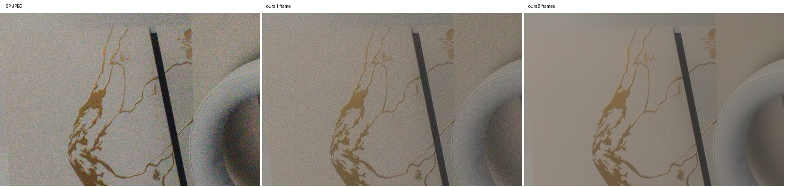
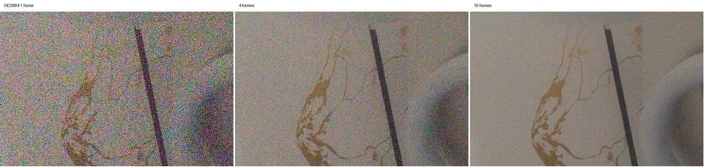
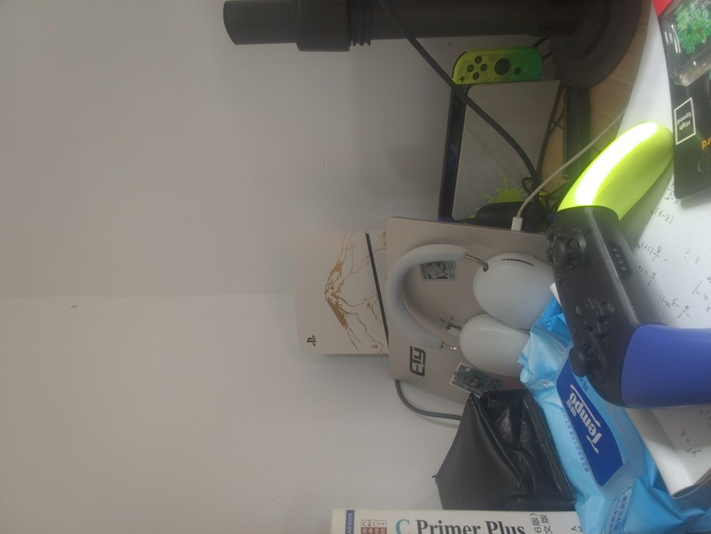
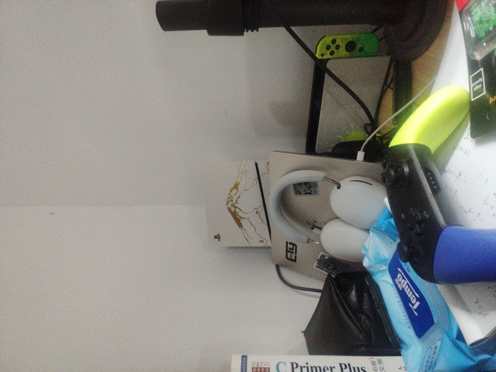
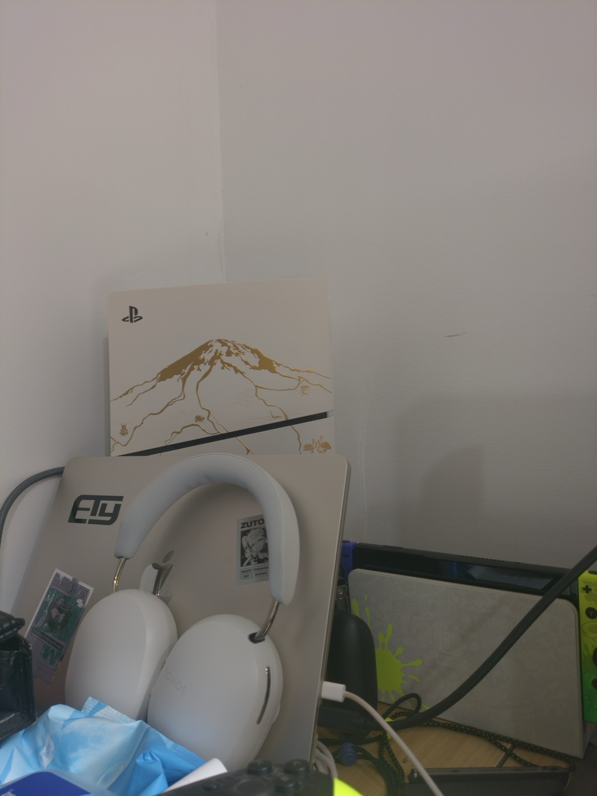

# Pixel 风格多帧 RAW 管线：架构调研、开源方案规划与 Poco F5 纯 CPU 实测

- 日期：2026-11-01
- 设备：Redmi Note 12 Turbo / Poco F5（marble），LineageOS，Snapdragon 7+ Gen 2（1×X2 2.92 GHz + 3×A710 2.5 GHz + 4×A510 1.8 GHz）
- 前置报告：[`REPORT.md`](REPORT.md)（Camera2 RAW 性能边界与 HAL 限制）
- 原型代码：研究工作区的 [`pipeline/`](../../../pipeline/)（C++17，约 1000 行，仅依赖 `stb_image_write.h`），采集端：[`probe/`](../../../probe/)（`CaptureActivity`）
- App 内实现：[`app/src/main/cpp/burstpipe/`](../../app/src/main/cpp/burstpipe/)（原生管线）与 [`app/src/main/java/com/izum1k/pocopaw/pipeline/`](../../app/src/main/java/com/izum1k/pocopaw/pipeline/)（阶段与曝光规划）

> 本文复制自研究工作区 `Poco-F5-RAW-Report/`。文中的 `pipeline/`、`probe/`、`data/`、`bin/` 都指该工作区下的原型、采集工具和素材，不在 PocoPaw 仓库内。

## PocoPaw 实现情况（2026-11-01）

本报告的 CPU 管线已接入 PocoPaw。2026-11-03 起，对齐、合并和后处理默认在 GPU（OpenCL）上运行，任一步失败自动回退到 CPU，详见第 7.5 节；NPU 只做了可行性探测。标注约定：**[App 已实现]** 指已在 PocoPaw 中运行并在手机上验证；**[仅原型]** 指只在研究工作区的 `burstpipe` 命令行原型中实现；**[未实现]** 指两边都没有做。

- 原型的 `align.cpp`、`merge.cpp`、`kr.cpp`、`finish.cpp` 原样移植到 `app/src/main/cpp/burstpipe/`，只改了三处：
  - RAW 帧改为直接读取相机拷贝出来的缓冲区（零拷贝）；
  - 去掉 `meta.json` 和文件读取，元数据由 `RawMetadata` 经 JNI 传入；
  - stb JPEG 编码改为输出 RGBA，由系统编码器（libjpeg-turbo）写 JPEG。（P0 起两边都改为原生 libjpeg-turbo 条带并行编码，代码相同。）
- 同一组素材（`uw8`）上，移植后的代码与原型输出的 JPEG **逐字节相同**，经典合并和核回归两种模式都已核对（`pipeline/tools/session_check.cpp`）。
- App 中的处理阶段是 `AlignStage`、`MergeStage`、`FinishStage`、`JpegWriteStage`，注册为两条管线：
  - `hdrplus`：HDR+ 分块对齐 + 空间域鲁棒合并 + MHC 去马赛克，默认；
  - `hdrplus_kr`：分块对齐 + LK 细化 + 核回归合并（1x），“细节更好，较慢”。
- 设置项：
  - 输出格式：DNG（单帧直出）、JPEG、DNG + JPEG（默认）。选 DNG + JPEG 时，最初写的是参考帧 DNG（合并之前写出）；P0 起默认写合成 DNG（设置“DNG 内容”，可改回参考帧）。
  - 处理方式：HDR+ 合并或核回归合并。
  - 连拍帧数：4 / 8 / 16，默认 8。
- 曝光规划 `BurstExposure` 已实现：用预览 AE 的“曝光 × ISO”，减 1 EV，优先最低 ISO，快门上限有 OIS 时 66 ms、无 OIS 时 33 ms。实拍中，预览 ISO 876 / 10 ms 被换算为连拍 ISO 67 / 66 ms。
- App 内实测见第 7.4 节。各模块的状态标在第 4 节和第 8 节的表格里。
- **P1 更新（2026-11-01）**：第 8 节 P1 表的条目都已实现，结果与取舍见 [`P1_REPORT.md`](P1_REPORT.md)。App 新增设置“场景”（自动 / 包围曝光 HDR / 夜景）、“风格”（标准 / Pixel 风格）和“Ultra HDR”；经典路径默认 RCD 去马赛克，两条合并路径都加了运动掩膜膨胀。原型与 App 的算法源文件现在逐字节相同。
- **P0 更新（2026-11-03）**：第 8 节 P0 表的条目都已实现并接入 App，见 [`P0_REPORT.md`](P0_REPORT.md)。主摄单一曝光默认边拍边合并（GPU，8 帧从对焦到 JPEG 1.68 s，内存与帧数无关）；主摄改用标定噪声曲线；DNG + JPEG 默认写合成 DNG。算法文件（`align`、`merge`、`merge_freq`、`kr`、`finish`、`demosaic`、`dng`、`ultrahdr`、`gpu/`）与原型仍逐字节相同；`common.h`、`burst.*` 和 JNI 是 App 独有的。

## 0. 结论摘要

1. **Google Camera（HDR+ 系列）和 Adobe Project Indigo 的管线骨架是同一个**：固定或包围曝光的**欠曝 RAW 连拍** → 在 **Bayer 域对齐 + 鲁棒合并**（一张降噪后的“合成 RAW”）→ **传统 RAW 后处理**（去马赛克、色彩）→ **强局部色调映射** → 锐化与风格化。两者的差异主要在“味道”：Pixel 的局部色调映射更重、阴影提得更高、锐度更强；Indigo 更克制，追求“单反感”。
2. 这套骨架的每一级都有**成熟的开源算法**可以纯 CPU 实现：HDR+ 金字塔块对齐、空间域鲁棒合并（HDR+ with Bracketing 的思路）、Malvar-He-Cutler 去马赛克、Mertens 合成曝光融合做局部色调映射等。
3. 我按这个规划写了一个**可在手机上直接运行的原型 `burstpipe`**，在 Poco F5 上纯 CPU、8 线程实测：
   - 主摄 16MP × 8 帧：**2.4 s** 出 JPEG（单线程 4.4 s），峰值内存约 **880 MB**。
   - 超广角 8MP × 8 帧：**1.5 s**；8MP × 16 帧：**2.3 s**。
   - 降噪效果符合 √N 理论：8 帧噪声降到 1/3.1，16 帧（ISO 2884）降到 1/4.6。ISO 2884 单帧几乎不可用，16 帧合成后接近正常光照观感。
4. 本机 HAL 的几个限制直接决定了管线设计（详见第 5 节）：
   - **每次打开相机最多 65 个 RAW 请求**，所以 GCam 式“快门前常驻 RAW 环形缓冲”（零快门延迟）无法长期维持，只能“按下快门再拍连拍”，或者周期性重开设备。
   - **AE 被 50 Hz 防频闪锁在 10 ms**，所以要先测光，再换算成“低 ISO + 长快门”的手动曝光。
   - **没有 `noiseProfile`**，噪声模型只能从连拍本身自标定（原型已实现）。
   - **镜头阴影很重（角落增益约 5 倍）**，原型在 RAW 域只做 85% 的亮度补偿，避免角落噪声被放大。
5. 原型已经打通了“采集 → 对齐 → 合并 → 后处理 → JPEG”全流程，但还不是完整的 Pixel 管线。最值得先做的是：边拍边合并的流式处理、NEON 与线程池优化、按噪声自适应的色度降噪和色调曲线、参考帧选择、合成 DNG 输出。完整路线图见第 8 节。**2026-11-03 更新：这些 P0 项都已完成并接入 PocoPaw，见 [`P0_REPORT.md`](P0_REPORT.md)；下文第 6、7 节的耗时是最初的纯 CPU 原型，保留作对照。**
6. **算法升级（后续工作，详见 [`ALGORITHM_UPGRADE.md`](ALGORITHM_UPGRADE.md)）**：
   - 合并与去马赛克已可换成核回归合并（Wronski 2019 / IPOL 2023，MIT），支持 1x 和 2x 输出。
   - 已接入学习式 RAW 降噪 PMRID（Apache-2.0）：4 帧合并 + PMRID 约等于 16 帧传统合并；手机 CPU 上 8 MP 一次推理约 1.1 s。
   - 色度降噪已改为按噪声自适应。

---

## 1. Google Camera 管线架构（公开资料）

### 1.1 HDR+（Hasinoff et al., SIGGRAPH Asia 2016）

这是 Pixel 所有静态照片模式的基础，论文和开源数据集都已公开。

| 阶段 | 做法 |
|---|---|
| 曝光策略 | 整组连拍**用同一个、偏短的曝光**（宁可欠曝也要保住高光），靠多帧平均把暗部噪声降下来。帧数通常 2 到 8 帧。曝光由一个基于样例库的“HDR 测光”决定，同时给出短曝光和“合成长曝光”的增益。 |
| 零快门延迟 | 取景时 RAW 帧持续进入环形缓冲，按下快门时直接取已经拍好的帧，没有延迟。 |
| 参考帧 | 从前 3 帧中选**最锐利**的一帧做参考（类似“幸运成像”）。 |
| 对齐 | 在 Bayer 2×2 平均得到的灰度图上建 4 级金字塔（下采样倍率 2/4/4），**由粗到细逐块搜索**；块大小 16/16/16/8，搜索半径 1/4/4/4；最细一级用 L1 距离，其它级用 L2。块之间重叠一半。 |
| 合并 | 对每个 16×16 块、每个 Bayer 平面做 **2D DFT，在频域做逐对的 Wiener 式鲁棒合并**：和参考帧差异大于噪声预期的频率分量会被拒收，从而抑制鬼影；块之间用升余弦窗混合。 |
| 后处理（Finishing） | 黑电平 → 镜头阴影校正 → 白平衡 → 去马赛克 → 色度降噪 → 色彩校正 → **局部色调映射（动态范围压缩）** → 去雾 → 全局色调曲线 → 色差校正 → 锐化 → 按色相调整颜色 → 抖动。 |
| 局部色调映射 | 从合并结果生成“短曝光”和“合成长曝光”两张图，用 **Mertens 式曝光融合**在拉普拉斯金字塔里混合。这是 Pixel“阴影提亮、高光不过曝、整体偏平但局部很有对比”的根源。 |

### 1.2 HDR+ with Bracketing（Google AI Blog, 2021，Pixel 5 起）

- 不再固定曝光：先取若干**短曝光**（零快门延迟），按下快门后再补**长曝光**帧。**短曝光帧做参考**（运动冻结得最好，高光也不会丢），长曝光帧用来提升暗部信噪比。
- 合并从频域改为**空间域逐像素合并**（思路接近 Super Res Zoom 的鲁棒性模型），官方称比原先快约 40%，同时能处理不同曝光的帧。
- 这正是本原型选用空间域鲁棒合并的理由。

### 1.3 Night Sight（Liba et al., SIGGRAPH Asia 2019）

- **运动测光**：取景时根据光流估计手持抖动和场景运动，动态决定每帧曝光（最长约 1/3 s 手持、上脚架可到 1 s）和帧数（最多 15 帧）。
- 合并沿用 HDR+ 或 Super Res Zoom 的鲁棒合并。
- **学习式白平衡**：在 FFCC（Fast Fourier Color Constancy，Barron & Tsai 2017）基础上，用夜景数据训练。
- **夜景专用色调映射**：保留“夜晚感”，不会把夜景拉成白天；适度提亮、加对比、压暗部饱和度。

### 1.4 Super Res Zoom（Wronski et al., SIGGRAPH 2019）

- 利用手抖带来的亚像素位移，把多帧 Bayer 数据直接累积到更高分辨率的 RGB 网格上，**同时完成去马赛克和超分**。
- 每个样本用**各向异性核回归**（根据局部结构张量决定核的形状）加权，再乘一个**鲁棒性权重**（和参考帧局部均值、方差的偏差）抑制运动物体。
- Pixel 3 起，变焦和主摄普通拍照都用这套合并（相当于“免去马赛克”）。

### 1.5 Live HDR+ 与 HDRnet（Gharbi et al., SIGGRAPH 2017；Google AI Blog 2020）

- 取景器里的“所见即所得”：用一个小网络在低分辨率预测**双边网格里的局部仿射颜色变换**，再在全分辨率上切片（slice）应用，以此实时逼近 HDR+ 的最终色调。
- 对本项目的启发：**色调映射可以在低分辨率上计算，再用引导上采样（双边网格或引导滤波）应用到全分辨率**，这是 CPU 上降低色调映射耗时的关键。

### 1.6 其它（公开资料 + 推测）

- **Ultra HDR**（Android 14+）：SDR JPEG + 增益图（gain map），HDR 屏幕上显示更亮的高光；开源实现 `libultrahdr`。
- **Real Tone**：针对深肤色的 AWB / 曝光 / 色调调优（公开博客，算法细节未公开）。
- **语义分割辅助**（推测，基于 Tensor 时代的宣传和成片观察）：天空、人脸、人像区域用不同的色调、颜色和降噪强度。
- **ML 降噪 / 去马赛克**（推测）：Tensor 芯片上可能有学习式降噪，公开论文不足。本规划不依赖这部分。

### 1.7 “Pixel 风格”的可量化特征（观察与推测）

| 特征 | 对应的管线环节 |
|---|---|
| 高光几乎不过曝，天空保留层次 | 欠曝连拍 + 短曝光参考 |
| 阴影大幅提亮、整体“偏平”，但局部对比强 | 两档合成曝光的曝光融合，压缩比高 |
| 画面干净、暗部噪声低 | 多帧合并 + 色度降噪 |
| 锐利、微对比强（有时被批评“过锐”） | 较强的 USM / 局部对比增强 |
| 颜色偏写实、饱和度适中，白平衡略偏冷 | 色彩矩阵 + 温和的饱和度与色相调整，学习式 AWB |
| 夜景保留“夜晚感” | 夜景色调曲线：目标亮度低于白天 |

---

## 2. Adobe Project Indigo（2025 年 6 月发布，Levoy / Kainz 团队）

根据 Adobe Research 的技术文章：

- **更激进的欠曝 + 更多帧**：普通拍照最多 32 帧，帧数多于常见手机相机，追求更低的噪声和更少的“涂抹感”。
- **零快门延迟**：Photo 模式的参考帧来自按下快门之前的缓冲；Night 模式会用更长的单帧曝光（文章提到可到约 1 s，最多 32 帧，依赖稳定性判断）。
- **前端 / 后端分离**：
  - 前端：RAW 连拍的对齐 + 合并，输出**去马赛克之前的合成 DNG**。这个 DNG 可以直接进 Lightroom 二次编辑。
  - 后端：色调映射、锐化、颜色。默认使用 **Adaptive Color Profile**（AI 生成的“外观”参数，写进 DNG），后端据此渲染。
- **外观**：刻意模仿单反——温和的色调映射、尽量少的降噪涂抹、保留颗粒、不过度锐化；与 Pixel / iPhone 的“重 HDR”形成对比。
- **输出**：SDR JPEG + HDR 增益图（与 Ultra HDR / ISO 21496 同类格式），以及可选 DNG。
- **其它模式**：
  - 2 倍及以上变焦用多帧超分（与 Super Res Zoom 同一类方法）。
  - Long Exposure 模式：不对齐直接平均，模拟慢门的运动模糊效果。

**对本规划的启发**：

1. 前端输出“合成 RAW / DNG”是很好的分层点：前端追求物理正确（降噪、保细节），后端负责风格。Pixel 风格和 Indigo 风格可以**共用前端，只换后端参数**。
2. 帧数上限 32 与本机 65 请求上限恰好匹配，一次开机内可完成一组 32 帧连拍并留有余量。

---

## 3. 统一的管线模型

```mermaid
flowchart LR
  subgraph Capture[采集]
    A[AE/AWB/AF 收敛<br/>YUV 预览] --> B[测光换算<br/>低 ISO + 长快门]
    B --> C[RAW 连拍 N 帧<br/>+ 元数据]
  end
  subgraph Front[前端：Bayer 域]
    C --> D[参考帧选择]
    D --> E[金字塔块对齐]
    E --> F[噪声模型自标定]
    F --> G[鲁棒合并]
  end
  G --> H[(合成 RAW / DNG)]
  subgraph Back[后端：风格]
    H --> I[黑电平 / LSC / WB]
    I --> J[去马赛克]
    J --> K[色彩矩阵]
    K --> L[色度降噪]
    L --> M[局部色调映射<br/>合成曝光融合]
    M --> N[全局曲线 / 饱和度]
    N --> O[锐化]
    O --> P[JPEG / Ultra HDR]
  end
```



---

## 4. 开源算法选型（纯 CPU）

| 阶段 | 原型采用 | 可替换 / 进阶方案 | 开源参考 | PocoPaw |
|---|---|---|---|---|
| 曝光规划 | 测光后按“曝光×ISO 守恒”换算，最长 66 ms，`ev` 控制欠曝档数 | Night Sight 式运动测光；包围曝光（短参考 + 长帧） | — | **[App 已实现]** `BurstExposure`：自动（−1 EV，OIS 66 ms / 无 OIS 33 ms）、包围曝光（2 帧 −2 EV + 1 帧 0 EV）、夜景运动测光（陀螺仪，33–333 ms） |
| 参考帧选择 | 固定第 0 帧（`-r` 可指定） | 前 3 帧按梯度能量选最锐利 | HDR+ 论文 | 固定第 0 帧；最锐帧选择 **[未实现]** |
| 对齐 | HDR+ 4 级金字塔块匹配（16/16/16/8，半径 1/4/4/4，L1/L2） | 亚像素精修（二次曲面拟合）；Lucas-Kanade 精修（超分需要） | [hdrplus-python (IPOL)](https://www.ipol.im/pub/art/2021/336/)、[timothybrooks/hdr-plus](https://github.com/timothybrooks/hdr-plus)、[hdr-plus-swift](https://github.com/martin-marek/hdr-plus-swift) | **[App 已实现]**；LK 亚像素精修仅在核回归模式中使用 |
| 噪声模型 | 从“参考帧 − 对齐帧”残差自标定 `var = a·S + b` | 离线按 ISO 标定查表（补上缺失的 `noiseProfile`） | — | **[App 已实现]**（自标定）；按 ISO 查表 **[未实现]** |
| 合并 | 空间域鲁棒合并：重叠块 + 升余弦窗，按 3×3 局部均值偏差（z 分数）给权重 | 频域 Wiener 合并；核回归超分合并 | hdr-plus-swift（两种合并都有）、[Handheld Multi-Frame SR](https://github.com/Jamy-L/Handheld-Multi-Frame-Super-Resolution)（[IPOL 2023](https://www.ipol.im/pub/art/2023/460/)） | 空间域合并（含包围曝光加权、运动掩膜膨胀）、核回归 1x、频域合并（夜景）**[App 已实现]**；核回归 2x **[仅原型]** |
| 镜头阴影 / WB | HAL 提供的 13×17 阴影图双线性插值，亮度部分补偿；HAL AWB 增益 | FFCC 学习式 AWB | [google/ffcc](https://github.com/google/ffcc) | **[App 已实现]**（HAL 阴影图 + HAL AWB）；FFCC、C5 **[仅原型]**（见 P1 报告第 11 节） |
| 去马赛克 | Malvar-He-Cutler 5×5 线性滤波 | RCD、AMaZE（细节更好，慢 3 到 10 倍） | [RCD](https://github.com/LuisSR/RCD-Demosaicing)、[librtprocess](https://github.com/CarVac/librtprocess) | MHC、RCD（默认）、AMaZE **[App 已实现]**（librtprocess，GPL-3，与本仓库一致；AMaZE 只在原生接口中可选） |
| 色彩 | HAL 给的 CCM（相机 RGB → 线性 sRGB） | DNG 双光源插值（ColorMatrix1/2 + ForwardMatrix） | Adobe DNG 规范 | HAL CCM **[App 已实现]**；DNG 双光源插值 **[未实现]** |
| 色度降噪 | YCbCr，Cb/Cr 下采样 4 倍后高斯模糊再上采样 | 按噪声水平自适应强度；引导滤波；非局部均值 | — | **[App 已实现]**，已按可见噪声自适应 |
| 局部色调映射 | 两档合成曝光（长曝光按对数平均亮度定增益，短曝光按 99.5 百分位定增益）+ Mertens 权重 + 拉普拉斯金字塔融合 | 局部拉普拉斯滤波；低分辨率计算 + 双边网格上采样（HDRnet 思路） | Mertens 2007；[Fast Local Laplacian (Aubry 2014)](https://people.csail.mit.edu/sparis/publi/2014/tog/Aubry_14-Fast_Local_Laplacian_Filters.pdf) | **[App 已实现]**（全分辨率）；低分辨率 + 引导上采样 **[未实现]** |
| 全局外观 | 高光去饱和、sRGB、smoothstep S 曲线、自然饱和度（vibrance） | 按色相调整；3D LUT | — | **[App 已实现]**，含 Pixel 风格预设（按色相调整天空、肤色）；3D LUT **[未实现]** |
| 锐化 | 亮度 USM，带噪声阈值（coring） | 多尺度细节增强 | — | **[App 已实现]** |
| 输出 | `stb_image_write` JPEG q95（带抖动） | libjpeg-turbo（SIMD 快 5 到 10 倍）；Ultra HDR 增益图；合成 DNG | [libjpeg-turbo](https://github.com/libjpeg-turbo/libjpeg-turbo)、[libultrahdr](https://github.com/google/libultrahdr) | **[App 已实现]** 系统 JPEG 编码（libjpeg-turbo）q95 + EXIF；Ultra HDR 增益图 **[App 已实现]**（libultrahdr）；合成 DNG **[未实现]** |

---

## 5. 针对本机的设计约束与适配

| 本机事实（见 `REPORT.md`） | 对管线的影响 | 原型中的处理 |
|---|---|---|
| 每次打开 `CameraDevice` 最多 65 个 RAW 请求 | 不能常驻 RAW 预览流做零快门延迟环形缓冲（约 2 秒就会触发错误）。单次连拍 ≤ 32 帧没有问题。 | 预览用 YUV 流，按下快门后再发 RAW 连拍；连拍结束即关闭设备，下次重开（约 0.5 s）。若要零快门延迟，可做“RAW 环形缓冲 + 每 60 帧重开设备”，代价是周期性断档。 |
| AE 带 RAW 流时快门被防频闪锁在 10 ms，只调 ISO | 直接用 AE 结果会得到“短快门 + 高 ISO”，不利于多帧降噪。 | 先用 YUV 预览让 AE 收敛，再按 `曝光×ISO×2^ev` 守恒换算成最低 ISO + 更长快门（上限 `maxexp`，默认 66 ms），超过上限再升 ISO。 |
| 没有 `android.sensor.noiseProfile` | 合并的鲁棒性阈值和降噪强度缺少依据。 | 从连拍残差自标定泊松-高斯噪声模型（48 个亮度桶的中位数 + 加权线性拟合）。 |
| 镜头阴影很重，角落增益约 5 倍 | 全额补偿会把角落噪声放大约 5 倍。 | RAW 域只做 85% 的亮度补偿（色彩部分全额补偿），保留轻微暗角。这也接近手机厂商的常见做法。 |
| 只能拿到像素合并后的尺寸（主摄 16MP、前置 4MP） | 无法利用 64MP 全分辨率。 | 后续靠多帧超分提升分辨率。 |
| 主摄有光学防抖，超广角和前置没有 | 超广角、前置手持时单帧快门要更短。 | `maxexp` 可按摄像头单独设置。 |
| 16MP RAW16 每帧 32 MB | 8 帧 256 MB，峰值内存约 880 MB；32 帧会超过 2 GB。 | 后续改为**边收帧边合并**的流式累加，内存与帧数无关。 |

**PocoPaw 中的处理**：

- 预览只出 YUV；RAW 额度不足时先重开设备。这两点在接入管线之前就由 `CameraController` 和 `RawRequestBudget` 实现了。
- 曝光换算由 `BurstExposure` 完成，噪声模型自标定和 85% 亮度补偿与原型相同。
- `ByteBuffer.allocateDirect` 在 Android 上计入 256 MB 的 Java 堆上限，16 帧主摄（512 MB）会直接 OOM。所以 RAW 拷贝改由原生 `malloc` 分配（`NativeMemory`），处理完显式释放。
- 实测峰值 RSS：主摄 8 帧核回归约 1.57 GB，16 帧经典合并约 1.9 GB，16 帧核回归约 2.18 GB；处理结束后回落到约 270 MB。
- 边拍边合并 **[未实现]**。

---

## 6. 原型实现：`burstpipe`

### 6.1 采集端（`probe/src/com/probe/raw/CaptureActivity.java`）

1. 开 1280×720 YUV 预览，AE / AWB / AF 自动、阴影图开启，跑 45 帧等待收敛。
2. 可选拍一张 ISP JPEG（q95）作为对照。
3. 读取收敛后的曝光、ISO、AWB 增益、CCM、对焦距离，换算成手动曝光；锁定对焦距离（AF OFF）。
4. 发 N 帧手动 RAW 连拍（`captureBurst`），保存 `frameNN.raw16` 和 `meta.json`（尺寸、行跨度、CFA、黑/白电平、WB、CCM、DNG 色彩矩阵、阴影图、每帧曝光/ISO/时间戳）。

### 6.2 处理端（`pipeline/src/`）

| 文件 | 内容 |
|---|---|
| `common.h` | 线程并行（`parallel_for`，原子计数分块，适应大小核；P1 起跑在常驻线程池上）、计时器、图像容器（未初始化内存 + 缓冲池复用，避免缺页中断和清零开销） |
| `io.cpp` | `meta.json` 解析、RAW 读取、缓冲池 |
| `align.cpp` | Bayer → 灰度（2×2 求和）、金字塔、HDR+ 由粗到细块匹配（父块 + 2 个邻块候选、提前退出） |
| `merge.cpp` | 噪声模型自标定、空间域鲁棒合并（每像素混合 4 个重叠块，权重 = 1 − 线性斜坡(z, 2.0, 4.5)，z 为 3×3 局部均值偏差除以噪声标准差） |
| `finish.cpp` | 归一化 + LSC + WB、去马赛克（最初为 MHC，P1 起默认 RCD，`demosaic.cpp`）、CCM、色度降噪、合成曝光融合色调映射（P0 起在 1/4 分辨率融合）、外观曲线、USM、抖动 + JPEG（最初为 stb，P0 起为 libjpeg-turbo 条带并行） |
| `dng.cpp` | P0 新增：合并后的马赛克写成 16 位 DNG（`--dng`），App 共用 |
| `main.cpp` | 命令行参数、阶段计时、噪声测量（Immerkær 方法，G 平面） |

可调的“外观”参数（`LookParams`）：`--key`（目标亮度，默认 0.18）、`--comp`（压缩比，0 为自动，最大 8）、`--contrast`（0.22）、`--sat`（1.12）、`--sharpen`（0.6）、`--chroma`（色度降噪强度）、`--lsc`（阴影补偿强度 0.85）、`--robust lo hi`（合并鲁棒性阈值）。

---

## 7. 手机实测结果（纯 CPU，8 线程）

### 7.1 测试素材

| 素材 | 摄像头 | 曝光 | 帧数 | 用途 |
|---|---|---|---|---|
| `main8` | 主摄 4624×3472 | 欠曝 1 档，换算后低 ISO | 8 | 性能基准（场景距离约 19 cm，画面失焦，不用于看细节） |
| `uw8` | 超广角 3280×2464 | 测光 33 ms / ISO 341 → 66 ms / ISO 87（−1 EV） | 8 | 画质对比（定焦，清晰） |
| `uwnoisy16` | 超广角 | 快门限制 2 ms → ISO 2884（−1 EV） | 16 | 模拟暗光高噪声 |

所有素材都是手机平放在桌面上拍的静态场景（未测试手持运动和运动物体，见第 8 节）。

### 7.2 降噪效果

噪声用 Immerkær 方法在合成 RAW 的 G 平面上测量（归一化到 0–1）：

| 素材 | 1 帧 σ | N 帧 σ | 实测降幅 | 理论 √N | 合并平均权重 |
|---|---|---|---|---|---|
| `main8`（N=8） | 0.00322 | 0.00109 | 2.95× | 2.83× | 0.989 |
| `uw8`（N=8） | 0.00766 | 0.00244 | 3.14× | 2.83× | 0.990 |
| `uwnoisy16`（N=4） | 0.01395 | 0.00621 | 2.25× | 2.00× | 0.976 |
| `uwnoisy16`（N=16） | 0.01395 | 0.00305 | 4.57× | 4.00× | 0.976 |

实测降幅略高于 √N，原因是重叠块的窗口混合带来了轻微的空间平滑。合并权重接近 1，说明在静态场景下对齐准确、几乎没有误拒收。

超广角正常光照（左：ISP 直出 JPEG；中：本管线单帧；右：本管线 8 帧），中心 600×400 裁切：



超广角 ISO 2884（左：1 帧；中：4 帧；右：16 帧）：



全图（左：本管线 8 帧；右：ISP 直出）：

| 本管线 `uw8` 8 帧 | ISP JPEG |
|---|---|
|  |  |

观察：

- 8 帧合成的平坦区域明显比 ISP 直出干净（ISP 用的是 33 ms / ISO 341，本管线是 8 × 66 ms / ISO 87），细节（金色纹理、边缘）保持良好，没有涂抹感。
- 本管线成片整体略暗、对比略低，白平衡略偏冷灰；ISP 更亮、更暖。要靠近 Pixel 风格，需要再提高目标亮度和局部压缩比、加强局部对比（第 8 节的调参项）。
- ISO 2884 单帧的**彩色噪点很重**：当前色度降噪强度是固定的，没有根据噪声水平自适应。16 帧合成后彩噪基本消失。

### 7.3 耗时（ms）

| 阶段 | 主摄 16MP × 8 | 超广 8MP × 8 | 超广 8MP × 16 | 超广 8MP × 1 |
|---|---|---|---|---|
| 读取 RAW | 112 | 64 | 108 | 14 |
| 灰度 + 金字塔 | 105 | 64 | 126 | 16 |
| 对齐 | 507 | 350 | 851 | — |
| 噪声标定 | 83 | 26 | 43 | — |
| 合并 | 230 | 119 | 261 | — |
| LSC + WB | 98 | 64 | 55 | 49 |
| 去马赛克 | 66 | 45 | 33 | 31 |
| CCM | 12 | 7 | 8 | 6 |
| 色度降噪 | 60 | 33 | 33 | 31 |
| 局部色调映射 | 395 | 232 | 272 | 227 |
| 外观曲线 | 86 | 47 | 45 | 46 |
| 锐化 | 92 | 53 | 57 | 57 |
| JPEG 编码 | 408 | 286 | 397 | 350 |
| **总计** | **2395** | **1462** | **2342** | **856** |

其它数据：

- 主摄 16MP × 8 帧：单线程 4414 ms，8 线程 2395 ms，加速比只有 1.84。原因：
  - JPEG 编码（stb）是单线程的，约占 17%。
  - 对齐和合并受内存带宽限制。
  - 4 颗 A510 小核比大核慢很多。
  - 内核 5.10 的 `mmap_lock` 让多线程并发缺页串行化（已用缓冲池缓解）。
- Mac（Apple Silicon，8 线程）同一组主摄数据：约 0.9 s。
- 峰值内存（主摄 8 帧）：约 880 MB。
- 采集耗时：8 帧 × 66 ms 连拍加保存约 0.7 s。

**优化过程中收益最大的三项**（总耗时从 3135 ms 降到 2395 ms）：

1. 图像缓冲改为未初始化内存，并用缓冲池复用，消除串行清零和缺页。
2. sRGB 编解码改为查表。
3. 拉普拉斯金字塔改为原地构建，少分配一半内存。


### 7.4 PocoPaw App 内实测（2026-11-01，纯 CPU）

测试条件：室内桌面静态场景（帧间平均位移 0 到 0.5 灰度像素），预览测光 ISO 876 / 10 ms，换算后主摄连拍为 ISO 67 / 66 ms。“总计”是从合并开始到文件写完的管线耗时，不含约 0.6 s（8 帧）的采集时间；输出为 DNG + JPEG。数据来自 logcat 中 `PocoPawPipeline` 的阶段日志。

| 摄像头 / 模式 | 帧数 | 对齐 | 合并 | 后处理（LSC 到锐化，含渲染位图） | JPEG | 其它（quick look + DNG） | 总计 |
|---|---|---|---|---|---|---|---|
| 主摄 16MP，HDR+ | 8 | 587 | 285 | 928 | 167 | 224 | **2191 ms** |
| 主摄 16MP，核回归 1x | 8 | 599 | 4536 | 920 | 163 | 225 | **6443 ms** |
| 主摄 16MP，HDR+ | 16 | 1215 | 671 | 956 | 155 | 407 | **3404 ms** |
| 主摄 16MP，核回归 1x | 16 | 1200 | 9573 | 946 | 147 | 236 | **12102 ms** |
| 超广角 8MP，HDR+ | 8 | 349 | 137 | 499 | 105 | 163 | **1253 ms** |
| 超广角 8MP，核回归 1x | 8 | 350 | 2283 | 490 | 101 | 155 | **3379 ms** |

- 与第 7.3 节原型相比（主摄 8 帧 2395 ms，其中 stb JPEG 408 ms），App 内主摄 8 帧为 2191 ms，**其中还多写了一张 32 MB 的 DNG**。主要差别是 JPEG 改用系统编码器，从约 400 ms 降到约 160 ms；另外没有了读文件的开销。
- 核回归耗时与 `ALGORITHM_UPGRADE.md` 中的命令行测量一致：超广角 3.3 s，主摄 5.8 到 6.4 s。
- 主摄 8 帧经典合并的成片（App 直出 JPEG，缩小到 1600 px）：



### 7.5 GPU 加速（OpenCL，2026-11-03）

**[App 已实现]**：设置 → 开发 → “GPU 加速”，默认开启。实现在 `pipeline/src/gpu/`（App 内为 `burstpipe/gpu/` 的同名副本）：

- 运行时：`dlopen` 系统的 `libOpenCL.so`（Manifest 用 `uses-native-library` 声明，`required="false"`）；按“源码 + 驱动版本 + 编译选项”缓存程序二进制；开启 `cl_qcom_perf_hint` 高性能档；中间图像全部常驻显存。
- 上 GPU 的步骤：
  - 对齐：灰度图、金字塔、逐块 L1/L2 搜索（候选 → 搜索 → 选优三个核）。
  - 合并：空间域鲁棒合并，以及核回归的 LK 细化和核累加。
  - 后处理：从 LSC / WB 到 RGBA 输出，只下载最终位图（Ultra HDR 需要时再按需下载线性 RGB）。
- 仍在 CPU 上的步骤：
  - 噪声标定，只用到几个块均值，数据量很小。
  - 频域合并（夜景）。逐系数 DFT 的 GPU 版比 CPU 慢约 10 倍，默认不启用，留待改写为寄存器 FFT。
  - JPEG / DNG 编码。
- 回退：任一步在 GPU 上失败（设备不可用、编译失败、显存不足），该步及之后的步骤自动改用 CPU，结果不变，只是变慢。日志 `PocoPawPipeline` 的摘要行末尾写明 `gpu: align merge finish`，表示哪些步骤在 GPU 上执行。

**一致性**：`session_check --gpu --compare` 把同一组素材的 GPU 和 CPU 输出逐像素对比（8 bit RGBA，PSNR）。

- Mac（Apple M 系列，OpenCL 1.2）上，所有模式都在 70 dB 以上：
  - 经典合并：RCD 96.5、MHC 97.7、AMaZE 92.4、Pixel 风格 89.7、夜景 96.8、包围曝光 93.8、2x 变焦 95.0、单帧 95.1 dB。
  - 核回归：1x 75.1、带 LCA 81.9、包围曝光 70.0、1.5x 79.2 dB。
- Ultra HDR 增益图的最大增益一致（2.37）。
- 手机上（`pipeline/tools/gpu_check.sh`，Adreno 725，暖机后单次，主摄 `main8` 8 帧，另注明的除外）：

| 模式 | CPU ms | GPU ms | PSNR | 最大差值（0–255） | 在 GPU 上的步骤 |
|---|---|---|---|---|---|
| RCD（默认） | 1736 | 1252 | 95.4 dB | 1 | 对齐、合并、后处理 |
| MHC | 1632 | 1121 | 96.6 dB | 1 | 对齐、合并、后处理 |
| AMaZE | 2316 | 1962 | 91.1 dB | 3 | 对齐、合并、后处理（AMaZE 本身在 CPU） |
| Pixel 风格 | 1909 | 1346 | 89.5 dB | 2 | 对齐、合并、后处理 |
| 夜景（`uw8`） | 956 | 757 | 95.8 dB | 2 | 对齐、合并、后处理 |
| 频域合并（`uwnoisy16`） | 1810 | 1558 | 94.3 dB | 1 | 对齐、后处理 |
| 核回归 1x | 3021 | 1473 | 76.5 dB | 12 | 对齐、核回归、后处理 |
| 核回归 + LCA（`uw8`） | 1597 | 825 | 82.8 dB | 9 | 对齐、核回归、后处理 |
| 包围曝光（`t_br`） | 828 | 671 | 93.6 dB | 3 | 对齐、合并、后处理 |
| 核回归包围曝光（`t_br`） | 1314 | 752 | 70.8 dB | 28 | 对齐、核回归、后处理 |
| 2x 变焦 | 972 | 765 | 94.2 dB | 1 | 对齐、合并、后处理 |
| 核回归 1.5x | 1759 | 1073 | 80.4 dB | 5 | 对齐、核回归、后处理 |
| 单帧 | 911 | 705 | 95.2 dB | 1 | 对齐、合并、后处理 |

- 差异来自浮点求和顺序、`-cl-mad-enable` 的乘加融合和核回归权重里的 `native_exp`。核回归的权重对微小误差更敏感，所以 PSNR 较低；即便如此，差值超过 8 的样本也不到十万分之二，肉眼不可见。

**耗时**（App 内实测，主摄 16MP，室内静态场景，JPEG 输出，与第 7.4 节同一场景条件；单位 ms）：

| 模式 | 帧数 | 后端 | 对齐 | 合并 | 后处理 | JPEG | 总计 |
|---|---|---|---|---|---|---|---|
| HDR+ | 4 | CPU | 250 | 222 | 1105 | 217 | **1795** |
| HDR+ | 4 | GPU | 199 | 104 | 692 | 217 | **1213** |
| HDR+ | 8 | CPU | 513 | 486 | 1090 | 198 | **2286** |
| HDR+ | 8 | GPU | 381 | 221 | 702 | 197 | **1501** |

- App 内 HDR+ 整体快约 1.5 倍：合并快 2.2 倍，后处理快 1.6 倍，对齐快 1.35 倍。后处理里剩下的大头是渲染预览位图和 RGBA 输出的回读。
- 核回归在 App 里只在手持（陀螺仪有抖动）时才会启用，静止时自动退回 HDR+，桌面测试拍不到，所以看上面 `session_check` 的数字：主摄 8 帧从 3021 ms 降到 1473 ms，约 2 倍。
- GPU 初始化（创建设备并编译全部 OpenCL 程序）首次约 740 ms，在开启 GPU 加速后由后台预热完成；之后从程序二进制缓存加载，约 13 ms。

**温度**：连续 5 次 4 帧连拍，每次间隔约 5 s，耗时稳定在 1200 到 1232 ms，没有降频迹象。温度变化如下：

| 传感器 | 测试前 | 测试后 |
|---|---|---|
| GPU（`gpuss-0`） | 33.9 °C | 36.7 °C |
| CPU 大核（`cpu-1-0`） | 36.7 °C | 40.2 °C |
| 机身（`quiet_therm`） | 29.4 °C | 30.0 °C |

**NPU（Hexagon cDSP）只做了可行性探测**，结果显示在“设备能力”页：

- FastRPC 可用。
- 架构 V69，有 4 个 128 字节 HVX 上下文。
- 系统报告支持 unsigned PD。
- 打开系统自带的 calculator 示例模块失败（错误 0x80000442）。

要在 cDSP 上跑自己的代码，需要用 Hexagon SDK 编译 skel 并随 App 打包，本阶段没有做。

---

## 8. 差距与路线图

### P0：工程化，预计把 16MP × 8 帧降到 1 s 左右（估算）

> 2026-11-03 更新：全部完成，见 [`P0_REPORT.md`](P0_REPORT.md)。App 内主摄 8 帧（GPU）管线 1501 → 916 ms，从对焦锁定到 JPEG 1.68 s。

| 项目 | 说明 | PocoPaw |
|---|---|---|
| 边拍边合并 | 每收到一帧就对齐、累加，处理时间与采集时间重叠；内存与帧数无关，支持 32 帧。 | **[App 已实现]**：单一曝光的空间域合并默认流式（CPU / GPU），失焦帧在线剔除；16 帧 3.19 → 2.29 s，峰值内存 +1064 → +181 MB；包围、夜景、核回归仍批处理 |
| 常驻线程池 + NEON | 对齐的 SAD、合并、去马赛克改 NEON intrinsic（或用 Halide 生成）；避免每阶段重新创建线程。 | **[App 已实现]**：常驻线程池（P1）；对齐与合并 NEON，主摄 CPU 对齐 454 → 347 ms、合并 349 → 234 ms；RCD 无 SIMD 分支可映射 |
| libjpeg-turbo | JPEG 从约 400 ms 降到约 50 ms。 | **[App 已实现]**：原生 libjpeg-turbo 条带并行，16MP 26–28 ms（原 `Bitmap.compress` 147–217 ms） |
| 低分辨率色调映射 | 在 1/4 分辨率计算融合增益，再用引导滤波或双边网格上采样（HDRnet 思路），预计 395 ms → 100 ms 以内。 | **[App 已实现]**：CPU 260 → 95 ms，GPU 138 → 72 ms |
| 参考帧选择 | 前 3 帧中选最锐利的帧。 | **[App 已实现]**：原生层回传参考帧，DNG 写实际参考帧 |
| 噪声自适应 | 色度降噪强度、锐化阈值、色调曲线目标亮度都按噪声模型和总增益调整（解决高 ISO 单帧彩噪问题）。 | **[App 已实现]**：色度降噪、锐化阈值、目标亮度上限 |
| 合成 DNG 输出 | 前端输出 Indigo 式“合成 RAW” DNG（可用 libtiff 或手写 TIFF），方便在 Lightroom 中对照和调参。 | **[App 已实现]**：设置“DNG 内容”默认合成；16 位 + GainMap + 双光源矩阵，与原型 `--dng` 逐像素一致 |

### P1：画质与模式

| 项目 | 说明 | PocoPaw |
|---|---|---|
| 手持与运动测试 | 当前只验证了静态场景。需要手持、运动物体场景来调鲁棒性阈值 `--robust`，必要时加入运动掩膜扩张。 | **[App 已实现]**：合成运动测试后保持阈值 2 / 4.5，两条路径默认膨胀 1；真实运动素材待拍 |
| 包围曝光 | 短曝光做参考 + 长曝光补暗部（HDR+ with Bracketing）。本机支持逐帧改曝光，空间域合并已能处理不同曝光（需要按曝光比归一化）。 | **[App 已实现]**：设置“场景 → 包围曝光 HDR”；真逆光素材待拍 |
| 夜景模式 | 运动测光（取景时估计抖动）决定单帧曝光和帧数；主摄有 OIS，可尝试 1/4 s 以上单帧；夜景专用色调曲线。 | **[App 已实现]**：设置“场景 → 夜景”（运动测光 + 频域合并 + 夜景风格）；真实夜景素材待拍 |
| 频域合并 | 作为可选路径与空间域合并对比（hdr-plus-swift 两种都有）。 | **[App 已实现]**：夜景模式使用 |
| 学习式 AWB | 移植 FFCC（模型很小，CPU 毫秒级），替代 HAL AWB。 | **[仅原型]**：FFCC 与 C5，见 P1 报告第 11 节 |
| 更好的去马赛克 | RCD（便宜）或 AMaZE（贵），改善细纹理的伪色。 | **[App 已实现]**：默认 RCD |
| Ultra HDR 输出 | 用 libultrahdr 把“短曝光档”与 SDR 结果生成增益图。 | **[App 已实现]**：设置“Ultra HDR” |
| Pixel 风格调参 | 目标亮度提高到约 0.22，压缩比 4 到 8，局部对比与锐化加强，略偏冷的白平衡偏移，按色相微调（天空蓝、肤色）。 | **[App 已实现]**：设置“风格 → Pixel 风格” |

### P2：进阶

| 项目 | 说明 | PocoPaw |
|---|---|---|
| 多帧超分 | **已完成**，见 [`ALGORITHM_UPGRADE.md`](ALGORITHM_UPGRADE.md)。移植 Jamy-L 的核回归合并（Super Res Zoom 开源复现），用于 2 倍数码变焦，同时替代去马赛克。学习式方案 JSR 的评估见 [`JSR_EVALUATION.md`](JSR_EVALUATION.md)：没有许可证、前端闭源、算力需求高约四个数量级，不适合接入，只作离线参照和思路借鉴。 | 1x 核回归 **[App 已实现]**；2x 超分 **[仅原型]** |
| 学习式模块 | RAW 降噪 PMRID 已验证；白平衡 C5、色调 HDRnet、Ultra HDR 输出 libultrahdr 等候选及许可证筛选见 [`ALGORITHM_UPGRADE.md`](ALGORITHM_UPGRADE.md) 第 4 节。 | PMRID **[仅原型]**（App 先做纯 CPU 经典管线，未引入 ONNX Runtime） |
| 语义区域 | 用 CPU 上的小模型（如 MediaPipe 人脸 / 天空分割）做区域化的色调和降噪。 | **[未实现]** |
| 零快门延迟 | RAW 环形缓冲 + 每约 60 帧重开设备，绕开 65 请求上限，评估断档对体验的影响。 | **[未实现]** |
| 加速器 | GPU（Vulkan / OpenCL）或 Hexagon NPU。 | GPU（OpenCL）**[App 已实现]**，见第 7.5 节（频域合并仍在 CPU）；Hexagon NPU **[未实现]**，只做了 FastRPC 能力探测 |

---

## 9. 复现步骤

**PocoPaw App**（在 PocoPaw 仓库根目录）：

```bash
./gradlew :app:installDebug          # 需要 NDK 29 与 SDK 中的 CMake 3.22.1
adb logcat -G 16M                    # 相机 HAL 日志很多，默认 256 KB 缓冲会冲掉应用日志
adb logcat -s PocoPawPipeline        # 每次拍摄打印各阶段耗时、噪声模型、合并权重
```

在设置中选择输出格式（DNG + JPEG / JPEG）、处理方式和连拍帧数，然后正常按快门。开启“RAW 信息”后，取景器上的开发者条会显示上次处理的帧数和总耗时。

**原型与采集工具**（研究工作区）：

```bash
cd ~/Documents/Poco-F5-RAW-Report

# 1) 采集：构建并安装探针 App，拍一组超广角 8 帧（-1 EV）
cd probe && ./build.sh
./cap.sh 30 --es mode hdrplus --es id 2 --es n 8 --es ev -1 --es out uw8
#    高噪声组：快门限制 2 ms、16 帧、不拍 ISP JPEG
./cap.sh 40 --es mode hdrplus --es id 2 --es n 16 --es ev -1 --es maxexp 2000000 --es out uwnoisy16 --ez jpeg false

# 2) 构建处理端（Mac 版 + Android arm64 版，需要 NDK）
cd ../pipeline && ./build.sh
adb push bin/burstpipe-android /data/local/tmp/burstpipe
adb shell chmod 755 /data/local/tmp/burstpipe

# 3) 在手机上运行（输出各阶段耗时）
adb shell /data/local/tmp/burstpipe /sdcard/Android/data/com.probe.raw/files/uw8 -n 8 -t 8 -o /data/local/tmp/uw8_n8.jpg
adb pull /data/local/tmp/uw8_n8.jpg

# 也可以把数据拉到 Mac 上跑
adb pull /sdcard/Android/data/com.probe.raw/files/uw8 data/uw8
bin/burstpipe-mac data/uw8 -n 8 -o out/uw8_n8.jpg
```

`CaptureActivity` 参数：`id`（摄像头）、`n`（帧数）、`ev`（相对测光的曝光档数）、`maxexp`（单帧最长曝光，纳秒）、`jpeg`（是否拍 ISP 对照）、`out`（输出目录名）、`mode`（`hdrplus` 或 `aetest`）。

`burstpipe` 参数：`-n` 帧数、`-r` 参考帧、`-t` 线程数、`--ds N` 输出缩小倍数，以及第 6.2 节列出的外观参数。

---

## 10. 参考资料

- Hasinoff et al., *Burst photography for high dynamic range and low-light imaging on mobile cameras*, SIGGRAPH Asia 2016 — [论文与数据集](http://www.hdrplusdata.org/)
- Monod, Delon, Veit, *An Analysis and Implementation of the HDR+ Burst Denoising Method*, IPOL 2021 — [链接](https://www.ipol.im/pub/art/2021/336/)
- Google AI Blog, *HDR+ with Bracketing on Pixel Phones*, 2021 — [链接](https://research.google/blog/hdr-with-bracketing-on-pixel-phones/)
- Liba et al., *Handheld Mobile Photography in Very Low Light*（Night Sight），SIGGRAPH Asia 2019 — [arXiv](https://arxiv.org/abs/1910.11336)
- Wronski et al., *Handheld Multi-Frame Super-Resolution*（Super Res Zoom），SIGGRAPH 2019 — [arXiv](https://arxiv.org/abs/1905.03277)
- Lafenetre, Facciolo, Eboli, *Implementing Handheld Burst Super-Resolution*, IPOL 2023 — [代码](https://github.com/Jamy-L/Handheld-Multi-Frame-Super-Resolution)
- Gharbi et al., *Deep Bilateral Learning for Real-Time Image Enhancement*（HDRnet），SIGGRAPH 2017 — [项目页](https://groups.csail.mit.edu/graphics/hdrnet/)
- Google AI Blog, *Live HDR+ and Dual Exposure Controls on Pixel 4 and 4a*, 2020 — [链接](https://research.google/blog/live-hdr-and-dual-exposure-controls-on-pixel-4-and-4a/)
- Barron & Tsai, *Fast Fourier Color Constancy*, CVPR 2017 — [代码](https://github.com/google/ffcc)
- Adobe Research, *Project Indigo: a computational photography camera app*, 2025 — [链接](https://research.adobe.com/articles/indigo/indigo.html)
- Mertens, Kautz, Van Reeth, *Exposure Fusion*, Pacific Graphics 2007
- Malvar, He, Cutler, *High-quality linear interpolation for demosaicing of Bayer-patterned color images*, ICASSP 2004
- 开源实现：[timothybrooks/hdr-plus](https://github.com/timothybrooks/hdr-plus)（Halide）、[martin-marek/hdr-plus-swift](https://github.com/martin-marek/hdr-plus-swift)、[google/libultrahdr](https://github.com/google/libultrahdr)、[libjpeg-turbo](https://github.com/libjpeg-turbo/libjpeg-turbo)、[RCD](https://github.com/LuisSR/RCD-Demosaicing)、[librtprocess](https://github.com/CarVac/librtprocess)、[stb](https://github.com/nothings/stb)
