# 实拍验证：系统相机对比、P1 实拍素材与主摄 2x

> 本文复制自研究工作区（`Poco-F5-RAW-Report/`）根目录的同名文档。`../../../` 开头的链接指向研究工作区，只在完整检出研究工作区时可用。

- 日期：2026-11-01 夜间（全设置组合对比）、2026-11-02（对焦与测量流）、2026-11-03（P1 实拍素材、2x 变焦）
- 设备：Redmi Note 12 Turbo / Poco F5（marble），LineageOS 24.0-20261027-NIGHTLY
- 脚本与原始数据：[`compare/`](../../../compare/)（系统相机对比，`compare/out/report/metrics.json`、[`appendix_table.md`](../../../compare/out/report/appendix_table.md)）、[`pipeline/tools/`](../../../pipeline/tools/)（`p1_check.py`、`noise_calib.py`、`p1_truth_eval.py`、`awb_eval.py`、`zoom_eval.py`）、[`isz/`](../../../isz/)（2x 同场景拍摄）；原始数字在 [`pipeline/out/p1/RESULTS.md`](../../../pipeline/out/p1/RESULTS.md) 的 “real P1 captures” 之后几节
- 相关文档：[`IMPLEMENTATION.md`](IMPLEMENTATION.md)（被验证的实现）、[`PIPELINE.md`](PIPELINE.md)（路线图）、[`CAMERA_HAL.md`](CAMERA_HAL.md)

标注约定同其它文档：**[App 已实现]**、**[仅原型]**、**[未实现]**。

## 问题跟进（2026-11-03）

第 1 节的对比用的是 PocoPaw 0.3.2；发现的 7 个问题都已在后续版本中处理，状态写在 1.7 节。第 2 节的实拍验证促成了 P0 的噪声标定接入和 P1 拍摄页修复。还缺的素材：运动组 `mo_*`、四组灰卡 `awb_*`、白天逆光包围、超广角暗场与三脚架组（附录 A）。

## 0. 结论摘要

1. **PocoPaw（0.3.2）的成片比系统相机干净得多，但更暗、更软，暖色高光更容易溢出**；系统相机更亮、更锐，但暗部噪点很重，而且只有 400 万像素。同尺寸下 PocoPaw 墙面噪声只有系统相机的一半，暗部只有三分之一。偏暗、偏软和高光溢出已在后续版本调整（1.7 节）。
2. **连拍帧数接近 1/√N**：4 → 16 帧墙面噪声降到 0.51 倍；8 帧是性价比点。**三脚架上 HDR+ 与核回归没有区别**，所以 App 改为静止时自动退回 HDR+。
3. **对焦是最大的变量**：两个 App 冷启动后按中心连续对焦都不可靠，HAL 每次锁定的位置散布约 1 D。PocoPaw 改为 App 自己做反差扫描，对焦距离标准差从 0.15–0.20 D 降到 0.04–0.06 D，偏软张数 6 → 0。
4. **P1 实拍素材（13 组）**：频域合并对 64 帧真值比空间域高 0.7–2.6 dB，确认夜景用频域；PMRID 官方权重单帧接近 8 帧空间域合并，且好于两版本机微调；HAL 噪声自估偏低 5–20%，标定曲线配单独阈值后已接入 App；主摄 LCA 不启用；两组灰卡上 C5 / FFCC 好于 HAL，但样本太少。
5. **主摄 2x**：8 帧合并 + 裁切相对单帧，亮光亮度噪声 4.2% → 0.9%、暗光 26.7% → 5.5%，细节和噪声都好于系统 ISP 的数码 2x。

---

## 1. PocoPaw 全设置组合与系统相机对比

- 日期：2026-11-01 夜间；三脚架固定，ADB 遥控
- PocoPaw：0.3.2（debug），主摄 1×，JPEG 输出
- 系统相机：LineageOS Aperture（`org.lineageos.aperture`），主摄 1×，照片模式，闪光关
- 场景：室内夜间台灯照明的书桌一角（白墙、PS5 盖板、白色耳机、笔记本贴纸、Switch、黑色背包、相机机身、被台灯照亮的米色木板），属于中低照度、动态范围不大的场景
- 成片在 `compare/out/pocopaw/`（72 张 + 2 张重复）和 `compare/out/system/`

**结论**：

| | 系统相机（Aperture） | PocoPaw 推荐（自动 HDR+ ×8 标准） |
|---|---|---|
| 分辨率 | 2304×1728（4 MP） | 4624×3472（16 MP） |
| 曝光 | 单帧 ISO ≈750、1/50 s | 8 帧 × ISO 115、1/15 s（66 ms） |
| 亮度（L\* 均值） | 53.4 | 43.6 |
| 墙面噪声 / 暗部噪声 | 2.0 / 10.0 | 1.0 / 3.2 |
| 贴纸锐度（梯度均值） | 95 | 53 |
| 高光裁切 | 1.9% | 4.7%（主要是台灯照亮的木板红通道溢出） |
| 按快门到出片 | 即时 | 约 3–4 s |

以上指标都在系统相机的原生尺寸（宽 2304）上比较：PocoPaw 先缩小到同尺寸再测，系统相机不放大。

设置项各自的作用（同场景、同对焦下）：

| 设置 | 实测影响 | 建议 |
|---|---|---|
| 连拍帧数 4 / 8 / 16 | 墙面噪声 1.86 → 1.31 → 0.95（接近 1/√N），出片 3.3 → 4.1 → 5.4 s | 8 帧是性价比点；三脚架上要最干净选 16 |
| 处理管线 HDR+ / HDR+ KR | 画面几乎一样（差异在两次重拍的随机误差内），KR 慢 0.7–3 s | 三脚架上用 HDR+；KR 的超分辨率优势只在手持时出现 |
| 风格 标准 / Pixel | Pixel 亮 1.8 L\*、锐度 +28%、局部对比 +23%、饱和度 +12%，但噪声 +78%，文件 +32% | 看口味；Pixel 在暗部会放大噪点（见 1.4 节） |
| 场景 自动 / 包围 / 夜景 | 包围在这个低反差场景里只增加噪声；夜景用 ISO 50 × 300 ms 长曝光，最干净（墙面噪声 0.5），但画面暗约 6 L\*、对比和饱和度都更低 | 室内弱光上三脚架用夜景；包围留给逆光大光比 |
| Ultra HDR 开 / 关 | SDR 底图不变；附加 30–60 KB 增益图（上限：自动 / 包围 3.3–3.8×，夜景 2.2–2.9×），多 0.25 s，文件 +0.3–1.1 MB | 有 HDR 屏幕就开 |
| 夜景下的“风格” | **不起作用**：夜景强制用 night 风格，标准与 Pixel 的所有指标都在随机误差内 | 夜景下这个选项可以置灰（已做） |

### 1.1 方法

**PocoPaw 72 个组合**：影响 JPEG 成片的五个设置全排列：场景（自动 / 包围 / 夜景）× 管线（HDR+ / HDR+ KR）× 帧数（4 / 8 / 16）× 风格（标准 / Pixel）× Ultra HDR（关 / 开）= 72。每个组合：

1. 生成 DataStore 设置文件（`output=JPEG`、闪光关、定时关，其余按组合），用 `run-as` 写入 App；
2. 强制停止并冷启动 App，这样取景器快捷设置里的会话覆盖值会清空、RAW 请求预算（65 次）也会重置；
3. 等 6 s 让 AE / AWB 收敛，在笔记本贴纸上点一下对焦（同时锁 AE），等 2 s 后按快门；
4. 等 `DCIM/PocoPaw` 出现新的完整 JPEG，拉回并保存 `PocoPawPipeline` 日志（每阶段耗时、曝光）。

拍完后 App 的设置文件恢复为拍摄前的备份，逐字节一致。

**系统相机**：Aperture 没有可写的设置文件，用 UI 自动化：关闪光、在同一张贴纸上点对焦、等 2 s 按快门。分别在“拍摄模式”的两个选项下各拍 3 张：默认“最低延迟”（Minimize latency）和“最高画质”（Maximize quality）。两种模式都只输出 2304×1728。HAL 的 JPEG 流其实支持 4624×3472，这是 Aperture（CameraX）自己选的尺寸，设置里没有分辨率选项。“最高画质”的主要区别是 JPEG 质量从约 95 提到约 98（量化表均值 5.8 → 2.4），文件 1.7 → 2.5 MB，画面指标几乎一样。拍完后 Aperture 的拍摄模式和闪光都恢复为原来的设置。

**对焦控制**：第一轮没点对焦，72 张里有 21 张（29%）贴纸区域明显虚焦，整轮作废（保留在 `compare/out/pocopaw_run1_af/`），改为两边都点贴纸对焦。点对焦后 PocoPaw 首轮仍有 11 / 72（15%）张虚焦，`refocus.py` 用贴纸边缘的梯度 99 分位做对焦评分，低于同场景同风格组中位数 80% 的重拍，全部一次（1 张两次）重拍合格；Aperture 默认模式 12 张里只有 5 张清晰，取最清晰的 3 张，“最高画质”3 / 3 清晰。重拍前的对焦检查图：[`focus_before_refocus.jpg`](../../../compare/out/report/focus_before_refocus.jpg)。对焦问题的诊断与修复见 1.6 节。

**指标**：全部图片配准到同一几何（PocoPaw 之间本来就重合；系统相机用 ORB + RANSAC 单应性对齐，内点 2000–2500），再缩放到宽 2304 测量。全局统计只用系统相机视场覆盖到的区域。

- **L\* 均值 / 高光裁切**：CIELAB 明度均值；任一通道 ≥ 250 的像素比例。
- **墙面噪声 / 暗部噪声**：白墙平坦区和左侧黑色背包上，减去 7×7 高斯模糊后残差的 MAD σ（8 bit 灰度级）。背包有纹理，暗部噪声里混有少量细节。
- **贴纸锐度**：对焦点贴纸上的 Sobel 梯度均值。数值同时受锐化和噪声影响，要结合裁切图看。
- **局部对比**：32×32 块内灰度标准差的均值。
- **饱和度**：Hasler–Süsstrunk colorfulness。
- **重复基线**：同一组合（自动 HDR+ ×8 标准）隔 20 分钟重拍两次，与原片 PSNR 29.6–32.0 dB；系统相机同模式三张之间 22–25 dB（单帧 ISO 750 噪声大）。设置之间的差异要超过这个基线才算真实。

### 1.2 系统相机 vs PocoPaw

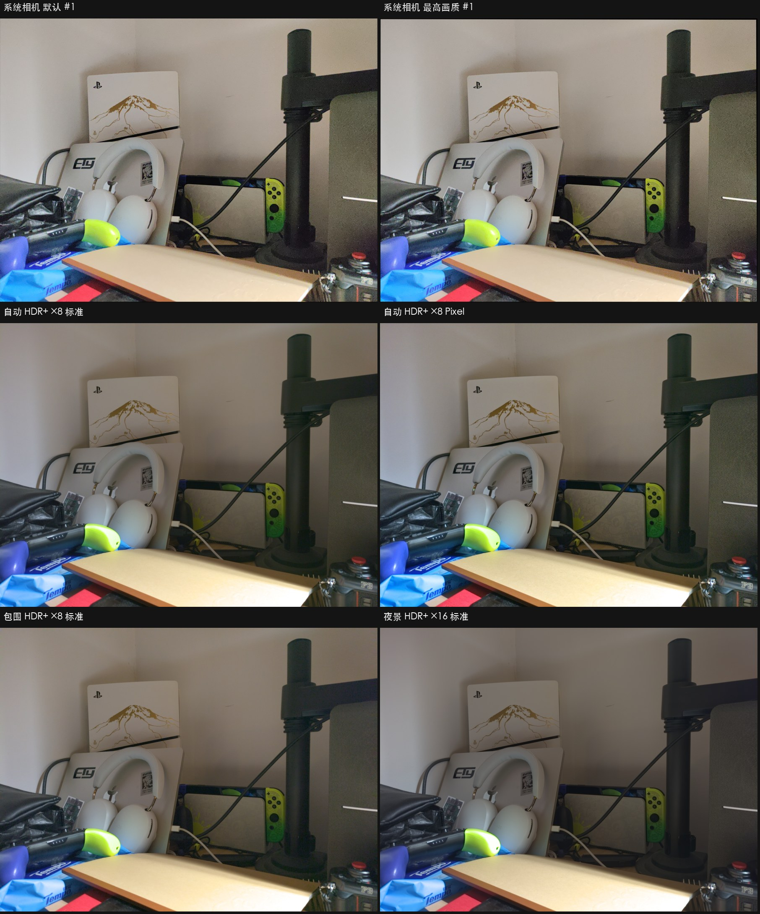

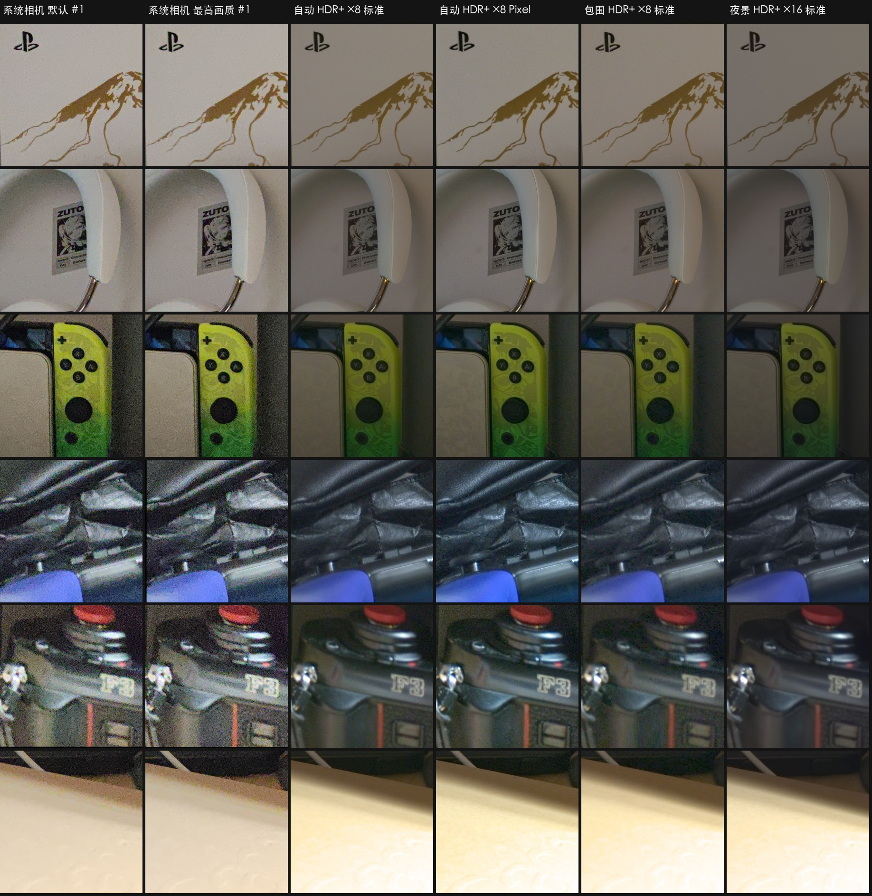

| 指标 | 系统相机 默认 | 系统相机 最高画质 | 自动 HDR+ ×8 标准 | 自动 HDR+ ×8 Pixel | 夜景 HDR+ ×16 标准 |
|---|---|---|---|---|---|
| L\* 均值 | 53.4 | 53.5 | 43.6 | 45.4 | 38.8 |
| L\* 99 分位 | 89.7 | 89.7 | 98.3 | 98.2 | 98.5 |
| 高光裁切 | 1.9% | 1.9% | 4.7% | 5.1% | 4.2% |
| 墙面 L\* / a\* / b\* | 66.4 / 1.7 / 7.2 | 66.5 / 1.5 / 7.1 | 52.8 / 1.8 / 8.9 | 54.8 / 1.0 / 8.4 | 45.8 / 1.9 / 6.6 |
| 墙面噪声 | 2.05 | 2.02 | 0.99 | 1.76 | 0.41 |
| 暗部噪声 | 10.1 | 9.9 | 3.2 | 4.9 | 1.5 |
| 贴纸锐度 | 97 | 94 | 53 | 66 | 42 |
| 局部对比 | 12.7 | 12.7 | 8.1 | 10.1 | 6.9 |
| 饱和度 | 41.9 | 41.8 | 36.8 | 40.9 | 32.9 |
| 文件 | 1.7 MB | 2.5 MB | 3.9 MB | 5.4 MB | 1.8 MB |

- **噪声**：同尺寸下 PocoPaw 墙面噪声只有系统相机的一半，暗部只有三分之一。裁切图第 4、5 行（背包、相机机身）最明显：系统相机满是彩色颗粒，PocoPaw 干净。系统相机是单帧 ISO 750 × 20 ms；PocoPaw 拍 8 帧 ISO 115 × 66 ms 再合并，总曝光时间 528 ms，是系统相机的 26 倍。噪声没有按进光量的平方根降到 1/5，是因为 PocoPaw 的成片整体更暗、并且保留了一些颗粒。
- **亮度与影调**：系统相机亮约 10 L\*，墙面 L\* 66 对 53。PocoPaw 按 HDR+ 的思路给高光留余量、整体偏暗，夜景风格更暗。两者白平衡接近，墙面都略偏暖（b\* 7 对 9）。
- **锐度**：系统相机锐化重，贴纸文字和 PS5 印花边缘更“脆”；PocoPaw 标准风格明显偏软，Pixel 风格接近一些。PocoPaw 有 4 倍像素，但缩到同尺寸后细节并没有胜出，说明它的锐化和局部对比偏保守。
- **高光**：PocoPaw 的 99 分位接近纯白（98），系统相机止于 90。多出来的裁切几乎全在画面底部被台灯照亮的米色木板上，**主要是红通道溢出**（红通道 ≥ 250：PocoPaw 3.3%，系统相机 0.4%），木板在 PocoPaw 里更黄、更白，层次更少。这是色调曲线 / 高光压缩的问题，不是传感器过曝：PocoPaw 单帧的 ISO × 快门只有系统相机的一半，少约 1 档。
- **速度**：系统相机即按即得；PocoPaw（0.3.2，纯 CPU）自动 ×8 约 3–4 s，夜景 ×16 KR 约 12 s。之后的 GPU 和 P0 把自动 ×8 降到 1.68 s（[`IMPLEMENTATION.md`](IMPLEMENTATION.md#0-结论摘要)）。

### 1.3 连拍帧数与处理管线

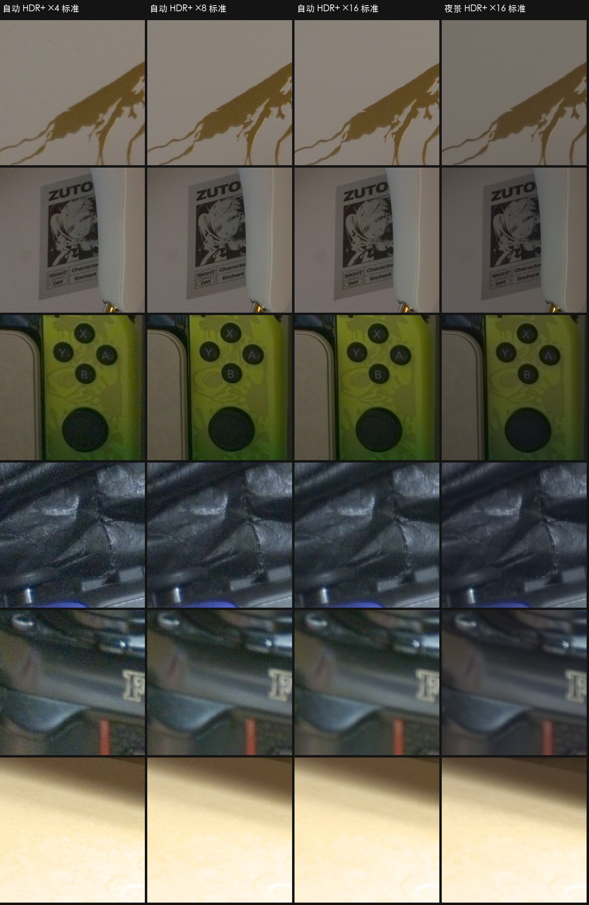

| 自动场景，标准风格平均 | ×4 | ×8 | ×16 |
|---|---|---|---|
| 墙面噪声 | 1.86 | 1.31 | 0.95 |
| 暗部噪声 | 4.76 | 3.92 | 3.13 |
| 管线耗时 HDR+ / KR | 2.1 / 2.8 s | 2.6 / 4.0 s | 3.7 / 6.6 s |
| 按快门到出片 HDR+ / KR | 3.3 / 3.9 s | 4.1 / 5.4 s | 5.4 / 8.6 s |

（“按快门到出片”含拍摄与 1 s 轮询粒度，±1 s。）

- 4 → 16 帧噪声降到 0.51 倍，接近理论的 1/√4 = 0.5，合并效率很好。亮度、白平衡、锐度不随帧数变。
- 夜景本来就干净，帧数收益小（0.59 → 0.49 → 0.41），但每帧 300 ms，16 帧光拍摄就要约 5 s，KR ×16 出片约 12 s。
- **HDR+ 与 HDR+ KR 在三脚架上几乎没有区别**：同组合成对比较的 PSNR（自动 33.1 dB、包围 30.8 dB）落在重复基线（29.6–32.0 dB）附近，噪声和锐度差异小于 10%，但 KR 慢 0.7 s（×4）、1.5 s（×8）到 3 s（×16）。KR 的核回归超分辨率依赖手持抖动带来的亚像素位移，三脚架上没有位移可用，这符合预期。

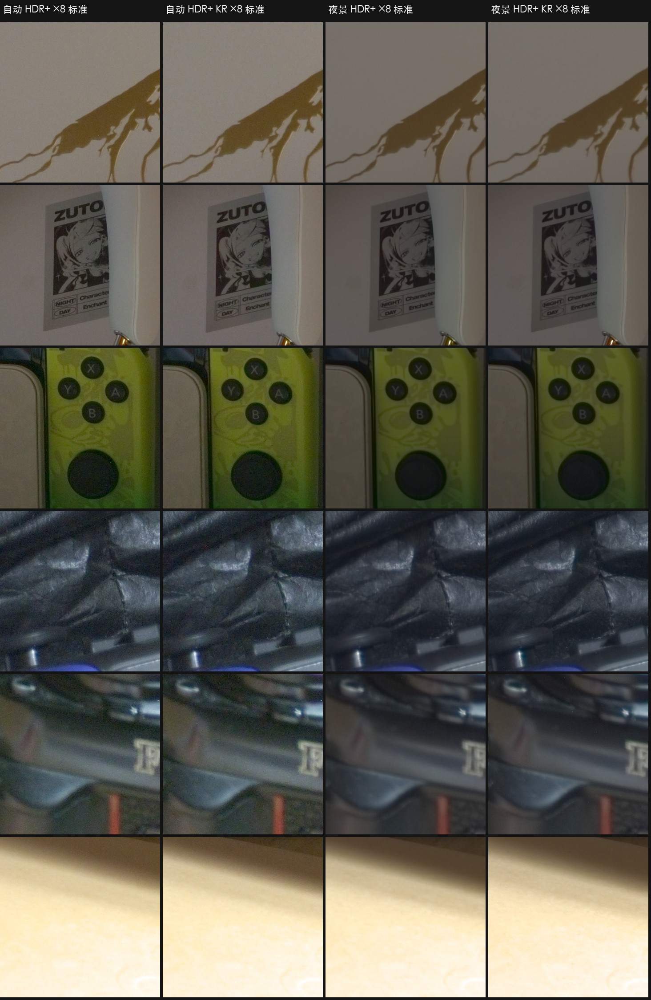

### 1.4 风格与场景

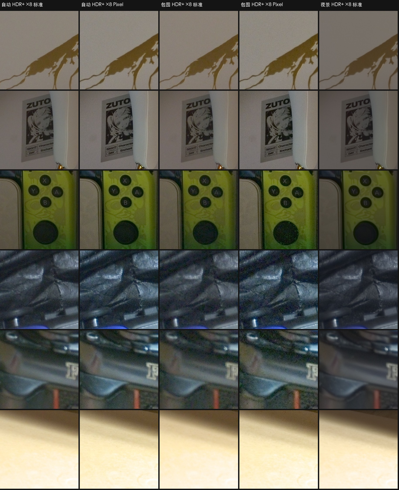

**Pixel 风格**（自动 + 包围平均，对比标准风格）：L\* +1.8，贴纸锐度 +28%，局部对比 +23%，饱和度 +12%，墙面噪声 +78%，文件 +32%。画面更通透、更接近系统相机的观感，代价是颗粒感。**包围 + Pixel** 组合在 Joy-Con 摇杆这类暗部会出现明显的彩色噪点，因为包围的参考帧曝光只有自动的一半，Pixel 的局部对比又进一步把暗部噪声拉了出来。

**包围曝光**：短帧 ISO 58（自动的一半），每三帧中有一帧 4 倍长曝光（日志 `bracket gains 1 1 0.25 …`），按短帧尺度合并。在这个大光比不明显的场景里，它没有换来任何高光（裁切率与自动相同，4.9%），墙面噪声反而高 20%、暗部高 35%。它是为逆光场景设计的，这里体现不出价值。

**夜景**：陀螺仪测到三脚架静止，选了 ISO 50 × 约 300 ms（自动是 ISO 115 × 66 ms），频域合并 + night 风格。墙面噪声 0.5，是所有组合里最干净的，暗部也最干净（1.6）；但画面暗约 6 L\*，局部对比低 24%，饱和度低 15%，观感偏灰、偏“夜晚”。夜景下的“风格”设置不起作用：`HdrPlusPipeline` 对夜景直接用 `look.copy(style = "night")`，实测标准与 Pixel 的所有指标差异都在随机误差内（成对 PSNR 40.5 dB，与改帧数、改 UHDR 的 40.9 / 41.8 dB 一样）。

三个场景的全部组合缩略图：[自动 24 组](../../../compare/out/report/sheet_auto.jpg)、[包围 24 组](../../../compare/out/report/sheet_bracket.jpg)、[夜景 24 组](../../../compare/out/report/sheet_night.jpg)。

### 1.5 Ultra HDR

- SDR 底图与关闭时一致：L\*、噪声、锐度、颜色差异都在随机误差内，色块均值只差几级，与同设置重拍的差异相当。
- 增益图 30–60 KB。增益上限（`hdrgm:GainMapMax`，换算成倍数）：自动 / 包围标准风格 3.3–3.6×，Pixel 风格 3.7–3.8×，夜景 HDR+ 2.2×，夜景 KR 2.8–2.9×。夜景下 KR 的增益上限明显高于 HDR+，原因未查。
- 多 0.2–0.3 s（编码增益图）。
- 文件比 SDR 大 0.3–1.1 MB，其中增益图只占几十 KB；主要是因为当时 Ultra HDR 的底图用 4:4:4 色度编码，SDR 路径（`Bitmap.compress`）是 4:2:0，两者量化表相同（质量 95）。之后底图改为 4:2:0（`4a312b7`）。

### 1.6 对焦重复性与测量流（2026-11-02，机位已重新架设）

**诊断**：`af_probe.py` 把同一个镜头反复冷启动拍 30 次（自动 / HDR+ / 4 帧 / 标准），分三组：点贴纸与耳机头梁交界（edge）、点贴纸中央（sticker）、不点（notap）。每张记录拍摄时镜头报告的对焦距离、贴纸的梯度 99 分位和 Tenengrad。镜头从来没有在连拍中移动，点对焦也没有重试，拍摄时 AF 都是锁定状态。问题出在 HAL 每次锁定的位置本身：同一个静止场景，锁定距离散布约 1 D（贴纸清晰峰值约 2.15 D，散布约等于 4 个景深）。耳机头梁和贴纸的峰值在同一个位置，所以不是对焦框里混了两个深度。

**修复**（PocoPaw `camera/FocusSweeper.kt`、`CameraController.kt`，**[App 已实现]**）：会话里加一路 1920×1440 YUV 分析流，App 自己做反差对焦。

- 冷启动 AE 收敛后，从远到近完整扫一遍（粗扫 0–4 D 每 0.5 D 加 5 / 6.5 / 8 / 10 D，再在峰值两侧精扫 7 点，最小二乘抛物线取峰），把镜头固定在峰值。用时约 1.95 s。
- 点对焦：先等 AE 收敛（最少 150 ms、最多 400 ms）再触发 HAL 扫描；HAL 锁定后在它附近 ±3 个超焦距步长精扫，再固定到峰值。精扫约 0.7 s，HAL 失败或曲线太平就完整扫描。
- 按快门：已经固定时不再触发 AF，先等镜头报告停在目标距离（最多 300 ms），连拍全程同一个距离；扫描进行中最多等 1 s，超时用目前最好的点。连拍里镜头还在动或偏离中位数 0.05 D 的帧会被丢掉（第 0 帧和包围曝光除外）。
- 陀螺仪检测到转动时交回 HAL 连续对焦，静止 0.5 s 后小幅转动（< 0.1 rad、亮度变化 < 1 EV）精扫，否则完整重扫。三脚架上 90 次拍摄中没有误触发。

**修复后**（每组 30 张，`compare/out/af_probe/before` vs `after`）：

| 组 | 对焦距离标准差（D） | 距离范围（D） | Tenengrad 变异系数 | 偏软张数（Tenengrad < 全轮 90 分位的 80%） |
|---|---|---|---|---|
| edge | 0.202 → **0.052** | 1.87–2.61 → 2.15–2.35 | 6.8% → **1.8%** | 2 → 0 |
| sticker | 0.160 → **0.063** | 1.92–2.65 → 2.22–2.58 | 5.9% → **2.1%** | 1 → 0 |
| notap | 0.150 → **0.044** | 1.64–2.22 → 1.96–2.12 | 10.9% → **1.9%** | 3 → 0 |

notap 组对准的是画面中央九宫格（中心权重最高），不是贴纸，所以落在 2.05 D 左右，贴纸稍软但每次一致。sticker 组唯一的 2.58 D 是那次扫描刚结束就按了快门，第 0 帧镜头还在回位（其余 3 帧 2.22 D，成片清晰）；之后加了“等镜头到位”，复测 258 ms 到位、16 帧都在同一距离。

代价：点对焦后约 1.3 s 才固定（AE 等待 + HAL 扫描 + 精扫），冷启动后约 2 s 内按快门会等扫描结束（最多 1 s）。这次只在室内弱光（预览 ISO 约 870）测了；亮场景和手持转动后的重扫还没有用脚本统计。

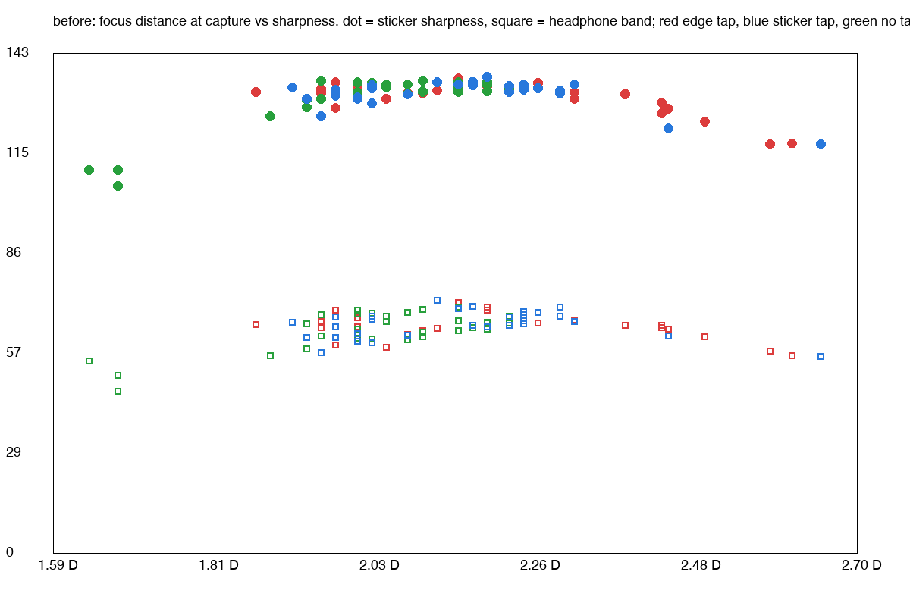
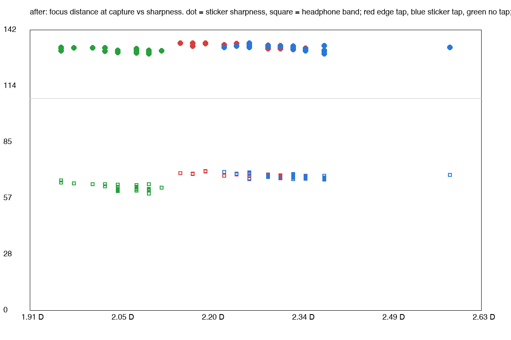

**测量流：场景检测与白平衡框架**（`fbd0440`，**[App 已实现]**）。HAL 的 AE、AWB 用的是 ISP 内部统计，不经过任何输出流，所以“把测光、白平衡挪到测量流”实际是指：App 读 YUV 分析流自己统计，再通过请求参数下发。这次保留 HAL AE（接管它要重做闪光、防频闪，收敛也更慢），测量流只做两件事：

- **场景变化检测**：取景时每 8 帧插入一个带分析流的预览请求（约 4 Hz），`SceneMeter` 在 64×48 格上统计场景亮度（线性亮度 ÷ ISO × 曝光时间，与 AE 无关）和 8×6 网格亮度。手机静止、没有点对焦保持时，如果相对上次扫描后的状态亮度变化超过 1 EV，或者网格相关系数低于 0.9，并持续 0.5 s，就重新完整扫描对焦。
- **白平衡框架**：同一帧用结果里的色调曲线、CCM 和 AWB 增益反推回白平衡前的线性相机 RGB。新增 `AwbEstimator` 接口，白平衡增益统一由 `applyWhiteBalance` 下发，预览和拍照一致，管线从 RAW 结果读到同一组增益。默认实现返回 null，即继续用 HAL AWB；C5 将来作为它的一个实现接入。
- 带分析流的请求不能放进重复 burst：burst 里已经排队的其余请求会把扫描请求最多推迟 8 帧，导致冷启动扫描收不到样本，所以改为用定时器单独 `capture()`。

反推是否准确（`meter_check.py`，冷启动 10 次，拍照时把最近一帧测量网格和 RAW 第 0 帧网格（扣黑电平、乘 HAL 阴影图）写进日志）：

| | 中位角误差 | p90 |
|---|---|---|
| 每格（480 格） | 0.85° | 2.74° |
| 中心 4×4 格 | 0.75° | 2.86° |
| 整帧平均色度 | 0.70° | 0.76° |

误差大的格子集中在很亮的近白表面（色调曲线肩部，HAL 还开着不在曲线里的局部色调映射）和超出 sRGB 色域的荧光色（ISP 已经裁掉）。所以编码值 ≥ 0.90 的点不参与白平衡统计（阈值 0.97 时中心格 p90 是 4.45°）。目标（中位 < 1°）已达到，不需要改用固定 gamma。

场景检测：三脚架静止 2.4 分钟和回归中的 90 次拍摄里都没有误触发；静止时亮度波动 0.21–0.23 EV，网格相关系数 ≥ 0.999。测试期间房间里有一次真实变化：画面变亮约 0.8 EV（相关系数 0.869），20 多秒后恢复，两次各触发了一次完整扫描（2.00 D、1.98 D）。没有用脚本做开关灯、放入物体的受控测试（需要人动手）。

性能（`stream_cost.py`，debug 构建，每档冷启动后测 180 s，依次运行）：

| 分析流 | 预览帧率 | App CPU | 相机 HAL CPU | cameraserver | 每帧：相机线程采样 / 后台换算 |
|---|---|---|---|---|---|
| 不出帧（只给对焦扫描用） | 29.97 | 35.2% | 123.4% | 10.1% | — |
| 每 8 帧一次（默认） | 29.96 | 37.6% | 125.1% | 10.6% | 4.55 / 1.98 ms |
| 每帧 | 29.95 | 48.2% | 127.8% | 11.4% | 2.28 / 2.20 ms |

- 默认档几乎没有代价：帧率不变，App 多 2.4 个百分点 CPU，HAL 多 1.7 个百分点。每帧都出会让 App 多约 13 个百分点，所以不采用。
- 相机线程上的采样最初逐点读 `ByteBuffer`，每帧约 10 ms；改为整行批量拷贝后降到 4.5 ms（debug 构建）。换算在后台线程，上一帧没算完就丢掉新帧。
- 电池电流在这台手机上没有读权限，而且 USB 一直在充电，所以用各进程的 CPU 时间代替功耗。
- 对焦回归（`af_probe`，每组 30 张）没有退步：三组对焦距离标准差约 0.06 D，Tenengrad 变异系数 1.4–1.7%，偏软 0 张，管线平均耗时 1873 → 1877 ms。

### 1.7 发现的问题与跟进

| 问题 | 建议 | 跟进 |
|---|---|---|
| 暖色高光溢出：台灯照亮的木板红通道溢出 3.3%，系统相机 0.4% | finish 阶段按色相保护地压缩高光 | **[App 已实现]**：彩色高光按最大通道保色相压缩（`844dbea`） |
| 标准风格偏暗偏软：同尺寸锐度只有系统相机的 55%，L\* 低 10 | 提高默认亮度目标或默认用 Pixel | **[App 已实现]**：标准风格目标亮度 0.23、锐化 0.8、局部对比 0.3（`da38e98`） |
| 包围 + Pixel 的暗部彩噪 | 局部对比随噪声收敛或加强色度降噪 | **[App 已实现]**：局部对比随可见噪声减弱（`61752b4`） |
| 夜景下“风格”选项无效 | UI 上禁用或注明 | **[App 已实现]**：夜景下置灰（`10526a7`） |
| 三脚架上 KR 没有收益 | 陀螺仪判定静止时回落到 HDR+ | **[App 已实现]**（`c9ef124`） |
| 点对焦后仍有 15% 虚焦（点对焦那一次就对错了，`focus locked in 27ms`） | 拍摄前检查对焦 | **[App 已实现]**：App 侧反差扫描（1.6 节，`3b0d662`、`10ef6a0`） |
| Ultra HDR 底图体积大 | 底图也用 4:2:0 | **[App 已实现]**（`4a312b7`） |

以上调整之后没有在同一机位重跑 72 组合，第 1 节的数字仍是 0.3.2 的结果。

---

## 2. P1 实拍素材验证

2026-11-03 用 PocoPaw 的 P1 拍摄页拍了 13 组素材（`pipeline/data/p1/<名称>/`，格式与 probe 相同），逐组检查用 `tools/p1_check.py`。拍摄清单见附录 A。

### 2.1 素材情况与拍摄页问题

- 主摄 HAL 的 ISO 上限是 876：`tp_main_iso3200` 实际是 ISO 876 / 1.25 ms，`dk_main` 的 1600–6400 三档都被钳到 876。P1 拍摄页已改成 `tp_main_iso400` 和暗场 100 / 200 / 400 / 800 / 876，另加一组明亮场景 `tp_main_bright`（`9a01460`）。
- **64 帧三脚架组后 8 帧失焦**：一次打开相机最多 65 个 RAW 请求，拍摄页把 64 帧拆成 56 + 8 两次拍摄，中间重开相机丢了对焦锁定。第 56–63 帧的 G 平面梯度从 10.80 降到 10.37。已修复（`54c6a26`）：后续分段关掉 AF，沿用第一段的对焦距离，`meta.json` 逐帧记录对焦距离。修复后补拍一组验证，64 帧对焦距离都是 1.799 D，梯度 14.81–14.84，第 55/56 帧前后没有变化。本节的真值只用前 56 帧。
- 场景偏暗：三组三脚架素材 p99 只有 18–138 DN（满量程约 960）；夜景组单帧信号只比黑电平高 2–20 DN，预览 AE 已顶到 30 ms / ISO 876；包围组拍的是暗房里的台灯，灯泡在 −2 EV 帧里也剪切。

### 2.2 噪声标定

`tools/noise_calib.py` 用 `dk_main` 求暗场参数，用 56 帧对齐均值作真值、帧对差分拟合 `var = k·S + b`（DN）：

| ISO | 读出噪声 DN | 热像素 | 标定 k / b | 管线自估 k / b |
|---|---|---|---|---|
| 100 | 0.58 | 42 | 0.120 / 0.49 | 0.114 / 0.34 |
| 400 | 1.34 | 274 | — | — |
| 800 | 2.17 | 1691 | 0.987 / 5.28 | 0.787 / 3.40 |
| 876 | 2.38 | 1566 | 1.247 / 5.36 | 1.123 / 2.81 |

各档黑电平比元数据的 64 高 0.20–0.26 DN（`meta.json` 把动态黑电平取整了），行噪声和列固定噪声都在 0.1 DN 以下。管线自估的 k 偏低 5–20%、b 偏低 30–50%；手持素材上 b 要么卡在下限 0.25，要么被对齐残差撑大（包围组 b = 8）。

直接换成标定噪声的效果不一致：三脚架真值 PSNR 只高 0.0–0.26 dB；手持夜景 `nt_main_hand` 的可见噪声 0.0047 → 0.0032；但手持包围的平均权重从 0.91 掉到 0.47，噪声反而增加 60%，原因是鲁棒性阈值是按自估模型调的。P0 给标定模型单独设了阈值 1.75 / 3.9，手持包围权重回到 .934，主摄已接入（[`IMPLEMENTATION.md`](IMPLEMENTATION.md#21-噪声标定)）。

### 2.3 合并与 PMRID：64 帧真值

`tools/p1_truth_eval.py`，RAW 域 PSNR（dB），8 帧合并对 56 帧真值（ISO 100 对 16 帧），128 px 边框裁掉：

| 方法 | ISO 100 | ISO 800 | ISO 876（−4 EV） |
|---|---|---|---|
| 单帧 | 53.25 | 47.64 | 50.54 |
| 空间域 | 56.32 | 54.07 | 59.40 |
| 频域 s1 | 57.06 | 55.13 | 61.58 |
| 频域 s2 | 57.09 | 55.22 | 61.98 |
| PMRID 官方（单帧） | 56.46 | 54.77 | 62.72 |
| PMRID 超广角微调 | 55.99 | 53.91 | 61.53 |
| PMRID 主摄微调 | 56.00 | 53.85 | 61.56 |

频域合并比空间域高 0.7–2.6 dB，确认夜景用频域是对的。PMRID 官方权重单帧就接近 8 帧空间域合并，在 ISO 876 还比频域 s2 高 0.7 dB。两版微调（Cube++ 合成噪声对，主摄版按标定 b 设了噪声范围）在主摄上都比官方低 0.5–1.2 dB：合成训练对迁移不到实拍，**保留官方权重**。等有更亮的 `tp_main_bright` 后，可以试着直接用真值做训练对。

### 2.4 包围曝光

`br_*` 手持，4.9 / 19.6 ms（超广角 12.2 / 48.8 ms），ISO 50：

| | 空间域 | 核回归 | 只用长帧作参考 |
|---|---|---|---|
| 主摄可见噪声 / 权重 | 0.0051 / 0.91 | 0.0044 / 0.91 | 0.0048 / 0.29 |
| 超广角 | 0.0057 / 0.92 | 0.0050 / 0.93 | 0.0050 / 0.29 |

默认以短帧为参考，12 帧都参与合并，长帧在剪切处被拒绝；以长帧为参考时短帧基本被拒，只剩 4 帧长帧（权重 0.29），高光也就跟着长帧剪切。Ultra HDR 两组都达到增益上限 4.0×（普通连拍是 1.7–2.6×），22% 的块被提亮。手机端：主摄空间域 + Pixel + Ultra HDR，CPU 2.58 s、GPU 2.41 s；核回归 3.80 / 2.41 s；GPU 与 CPU 差 76–79 dB。（权重 0.91 是 P0 之前自估噪声下的数值，标定噪声 + 新阈值下为 .934。）场景是台灯而不是窗前逆光，暗部细节和窗外层次还要补拍验证。

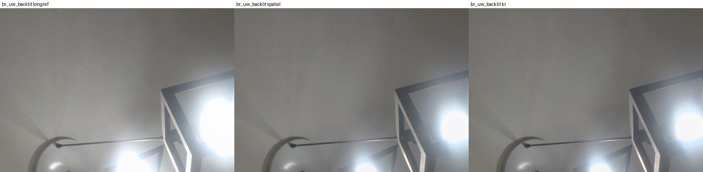

### 2.5 LCA

屏幕棋盘格标定（`calib/lca_cam*_checker.json`）：主摄中径 R 约 0、B +0.19 px，但在校正后的核回归成片上复测时，结果和 RAW 拟合对不上，校正还会过冲，**主摄继续不启用**。超广角 B 与现有系数一致（0.20 对 0.19 px），R 只拟合出线性项（中径 0.55 对 0.39 px），**现有系数不变**。

### 2.6 夜景

运动测光：手持选了 33 ms × 30 帧（陀螺仪 0.18 rad/s），靠稳选了 192 ms × 16 帧，两组都看不到运动模糊。可见噪声：

| | 默认风格 | 夜景 s1 | 夜景 s2 | 夜景 s4 | 夜景 + 核回归 |
|---|---|---|---|---|---|
| `nt_main_hand` | 0.0266 | 0.0072 | 0.0047 | 0.0029 | 0.0090 |
| `nt_main_brace` | 0.0152 | 0.0037 | 0.0024 | 0.0015 | 0.0053 |
| `nt_uw_hand` | 0.0554 | 0.0168 | 0.0123 | 0.0084 | 0.0201 |

s4 会把仅有的纹理抹平，**默认仍是 s2**。手机端夜景频域：主摄手持 30 帧 CPU 5.09 s、GPU 4.75 s（16 帧 3.07 / 2.91 s），靠稳 3.15 / 3.06 s，超广角 2.65 / 2.59 s；GPU 与 CPU 差 93–95 dB，远好于 50 dB 的门槛。30 帧耗时超过 5 s；只用 16 帧时噪声 0.0047 → 0.0058，耗时降到约 3 s，App 的夜景帧数上限可以在两者之间权衡。

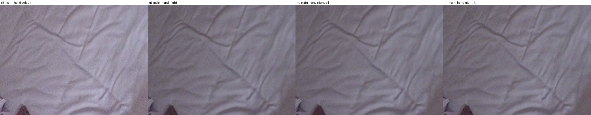

### 2.7 AWB（初步，2 组）

白纸真值角误差（°）：

| | HAL | 灰度世界 | Shades of Gray | C5 | FFCC | FFCC 去先验 |
|---|---|---|---|---|---|---|
| `awb_warm` | 2.71 | 3.65 | 3.30 | 2.89 | 2.45 | 1.92 |
| `awb_cool` | 5.32 | 6.81 | 4.30 | 0.56 | 0.70 | 5.50 |

`awb_cool` 的白纸确实偏冷，HAL 把它判暖了 5.3°；C5 和 FFCC 都在 1° 以内。两组均值：FFCC 1.57°、C5 1.73°、HAL 4.02°。样本太少，等其余 `awb_*` 到齐再决定。

### 2.8 素材状态

| 素材 | 状态 |
|---|---|
| `tp_main_iso100/800/3200`、`dk_main` | 已完成标定与真值评测；后 8 帧失焦，需重拍（拍摄页已修复） |
| `lca_main`、`lca_uw` | 已完成，主摄不启用，超广角不变 |
| `br_main_backlit`、`br_uw_backlit` | 流程验证通过；需白天窗前逆光重拍 |
| `nt_main_hand`、`nt_main_brace`、`nt_uw_hand` | 已完成；可补一组不那么极端的夜景 |
| `awb_warm`、`awb_cool` | 已完成初评 |
| `mo_main_wave`、`mo_main_walk`、`mo_uw_street` | 未拍：真实运动下阈值 2 / 4.5 + 膨胀 1 是否够用 |
| `awb_day`、`awb_shade`、`awb_mixed`、`awb_night` | 未拍 |
| `tp_main_bright`、`tp_main_iso400` | 新增项，未拍 |
| `dk_uw`、`tp_uw_iso100`、`tp_uw_iso800` | P0 新增（超广角噪声标定），未拍 |

---

## 3. 主摄 2x 实拍对比

方案与有真值的合成评估见 [`PIPELINE.md`](PIPELINE.md#9-主摄-2x软件变焦)。同一场景：

- 亮光：ISO 95，66 ms，8 帧（`data/z_bright`）。
- 暗光：ISO 875（这颗传感器的 ISO 上限），3 ms，8 帧（`data/z_dark`），信号只有约 20 DN。
- ISP 2x：同场景用 `zoomRatio=2` 拍系统 JPEG（`data/z_isp2`、`data/z_dark_isp2`）。暗光那张用了相同的手动曝光（`pman`），ISP 不会自动补亮，所以展示时按线性亮度把它提亮到和我们的结果一致。ISP JPEG 是 1:1 画幅，只覆盖中间部分。

平坦墙面的噪声（高通后的标准差，8-bit；ISP 的影调不同，数值仅供参考）：

| 方案 | 亮光：亮度噪声 | 亮光：色度噪声 | 暗光：亮度噪声 | 暗光：色度噪声 |
|---|---|---|---|---|
| 核回归 2x | 0.9% | 0.47 | **5.1%** | 0.71 |
| 核回归 1x + Lanczos | 0.9% | 0.48 | 5.5% | 0.66 |
| 分块合并 + Lanczos | 1.0% | 0.45 | 7.7% | 0.63 |
| 单帧 + Lanczos | 4.2% | 0.47 | 26.7% | 2.53 |
| ISP 数码 2x | 1.8% | 0.70 | 12.3%（提亮 24 倍后） | 2.42 |

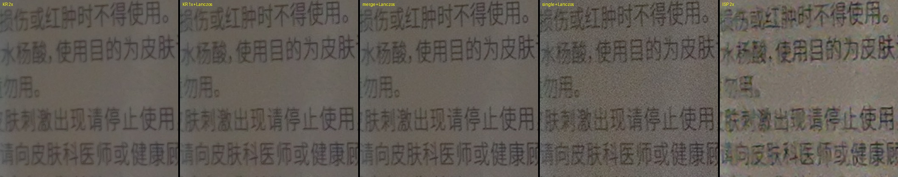

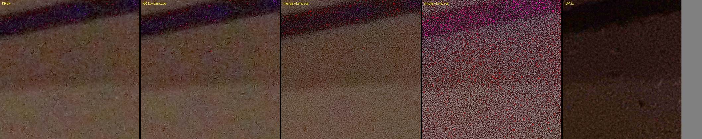

- 亮光下，三种多帧方案的小字清晰度相近，都比单帧干净，也比 ISP 2x 少了涂抹感和锐化光晕。静态连拍的亚像素多样性是 0，`--scale auto` 会选 1x，这时做 2x 纯属浪费。
- 暗光下，单帧和 ISP 都被噪声淹没（ISP 是降噪成一片糊）。核回归的噪声最低，分块合并次之。这个信号水平下小字三种方案都看不清，那是 8 帧 3 ms 本身的光量不够。
- 画面边缘的对比要注意：ISP JPEG 做了畸变校正，RAW 管线没做，所以边缘的物体位置对不上。

---

## 4. 复现

**系统相机对比**（在 `compare/` 下）：

```bash
python3 capture_pocopaw.py                 # 72 个组合（已拍的跳过）；可传组合名只拍指定的
python3 capture_pocopaw.py --repeat=2      # 参考组合重拍，作随机误差基线
.venv/bin/python refocus.py                # 对焦质检与重拍
.venv/bin/python af_probe.py shoot TAG --n=30   # 对焦重复性：三组各冷启动 30 次
.venv/bin/python af_probe.py analyze before after
.venv/bin/python meter_check.py shoot TAG --n=10   # 分析流反推色度 vs RAW（debug 构建）
.venv/bin/python stream_cost.py off 8 1            # 分析流出帧频率的性能代价（debug 构建）
.venv/bin/python capture_system.py aperture 3      # 系统相机（拍摄模式需在 Aperture 设置里手动切换）
.venv/bin/python analyze.py                # 指标、裁切图、缩略图 → out/report/
```

`capture_pocopaw.py` 和 `capture_system.py` 里的点对焦坐标对应这次三脚架的机位；机位变了要重新定位（用取景截图和参考照片做 ORB 匹配，见 `compare/tmp/locate.py`）。

**P1 实拍素材**（在 `pipeline/` 下）：

```bash
tools/pull_p1.sh                                         # 手机 P1 目录 -> data/p1/<名称>
python3 tools/p1_check.py data/p1/*                      # 逐组质量表
python3 tools/noise_calib.py dark data/p1/dk_main        # 暗场 -> calib/dark_cam0.json
python3 tools/noise_calib.py flat data/p1/tp_main_iso{100,800,3200} --pipeline --out calib/noise_cam0.json
python3 tools/noise_calib.py curve ...                   # 标定曲线 -> calib/noise_curve_cam0.json（P0）
python3 tools/p1_truth_eval.py data/p1/tp_main_iso800 --ckp official=/tmp/PMRID/models/torch_pretrained.ckp main=calib/pmrid_poco_main.ckp
python3 tools/lca_calib.py ...                           # LCA 标定 -> calib/lca_cam*_checker.json
python3 tools/awb_eval.py data/p1/awb_warm data/p1/awb_cool
```

**2x 同场景拍摄**（研究工作区根目录）：

```bash
isz/run.sh z_bright 40 --es out z_bright --es n 8 --ez jpeg true
isz/run.sh z_isp2 25 --es out z_isp2 --es zoom 2 --ez jpeg true --ez noraw true
isz/run.sh z_dark 40 --es out z_dark --es n 8 --ez jpeg true --es iso 876 --es exp 3000000 --ez pman true
```

---

## 附录 A：P1 拍摄清单

用 `probe` 采集，手机通过 USB 连 Mac。先关掉 PocoPaw（它会占用相机），再运行 `probe/build.sh` 安装采集工具。也可以直接用 PocoPaw 设置里的“P1 素材采集”页拍，各项参数与下表相同；拍完用 `pipeline/tools/pull_p1.sh` 拉取每项最新的一组到 `pipeline/data/p1/<名称>/`。旧版拍摄页拍 64 帧时第 56–63 帧会失焦，请先更新到 `dev-exp` 最新版。

每组命令都在 `probe/` 目录下运行。`DELAY=5` 表示倒数 5 秒后开拍，方便先对好构图。拍完用 `./pull.sh <名称...>` 拷到 `pipeline/data/`。主摄 `id 0`（16 MP，有 OIS），超广角 `id 2`（8 MP）。

### A.1 手持与运动（调鲁棒性阈值）—— 未拍

手持拍摄。画面中要有明显运动，同时保留静止背景，方便对比鬼影。

| 名称 | 场景 | 命令 |
|---|---|---|
| mo_main_wave | 有人在画面中挥手或摇头 | `DELAY=5 ./cap.sh 30 --es id 0 --es n 8 --es out mo_main_wave` |
| mo_main_walk | 行人横穿画面 | `DELAY=5 ./cap.sh 30 --es id 0 --es n 8 --es out mo_main_walk` |
| mo_uw_street | 街道车流，或风吹的树叶 | `DELAY=5 ./cap.sh 30 --es id 2 --es n 8 --es out mo_uw_street` |

### A.2 包围曝光（强逆光）—— 需重拍

白天窗前逆光的室内，或对着亮天空的建筑，窗外和室内都要有细节（第一批拍的是暗房里的台灯）。手持即可。每 3 帧中 2 帧短曝光（−2 EV）作参考，1 帧长曝光（+2 EV，即正常曝光）补暗部。

| 名称 | 命令 |
|---|---|
| br_main_backlit | `DELAY=5 ./cap.sh 40 --es id 0 --es n 12 --es ev -2 --es bracket "0,0,2" --es out br_main_backlit` |
| br_uw_backlit | `DELAY=5 ./cap.sh 40 --es id 2 --es n 12 --es ev -2 --es bracket "0,0,2" --es out br_uw_backlit` |

### A.3 夜景（运动测光）—— 已完成

关灯的室内（留一盏小灯），或室外夜景。`night` 模式会在预览期间读陀螺仪，自动决定单帧曝光和帧数。可选补一组不那么极端的夜景（让预览 AE 不顶到 30 ms / ISO 876）。

| 名称 | 方式 | 命令 |
|---|---|---|
| nt_main_hand | 主摄，正常手持 | `DELAY=5 ./cap.sh 60 --es mode night --es id 0 --es out nt_main_hand` |
| nt_main_brace | 主摄，靠墙或靠桌子稳住 | `DELAY=5 ./cap.sh 60 --es mode night --es id 0 --es out nt_main_brace` |
| nt_uw_hand | 超广角，正常手持 | `DELAY=5 ./cap.sh 60 --es mode night --es id 2 --es out nt_uw_hand` |

### A.4 白平衡真值（灰卡或白纸）—— 部分完成

画面里放一张灰卡或白纸（约占画面 5%，不要过曝），同一张纸在每个场景都用。尽量覆盖不同光源。命令（把 `<名称>` 换成下表名称）：`DELAY=5 ./cap.sh 30 --es id 0 --es n 4 --es out <名称>`

| 名称 | 光源 | 状态 |
|---|---|---|
| awb_day | 室外日光或阴天 | 未拍 |
| awb_shade | 室外阴影处 | 未拍 |
| awb_warm | 暖色白炽灯或暖光 LED | 已完成 |
| awb_cool | 冷白 LED 或荧光灯 | 已完成（白纸确实偏冷，是 HAL 判错了，不用重拍） |
| awb_mixed | 窗外日光加室内暖灯混合 | 未拍 |
| awb_night | 夜晚路灯（钠灯或 LED） | 未拍 |

### A.5 三脚架 64 帧（噪声标定与 PMRID 真值）—— 需重拍

手机固定不动（三脚架，或稳稳靠在书堆上），场景静止，纹理丰富（书架、织物、植物），亮暗都有，尽量亮一些。每组 64 帧，主摄每组约 2 GB，拍完尽快拉取。同一机位、同一场景连着拍最好。

| 名称 | 命令 |
|---|---|
| tp_main_iso100 | `DELAY=3 ./cap.sh 90 --es id 0 --es n 64 --es iso 100 --es maxexp 250000000 --es out tp_main_iso100 --ez jpeg false` |
| tp_main_bright | 同上但 `--es ev 0`，场景要亮（白天窗边或开强光），最亮处 600 DN 以上但不过曝 |
| tp_main_iso400 | `DELAY=3 ./cap.sh 90 --es id 0 --es n 64 --es iso 400 --es ev -1 --es out tp_main_iso400 --ez jpeg false` |
| tp_main_iso800 | `DELAY=3 ./cap.sh 90 --es id 0 --es n 64 --es iso 800 --es ev -2 --es out tp_main_iso800 --ez jpeg false` |
| tp_uw_iso100 | `DELAY=3 ./cap.sh 90 --es id 2 --es n 64 --es iso 100 --es maxexp 250000000 --es out tp_uw_iso100 --ez jpeg false` |
| tp_uw_iso800 | `DELAY=3 ./cap.sh 90 --es id 2 --es n 64 --es iso 800 --es ev -2 --es out tp_uw_iso800 --ez jpeg false` |

主摄 ISO 上限是 876，更高的 ISO 会被钳到 876，所以没有 ISO 3200 组。超广角两组用于给超广角接上噪声标定，以及 PMRID 低噪声端的门控。

然后遮住镜头（手指或黑布，完全遮黑），拍暗场：

- `dk_main`：`./cap.sh 60 --es mode dark --es id 0 --es n 8 --es isos "100,200,400,800,876" --es out dk_main`
- `dk_uw`：`./cap.sh 60 --es mode dark --es id 2 --es n 8 --es isos "100,200,400,800,1600,3200" --es out dk_uw`

### A.6 横向色差（LCA 标定）—— 已完成

静止的高对比细边，最好铺满整个画面（窗框、对着天空的树枝和楼宇，或电脑屏幕上全屏显示黑白棋盘格）。手机静置。

| 名称 | 命令 |
|---|---|
| lca_main | `DELAY=3 ./cap.sh 30 --es id 0 --es n 8 --es out lca_main` |
| lca_uw | `DELAY=3 ./cap.sh 30 --es id 2 --es n 8 --es out lca_uw` |

### A.7 拉取

```bash
./pull.sh mo_main_wave mo_main_walk mo_uw_street br_main_backlit br_uw_backlit \
  nt_main_hand nt_main_brace nt_uw_hand awb_day awb_shade awb_warm awb_cool awb_mixed awb_night \
  tp_main_iso100 tp_main_bright tp_main_iso400 tp_main_iso800 dk_main lca_main lca_uw \
  dk_uw tp_uw_iso100 tp_uw_iso800
```

拍不到的场景可以跳过。

---

## 附录 B：全部组合指标

PocoPaw 0.3.2，第 1 节的 72 个组合与系统相机。单帧 ISO / 快门取自 `PocoPawCamera` 日志的第一帧（包围的长帧是 4 倍曝光）。噪声、锐度、对比、饱和度都在宽 2304 上测量，定义见 1.1 节。数据文件：[`compare/out/report/appendix_table.md`](../../../compare/out/report/appendix_table.md)、`metrics.json`。

| 组合 | 单帧 ISO / 快门 | 管线 s | 出片 s | 文件 MB | 增益图上限 | L\* 均值 | 墙面噪声 | 暗部噪声 | 贴纸锐度 | 局部对比 | 饱和度 |
|---|---|---|---|---|---|---|---|---|---|---|---|
| 自动 HDR+ ×4 标准 | 116 / 66 ms | 1.8 | 3.2 | 4.9 | — | 43.6 | 1.39 | 4.34 | 52 | 8.5 | 36.7 |
| 自动 HDR+ ×4 标准 UHDR | 115 / 66 ms | 2.1 | 3.3 | 5.5 | 3.4× | 43.5 | 1.37 | 4.46 | 50 | 8.6 | 36.9 |
| 自动 HDR+ ×4 Pixel | 115 / 66 ms | 2.1 | 3.3 | 6.4 | — | 45.4 | 2.54 | 5.88 | 68 | 10.7 | 41.4 |
| 自动 HDR+ ×4 Pixel UHDR | 115 / 66 ms | 2.3 | 3.3 | 7.0 | 3.7× | 45.3 | 2.55 | 5.35 | 66 | 10.5 | 40.9 |
| 自动 HDR+ ×8 标准 | 115 / 66 ms | 2.3 | 3.3 | 3.9 | — | 43.6 | 0.99 | 3.15 | 53 | 8.1 | 36.8 |
| 自动 HDR+ ×8 标准 UHDR | 115 / 66 ms | 2.6 | 4.4 | 4.6 | 3.4× | 43.6 | 0.94 | 3.47 | 52 | 8.2 | 36.6 |
| 自动 HDR+ ×8 Pixel | 115 / 66 ms | 2.6 | 4.3 | 5.4 | — | 45.4 | 1.76 | 4.85 | 66 | 10.1 | 40.9 |
| 自动 HDR+ ×8 Pixel UHDR | 116 / 66 ms | 2.8 | 4.4 | 6.0 | 3.8× | 45.2 | 1.73 | 5.06 | 65 | 10.2 | 40.9 |
| 自动 HDR+ ×16 标准 | 116 / 66 ms | 3.4 | 5.4 | 3.2 | — | 43.6 | 0.74 | 2.48 | 51 | 7.8 | 36.6 |
| 自动 HDR+ ×16 标准 UHDR | 115 / 66 ms | 3.7 | 5.5 | 3.8 | 3.4× | 43.5 | 0.70 | 2.98 | 50 | 8.0 | 36.4 |
| 自动 HDR+ ×16 Pixel | 116 / 66 ms | 3.6 | 5.4 | 4.5 | — | 45.3 | 1.27 | 3.79 | 66 | 9.6 | 40.8 |
| 自动 HDR+ ×16 Pixel UHDR | 115 / 66 ms | 3.9 | 5.4 | 5.0 | 3.7× | 45.4 | 1.22 | 3.85 | 66 | 9.6 | 41.1 |
| 自动 HDR+ KR ×4 标准 | 115 / 66 ms | 2.6 | 3.4 | 4.9 | — | 43.6 | 1.30 | 3.68 | 52 | 8.4 | 36.5 |
| 自动 HDR+ KR ×4 标准 UHDR | 118 / 66 ms | 2.8 | 4.4 | 5.6 | 3.5× | 43.6 | 1.27 | 3.71 | 52 | 8.4 | 36.9 |
| 自动 HDR+ KR ×4 Pixel | 118 / 66 ms | 2.8 | 3.3 | 6.2 | — | 45.4 | 2.18 | 5.59 | 63 | 10.6 | 40.8 |
| 自动 HDR+ KR ×4 Pixel UHDR | 115 / 66 ms | 3.0 | 4.4 | 7.1 | 3.7× | 45.4 | 2.32 | 5.05 | 66 | 10.5 | 41.0 |
| 自动 HDR+ KR ×8 标准 | 115 / 66 ms | 3.8 | 5.4 | 3.9 | — | 43.5 | 0.92 | 3.14 | 51 | 8.1 | 36.3 |
| 自动 HDR+ KR ×8 标准 UHDR | 116 / 66 ms | 4.0 | 5.5 | 4.6 | 3.3× | 43.6 | 0.88 | 3.30 | 50 | 8.1 | 36.7 |
| 自动 HDR+ KR ×8 Pixel | 115 / 66 ms | 4.0 | 5.4 | 5.4 | — | 45.4 | 1.62 | 4.21 | 65 | 9.9 | 41.0 |
| 自动 HDR+ KR ×8 Pixel UHDR | 115 / 66 ms | 4.3 | 5.4 | 6.0 | 3.7× | 45.4 | 1.59 | 4.19 | 65 | 9.9 | 41.3 |
| 自动 HDR+ KR ×16 标准 | 115 / 66 ms | 6.4 | 8.6 | 3.2 | — | 43.6 | 0.68 | 2.73 | 50 | 7.9 | 36.5 |
| 自动 HDR+ KR ×16 标准 UHDR | 116 / 66 ms | 6.6 | 8.6 | 3.7 | 3.5× | 43.6 | 0.69 | 2.36 | 50 | 7.8 | 36.7 |
| 自动 HDR+ KR ×16 Pixel | 116 / 66 ms | 6.6 | 8.7 | 4.4 | — | 45.4 | 1.14 | 3.51 | 64 | 9.5 | 41.2 |
| 自动 HDR+ KR ×16 Pixel UHDR | 115 / 66 ms | 6.8 | 8.6 | 5.0 | 3.7× | 45.3 | 1.14 | 3.37 | 64 | 9.5 | 41.0 |
| 包围 HDR+ ×4 标准 | 58 / 66 ms | 1.9 | 3.3 | 5.5 | — | 43.5 | 1.59 | 5.36 | 56 | 9.0 | 36.6 |
| 包围 HDR+ ×4 标准 UHDR | 58 / 66 ms | 2.2 | 3.3 | 6.4 | 3.4× | 43.6 | 1.54 | 5.60 | 54 | 9.1 | 36.6 |
| 包围 HDR+ ×4 Pixel | 58 / 66 ms | 2.2 | 3.3 | 7.0 | — | 45.4 | 2.89 | 7.37 | 71 | 11.3 | 41.0 |
| 包围 HDR+ ×4 Pixel UHDR | 58 / 66 ms | 2.4 | 3.4 | 8.1 | 3.7× | 45.4 | 2.87 | 8.09 | 67 | 11.5 | 41.0 |
| 包围 HDR+ ×8 标准 | 56 / 66 ms | 2.5 | 4.3 | 4.4 | — | 43.6 | 1.13 | 3.47 | 52 | 8.2 | 37.2 |
| 包围 HDR+ ×8 标准 UHDR | 58 / 66 ms | 2.8 | 4.3 | 5.5 | 3.5× | 43.4 | 1.11 | 4.62 | 55 | 8.7 | 36.5 |
| 包围 HDR+ ×8 Pixel | 57 / 66 ms | 2.8 | 4.3 | 6.1 | — | 45.3 | 2.06 | 6.29 | 68 | 10.7 | 41.1 |
| 包围 HDR+ ×8 Pixel UHDR | 58 / 66 ms | 3.0 | 4.4 | 7.0 | 3.7× | 45.3 | 2.04 | 6.30 | 69 | 10.7 | 40.7 |
| 包围 HDR+ ×16 标准 | 58 / 66 ms | 3.7 | 5.4 | 3.8 | — | 43.4 | 0.84 | 3.54 | 52 | 8.3 | 36.2 |
| 包围 HDR+ ×16 标准 UHDR | 58 / 66 ms | 3.9 | 5.5 | 4.6 | 3.5× | 43.5 | 0.82 | 3.47 | 53 | 8.3 | 36.5 |
| 包围 HDR+ ×16 Pixel | 58 / 66 ms | 3.9 | 5.4 | 5.3 | — | 45.2 | 1.46 | 5.24 | 68 | 10.3 | 41.0 |
| 包围 HDR+ ×16 Pixel UHDR | 58 / 66 ms | 4.1 | 5.5 | 6.2 | 3.8× | 45.3 | 1.41 | 5.95 | 62 | 10.6 | 41.1 |
| 包围 HDR+ KR ×4 标准 | 57 / 66 ms | 2.6 | 3.3 | 5.9 | — | 43.6 | 1.57 | 5.46 | 55 | 9.0 | 36.9 |
| 包围 HDR+ KR ×4 标准 UHDR | 58 / 66 ms | 2.9 | 4.4 | 6.7 | 3.5× | 43.7 | 1.56 | 5.04 | 55 | 8.9 | 36.3 |
| 包围 HDR+ KR ×4 Pixel | 58 / 66 ms | 2.9 | 4.4 | 7.2 | — | 45.5 | 2.83 | 6.27 | 67 | 11.0 | 40.8 |
| 包围 HDR+ KR ×4 Pixel UHDR | 59 / 66 ms | 3.1 | 4.4 | 8.5 | 3.7× | 45.4 | 2.86 | 7.16 | 69 | 11.4 | 41.0 |
| 包围 HDR+ KR ×8 标准 | 58 / 66 ms | 4.0 | 5.5 | 4.9 | — | 43.5 | 1.15 | 4.05 | 54 | 8.5 | 36.2 |
| 包围 HDR+ KR ×8 标准 UHDR | 58 / 66 ms | 4.2 | 5.5 | 6.1 | 3.5× | 43.6 | 1.13 | 4.42 | 54 | 8.6 | 37.0 |
| 包围 HDR+ KR ×8 Pixel | 58 / 66 ms | 4.1 | 5.4 | 6.6 | — | 45.4 | 2.02 | 6.41 | 66 | 10.8 | 40.8 |
| 包围 HDR+ KR ×8 Pixel UHDR | 58 / 66 ms | 4.4 | 5.4 | 7.5 | 3.7× | 45.5 | 2.04 | 6.13 | 68 | 10.7 | 41.1 |
| 包围 HDR+ KR ×16 标准 | 58 / 66 ms | 6.5 | 8.7 | 4.4 | — | 43.6 | 0.86 | 3.62 | 53 | 8.4 | 36.8 |
| 包围 HDR+ KR ×16 标准 UHDR | 58 / 66 ms | 6.8 | 8.7 | 5.0 | 3.5× | 43.6 | 0.81 | 3.63 | 53 | 8.4 | 36.6 |
| 包围 HDR+ KR ×16 Pixel | 58 / 66 ms | 6.8 | 8.7 | 5.7 | — | 45.4 | 1.42 | 5.48 | 66 | 10.4 | 41.3 |
| 包围 HDR+ KR ×16 Pixel UHDR | 58 / 66 ms | 7.0 | 8.7 | 6.6 | 3.7× | 45.4 | 1.45 | 5.21 | 67 | 10.3 | 41.1 |
| 夜景 HDR+ ×4 标准 | 50 / 301 ms | 2.1 | 4.4 | 2.0 | — | 38.7 | 0.53 | 1.57 | 42 | 6.9 | 32.9 |
| 夜景 HDR+ ×4 标准 UHDR | 50 / 301 ms | 2.3 | 4.4 | 2.3 | 2.2× | 38.7 | 0.50 | 1.61 | 42 | 7.0 | 32.9 |
| 夜景 HDR+ ×4 Pixel | 50 / 299 ms | 2.1 | 4.4 | 2.1 | — | 38.7 | 0.50 | 1.85 | 42 | 7.0 | 32.7 |
| 夜景 HDR+ ×4 Pixel UHDR | 50 / 304 ms | 2.3 | 4.4 | 2.3 | 2.2× | 38.7 | 0.50 | 1.48 | 42 | 6.9 | 32.9 |
| 夜景 HDR+ ×8 标准 | 50 / 305 ms | 2.6 | 5.5 | 1.9 | — | 38.8 | 0.44 | 1.61 | 42 | 7.0 | 32.9 |
| 夜景 HDR+ ×8 标准 UHDR | 50 / 299 ms | 2.9 | 6.5 | 2.1 | 2.2× | 38.8 | 0.44 | 1.46 | 42 | 6.9 | 33.1 |
| 夜景 HDR+ ×8 Pixel | 50 / 301 ms | 2.7 | 5.5 | 1.9 | — | 38.8 | 0.46 | 1.48 | 42 | 6.9 | 32.8 |
| 夜景 HDR+ ×8 Pixel UHDR | 50 / 304 ms | 2.9 | 6.5 | 2.1 | 2.2× | 38.8 | 0.43 | 1.45 | 42 | 6.9 | 32.8 |
| 夜景 HDR+ ×16 标准 | 50 / 305 ms | 3.9 | 9.8 | 1.8 | — | 38.8 | 0.41 | 1.51 | 42 | 6.9 | 32.9 |
| 夜景 HDR+ ×16 标准 UHDR | 50 / 305 ms | 4.1 | 9.7 | 2.0 | 2.2× | 38.8 | 0.39 | 1.31 | 41 | 6.8 | 33.1 |
| 夜景 HDR+ ×16 Pixel | 50 / 299 ms | 3.9 | 9.7 | 1.8 | — | 38.8 | 0.38 | 1.65 | 42 | 6.9 | 33.0 |
| 夜景 HDR+ ×16 Pixel UHDR | 50 / 304 ms | 4.1 | 9.7 | 2.0 | 2.2× | 38.7 | 0.39 | 1.42 | 42 | 6.9 | 32.6 |
| 夜景 HDR+ KR ×4 标准 | 50 / 305 ms | 2.6 | 4.3 | 2.7 | — | 38.8 | 0.66 | 1.95 | 42 | 7.1 | 33.2 |
| 夜景 HDR+ KR ×4 标准 UHDR | 50 / 304 ms | 2.8 | 4.3 | 3.0 | 2.8× | 38.8 | 0.65 | 1.86 | 42 | 7.0 | 33.1 |
| 夜景 HDR+ KR ×4 Pixel | 50 / 301 ms | 2.6 | 4.3 | 2.7 | — | 38.8 | 0.69 | 1.82 | 42 | 7.0 | 32.8 |
| 夜景 HDR+ KR ×4 Pixel UHDR | 50 / 301 ms | 2.8 | 4.4 | 3.0 | 2.9× | 38.8 | 0.66 | 1.76 | 42 | 7.0 | 32.9 |
| 夜景 HDR+ KR ×8 标准 | 50 / 299 ms | 3.8 | 7.6 | 2.4 | — | 38.8 | 0.54 | 1.89 | 41 | 7.0 | 32.7 |
| 夜景 HDR+ KR ×8 标准 UHDR | 50 / 301 ms | 4.0 | 7.6 | 2.6 | 2.8× | 38.8 | 0.53 | 1.67 | 42 | 7.0 | 32.8 |
| 夜景 HDR+ KR ×8 Pixel | 50 / 299 ms | 3.7 | 6.5 | 2.3 | — | 38.8 | 0.55 | 1.66 | 42 | 7.0 | 32.9 |
| 夜景 HDR+ KR ×8 Pixel UHDR | 50 / 304 ms | 4.0 | 7.6 | 2.6 | 2.8× | 38.8 | 0.52 | 1.70 | 42 | 6.9 | 32.9 |
| 夜景 HDR+ KR ×16 标准 | 50 / 305 ms | 6.2 | 11.9 | 2.1 | — | 38.8 | 0.43 | 1.84 | 41 | 7.0 | 32.7 |
| 夜景 HDR+ KR ×16 标准 UHDR | 50 / 299 ms | 6.4 | 11.9 | 2.4 | 2.8× | 38.8 | 0.42 | 1.69 | 42 | 6.9 | 32.6 |
| 夜景 HDR+ KR ×16 Pixel | 50 / 304 ms | 6.2 | 12.0 | 2.1 | — | 38.8 | 0.46 | 1.63 | 42 | 6.9 | 33.1 |
| 夜景 HDR+ KR ×16 Pixel UHDR | 50 / 304 ms | 6.4 | 11.9 | 2.3 | 2.9× | 38.7 | 0.41 | 1.56 | 42 | 6.9 | 32.8 |
| 系统相机 默认 #1 | ~750 / 20 ms | — | 即时 | 1.6 | — | 53.3 | 2.02 | 9.82 | 98 | 12.6 | 41.7 |
| 系统相机 默认 #2 | ~750 / 20 ms | — | 即时 | 1.7 | — | 53.5 | 2.07 | 10.21 | 97 | 12.8 | 42.0 |
| 系统相机 默认 #3 | ~750 / 20 ms | — | 即时 | 1.7 | — | 53.3 | 2.08 | 10.16 | 95 | 12.8 | 42.0 |
| 系统相机 最高画质 #1 | ~750 / 20 ms | — | 即时 | 2.5 | — | 53.5 | 2.01 | 9.94 | 97 | 12.7 | 41.6 |
| 系统相机 最高画质 #2 | ~750 / 20 ms | — | 即时 | 2.5 | — | 53.4 | 2.02 | 9.73 | 95 | 12.5 | 42.0 |
| 系统相机 最高画质 #3 | ~750 / 20 ms | — | 即时 | 2.5 | — | 53.5 | 2.03 | 10.08 | 89 | 12.8 | 41.9 |
